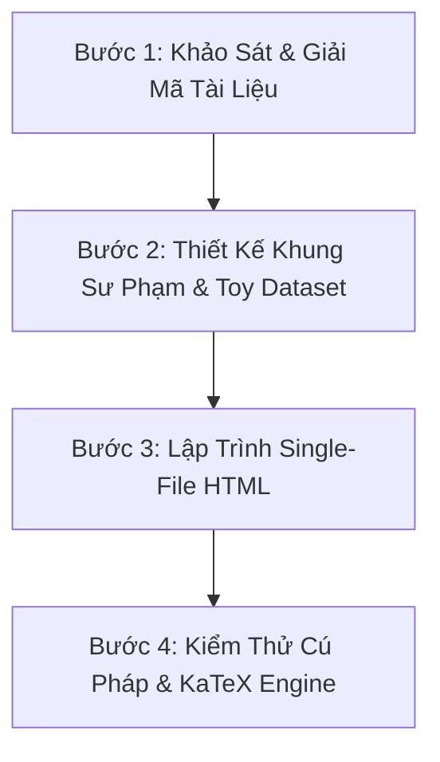

# Lecture Visualizer — Sư Phạm Trực Quan & Đóng Gói Bài Giảng Học Thuật

Kỹ năng chuyên biệt dành cho học viên và sinh viên ngành **Khoa học Máy tính (Computer Science) & Công nghệ Thông tin**. 

Kỹ năng này biến đổi mọi tài liệu học thuật phức tạp (slide bài giảng, giáo trình đại học, bài báo khoa học ACM/IEEE/SIGMOD, giáo trình đại học và sau đại học...) thành một **tài liệu học tập tương tác Single-File HTML duy nhất (`index.html`)**, kết hợp giữa:
1. **Độ sâu học thuật chuẩn sau đại học**: Bảo toàn định lý, bổ đề, chứng minh toán học, đánh giá độ phức tạp $O(\cdot)$ và kiến trúc mở rộng Big Data / Hệ phân tán.
2. **Phương pháp sư phạm "Dành Cho Người Học Chậm"**: Đóng vai trò như một giảng viên cực kỳ kiên nhẫn, giải thích bản chất từng ký hiệu toán học bằng văn phong đời thường, dùng ví dụ siêu thị/đời sống thực tế, phân tích từng bước số học (arithmetic trace).
3. **Thiết kế giao diện Full-Width thanh lịch**: Sidebar tối giản kiểu Word/Notion có ScrollSpy và Progress Bar, KaTeX kết xuất công thức toán học sắc nét, không gò bó chiều rộng khiến bảng bị co rúm.
4. **Widget tương tác 2D & Đồ họa không gian 3D**: Thanh trượt tính toán bùng nổ tổ hợp, mô phỏng cây/trạng thái thuật toán từng bước, trình khám phá đệ quy, bộ 15 câu hỏi phản biện bảo vệ đề tài, và đồ họa 3D Three.js khi bài học yêu cầu biểu diễn không gian.

---

## 1. Khi Nào Kích Hoạt Kỹ Năng Này? (Triggers)

Kích hoạt kỹ năng này khi người dùng yêu cầu:
- *"Tạo file HTML bài giảng / tài liệu học tập cho môn học..."* (CS2207 Data Mining, Machine Learning, Deep Learning, Distributed Systems, Computer Vision, Advanced Algorithms, Computer Graphics, Information Retrieval...).
- *"Giải thích giúp tôi bài này, tôi học khá chậm nên cần rõ từng phần, có ví dụ đời thường để dễ hiểu sâu hơn."*
- *"Chuyển slide / tài liệu PDF / giáo trình thành trang landing page trực quan, có sidebar, công thức toán và mô phỏng tương tác."*
- *"Trực quan hóa thuật toán này bằng HTML / widget tương tác / mô phỏng 3D."*
- *"Tạo bộ câu hỏi phản biện và kịch bản thuyết trình bảo vệ đề tài trước hội đồng."*
- *"Đọc và hiểu sâu sắc paper khoa học này để làm báo cáo / làm slide thuyết trình nhóm cuối môn."* (Kích hoạt Chế độ Hiểu Paper).
- *"Tích hợp cả bài báo vào trang trực quan để vừa đọc nguyên văn bài báo vừa đọc lời giải thích (Dual-Reading). "* (Kích hoạt Chế độ Hiểu Paper).

---

## 2. Hệ Thống Kỹ Năng Phối Hợp (Ecosystem Sibling Skills)

Khi xử lý các yêu cầu chuyên biệt, kỹ năng này tự động phối hợp với các kỹ năng khác trong `.agents/skills/`:

| Nhu Cầu Chuyên Biệt | Sibling Skill Phối Hợp | Vai Trò & Cách Kích Hoạt |
|:---|:---|:---|
| **Trực quan hóa không gian 3D (WebGL / Three.js)** | `3dviz-pro-max` | Khi bài học liên quan đến: Không gian vector 3D, mặt phẳng phân chia Hyperplane (SVM), Gradient Descent trên hàm mất mát 3D, cấu trúc cây không gian (Octree, KD-Tree), đồ thị mạng phức tạp (Graph Embeddings, 3D Mesh). |
| **Thiết kế UI/UX & Typography** | `ui-ux-pro-max`, `ui-styling` | Đảm bảo tính khả dụng cao, tương phản chuẩn WCAG AAA, typography Inter + JetBrains Mono, bảng màu Slate/Blue/Emerald dịu mắt. |
| **Sơ đồ kiến trúc & Quy trình hệ thống** | `diagram-design`, `html-diagram` | Tạo sơ đồ luồng dữ liệu, pipeline kiến trúc Spark PFP, cấu trúc dữ liệu nén. |
| **Tiêu chuẩn Code sạch & Tối ưu** | `clean-code` | Đảm bảo code JavaScript mô phỏng và CSS inline không có lỗi lặt vặt, hiệu năng mượt 60fps. |

---

## 3. Bản Đồ Tài Liệu Hướng Dẫn Kỹ Thuật (Reference Guides)

Để thực thi chính xác từng khía cạnh, luôn tham khảo các tài liệu chuyên sâu trong thư mục `references/`:

1. [`references/pedagogical-framework.md`](references/pedagogical-framework.md): **Khung Sư Phạm Cho Người Học Chậm** — Phương pháp trực giác hóa toán học, xây dựng từ điển ký hiệu đối chiếu, hộp thoại `.callout.intuition`, cách thiết kế trace số học trên 1 bộ dữ liệu nhất quán.
2. [`references/soft-clean-cards.md`](references/soft-clean-cards.md): **Design System "Soft Clean Cards" (BẮT BUỘC CHO MỌI CARD)** — Tiêu chuẩn tối cao cho thiết kế thẻ: nền trắng, bo góc lớn 28px, đổ bóng mờ siêu nhẹ, một hero metric làm điểm nhấn, màu sắc chỉ xuất hiện ở dữ liệu.
3. [`references/html-design-system.md`](references/html-design-system.md): **Kiến Trúc Giao Diện Full-Width & Sidebar ScrollSpy** — Hệ thống token CSS, bố cục không gò bó `max-width`, sticky sidebar với thanh tiến trình và hiệu ứng chỉ thị cuộn trang.
4. [`references/interactive-widgets-and-katex.md`](references/interactive-widgets-and-katex.md): **Cấu Hình KaTeX & Bộ Widget Tương Tác** — Delimiters KaTeX chuẩn, code template thanh trượt tổ hợp, mô phỏng thuật toán step-by-step, suffix explorer và accordion 15 câu hỏi Q&A bảo vệ đề tài.
5. [`references/3d-cs-visualization.md`](references/3d-cs-visualization.md): **Hướng Dẫn Tích Hợp Đồ Họa 3D (Three.js/WebGL)** — Cách nhúng canvas Three.js độc lập vào trang HTML cho các bài toán Khoa học Máy tính cần biểu diễn không gian.
6. [`templates/lecture-starter-template.html`](templates/lecture-starter-template.html): **Mẫu Khung HTML Chuẩn Khởi Tạo Nhanh** — Bộ khung có sẵn toàn bộ CSS Soft Clean Cards, KaTeX CDN, Sidebar, JS engine chỉ cần đổ nội dung chuyên đề vào.
7. [`references/paper-understanding-mode.md`](references/paper-understanding-mode.md): **Chế Độ Hiểu Paper Khoa Học & Hệ Thống Đọc Kép (Dual-Reading System)** — Cổng kiểm tra tài nguyên bắt buộc (HALT nếu thiếu bản dịch/figures), cấu trúc khối thẻ `.paper-passage-card` song hành, điều hướng sidebar 2 tầng, và phân tách kiến trúc module HTML/CSS/JS.

---

## 4. Năm Trụ Cột Sư Phạm "Dành Cho Người Học Chậm"

Một học viên tự nhận mình "học chậm" thực chất là người **cần hiểu rõ bản chất nguyên lý (first principles)** thay vì học vẹt công thức. Người thầy giỏi phải tuân thủ nghiêm ngặt 5 nguyên tắc:

### Nguyên Tắc 1: Trực Giác Trước — Ký Hiệu Sau (Intuition Before Notation)
- **Tuyệt đối không** ném ra công thức toán học trần trụi ngay đầu bài (ví dụ: $c(X \Rightarrow Y) = \frac{\sigma(X \cup Y)}{\sigma(X)}$ mà không có lời giải thích).
- **Luôn luôn** bắt đầu bằng câu chuyện thực tế: *"Giả sử bạn đang đứng ở quầy thu ngân siêu thị quan sát 100 người cầm chai Sữa..."* Sau khi học viên đã hiểu bản chất thì mới giới thiệu công thức toán.

### Nguyên Tắc 2: Bảng Từ Điển Ký Hiệu Đối Chiếu 4 Cột
Mọi chuyên đề toán học / thuật toán phải có một bảng từ điển quy đổi ngay phần đầu:
- **Cột 1**: Ký hiệu toán học ($i, I, X, k, T, D, |D|, \sigma, s, minsup, c$).
- **Cột 2**: Tên tiếng Anh chuẩn học thuật (Item, Itemset, Transaction, Support...).
- **Cột 3**: Tên tiếng Việt chính xác.
- **Cột 4**: Nghĩa đời thường cực dễ hiểu (Ví dụ siêu thị, giỏ hàng, đếm hóa đơn...).

### Nguyên Tắc 3: Hộp Thoại "Góc Dành Cho Người Học Chậm" (`.callout.intuition`)
Mỗi khi xuất hiện một khái niệm dễ gây hoang mang (như $C_k$ vs $F_k$, Cắt tỉa Pruning, Cơ sở mẫu điều kiện CPB, Không gian lưới $2^{|I|}$):
- Sử dụng khối `.callout.intuition` (màu xanh lá ngọc bảo hiền hòa, biểu tượng 🌱 mầm cây).
- Dùng phép so sánh ẩn dụ thân thuộc (Ví dụ: $C_k$ là "Danh sách thí sinh đăng ký thi", $F_k$ là "Bảng vàng thí sinh đỗ đạt").

### Nguyên Tắc 4: Trace Số Học Từng Bước Trên 1 Bộ Dữ Liệu Nhất Quán
- Chọn một bộ dữ liệu mẫu nhỏ gọn (Toy Dataset: 5-6 giao dịch, 4-5 mục hàng).
- Trình bày bảng tính chi tiết từng dòng, từng phép cộng trừ chia, chỉ rõ vì sao mẫu này được giữ lại ($\ge minsup$) và vì sao mẫu kia bị gạch tên ($< minsup$).
- **Nguyên tắc vàng**: Nếu bài học so sánh hai thuật toán (ví dụ Apriori vs FP-Growth), **bắt buộc phải chạy cả hai thuật toán trên cùng 1 bộ dữ liệu đó** để kết quả cuối cùng cho ra trùng khớp 100% (ví dụ: cùng ra đúng 19 tập phổ biến). Học viên sẽ có khoảnh khắc "Aha! moment" sâu sắc.

### Nguyên Tắc 5: Bảng Đối Chiếu 1-1 & Bóc Tách Bản Chất
- Sau khi trình bày các thuật toán, luôn có bảng đối chiếu 1-1 từng cặp kết quả để học viên thấy hai thuật toán như hai mặt của một đồng xu: một bên duyệt ngang (BFS), một bên duyệt dọc (DFS) nhưng cùng đi đến chân lý.

---

## 5. Quy Trình 4 Bước Tạo Bài Giảng Chuẩn Mực

Khi nhận được tài liệu mới (slide, PDF, ghi chú) từ người dùng, hãy thực hiện theo đúng 4 bước:

### Bước 1: Khảo Sát & Giải Mã Tài Liệu
- Đọc kỹ toàn bộ slide và giáo trình được cung cấp.
- Trích xuất: Các định nghĩa, công thức toán, ví dụ mẫu mà giảng viên sử dụng trên lớp (để đảm bảo tính đồng bộ với bài thi/bài tập lớn của trường UIT).
- Xác định các "điểm nghẽn tư duy" mà người học chậm thường mắc kẹt.

### Bước 2: Thiết Kế Khung Sư Phạm & Toy Dataset
- Lập dàn ý 6 Chuyên đề (Module 01 đến Module 06).
- Chuẩn hóa bộ dữ liệu mẫu (Toy Dataset) chuẩn mực.
- Thiết kế các câu hỏi phản biện Q&A thường gặp của hội đồng chấm luận văn / báo cáo môn học.

### Bước 3: Lập Trình Single-File HTML
- Sử dụng mẫu [`templates/lecture-starter-template.html`](templates/lecture-starter-template.html).
- Bố cục Full-Width (`calc(100% - var(--sidebar-width))`), không dùng container co hẹp.
- Nhúng đầy đủ:
  - Sidebar văn bản tối giản với ScrollSpy tự động đánh dấu mục đang đọc.
  - KaTeX CDN với cấu hình render tự động không lỗi hiển thị.
  - Các widget tương tác (Thanh trượt, Bộ mô phỏng từng bước, Bộ câu hỏi Accordion).
  - Khối 3D WebGL (nếu môn học có yếu tố không gian, tham khảo [`references/3d-cs-visualization.md`](references/3d-cs-visualization.md)).

### Bước 4: Kiểm Thử Cú Pháp & KaTeX Engine
- Chạy script kiểm thử cú pháp HTML bằng Python trong môi trường ảo `.venv`:
  `python -c "from html.parser import HTMLParser; ..."` để đảm bảo $100\%$ không có thẻ mở/đóng sai lệch.
- Đảm bảo toàn bộ công thức LaTeX toán học kết xuất hoàn hảo, không có text raw lộ ra ngoài.
- Cập nhật nhật ký công việc vào `tasks/todo.md` và bài học vào `tasks/lessons.md`.

---

## 6. Chế Độ Đọc Kép Khi Nghiên Cứu & Hiểu Paper Khoa Học (Dual-Reading Paper Mode)

Khi mục tiêu của người dùng là **đọc, hiểu sâu, báo cáo hoặc làm slide thuyết trình về một bài báo khoa học (Scientific Paper)**:

### ⚠️ CỔNG KIỂM TRA TÀI NGUYÊN BẮT BUỘC (MANDATORY RESOURCE GATE)
1. **Kiểm tra trước khi thực hiện**:
   - Agent **bắt buộc** phải kiểm tra xem trong workspace đã có bản dịch tiếng Việt của paper hay chưa (chẳng hạn thư mục `presentation/another-resources/` chứa file HTML dịch, các batch văn bản dịch, hoặc file PDF bản dịch tiếng Việt).
2. **Quy tắc dừng ngay lập tức (HALT)**:
   - Nếu **CHƯA CÓ BẢN DỊCH TIẾNG VIỆT HOẶC THIẾU TÀI NGUYÊN BÀI BÁO**:
     - **DỪNG NGAY LẬP TỨC!** Không tự ý tóm tắt sơ sài từ bản tiếng Anh rồi bỏ qua yêu cầu đọc nguyên văn.
     - Yêu cầu người dùng cung cấp bản dịch tiếng Việt (file PDF, HTML hoặc thư mục batch dịch kèm figures/tables) trước khi tiếp tục.
3. **Khi đã có đầy đủ tài nguyên**:
   - Triển khai theo cấu trúc **Hệ Thống Đọc Kép (Dual-Reading System)** quy định chi tiết tại [`references/paper-understanding-mode.md`](references/paper-understanding-mode.md):
     - **Nguyên văn bài báo**: Bao bọc từng phần trong thẻ `.paper-passage-card` với badge `📄 NGUYÊN VĂN BÀI BÁO`, trích dẫn hội nghị/tác giả, giữ trọn vẹn văn bản dịch, hình ảnh gốc (`assets/figures/`) và bảng số liệu thực nghiệm gốc.
     - **Phân tích sư phạm liền kề**: Đặt ngay phía dưới mỗi đoạn paper để giải thích trực giác, ẩn dụ đời thường, trace số học và bảng từ điển ký hiệu.
     - **Trang Foundation mở rộng**: Tạo các trang phụ trợ (`foundations-*.html`) để giảng dạy cặn kẽ các công nghệ nền tảng mà người học chưa nắm vững (CNN, Transformers, Attention, Self-Supervised, Deep Blocks...).
     - **Tách biệt kiến trúc**: Phân chia rõ ràng `index.html`, `css/`, `js/`, `assets/figures/`, không dồn tất cả vào một file HTML duy nhất dễ gây quá tải và lỗi cú pháp.
     - **Sidebar 2 tầng**: Đánh dấu nhãn `📄` dẫn trực tiếp tới từng đoạn paper và các mô-đun sư phạm.

---

## 7. Tiêu Chuẩn Nghiệm Thu Bài Giảng (Staff Engineer Checklist)

Trước khi bàn giao bất kỳ tài liệu bài giảng nào cho học viên, hãy rà soát:
- [ ] **Cổng Tài Nguyên (Với Case Hiểu Paper)**: Đã kiểm tra sự tồn tại của bản dịch tiếng Việt chưa? Nếu thiếu đã dừng lại hỏi người dùng chưa?
- [ ] **Ánh Xạ Đọc Kép (Với Case Hiểu Paper)**: Các đoạn nguyên văn bài báo có được bao bọc trong `.paper-passage-card` chuẩn mực không? Toàn bộ hình ảnh và bảng số liệu thực nghiệm gốc của paper có được nhúng đầy đủ không?
- [ ] **Sư phạm**: Đã có bảng từ điển ký hiệu 4 cột chưa? Các công thức toán có hộp thoại "Góc Dành Cho Người Học Chậm" chưa?
- [ ] **Dữ liệu**: Bộ dữ liệu mẫu có được giải chi tiết từng bước số học không? Kết quả giữa các thuật toán có khớp nhau 100% không?
- [ ] **Giao diện**: Trang có bị bóp hẹp chiều ngang không? Bảng biểu có thoáng đãng, dễ đọc trên cả màn hình lớn lẫn điện thoại không?
- [ ] **Thiết kế Thẻ (Soft Clean Cards)**: Mọi thẻ card (interactive widget, metrics, Q&A) có tuân thủ đúng chuẩn "Soft Clean Cards" (nền trắng, bo góc lớn 28px, bóng mờ `--shadow-card`, viền 1px `--border-card: #e9e9ee`, 1 hero element nổi bật, màu chỉ dùng cho dữ liệu) không?
- [ ] **Sidebar & Cuộn**: Sidebar có bám dính (sticky), cuộn đến đâu sáng đèn đến đó (Scrollspy) và thanh tiến trình đọc có hoạt động mượt mà không?
- [ ] **KaTeX**: Toàn bộ ký hiệu toán ($i, I, \sigma, minsup...$) có được bao bọc trong dấu `$...$` hoặc `$$...$$` và hiển thị chuẩn LaTeX không?
- [ ] **Tương tác**: Các nút bấm, thanh trượt, bộ mô phỏng và danh sách câu hỏi Q&A có phản hồi tức thì và không bị lỗi JavaScript trong Console không?
- [ ] **3D Visualization**: Nếu chủ đề có yếu tố hình học / không gian, canvas 3D có chạy mượt mà, có điều khiển xoay chuột (OrbitControls) và chú thích trực quan không?
