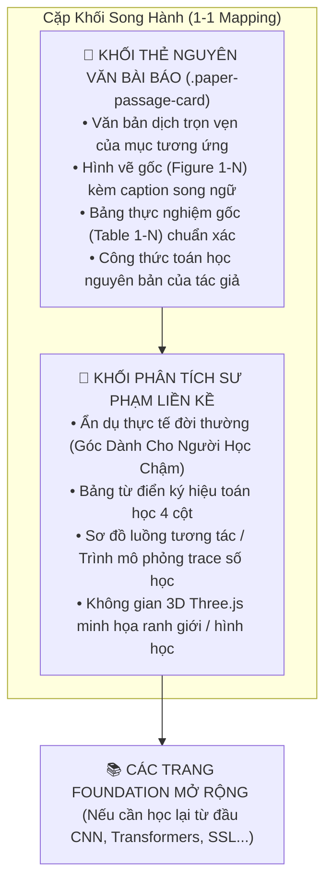
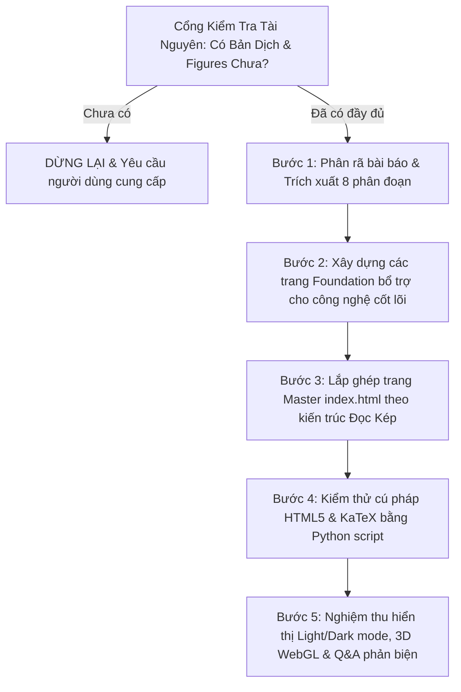

# Chế Độ Hiểu Paper Khoa Học (Paper Understanding & Dual-Reading Mode)

> **Mục tiêu**: Hướng dẫn Agent triển khai bài giảng và tài liệu trực quan hóa chuyên sâu cho các bài báo khoa học đỉnh cao (AAAI, NeurIPS, ICML, ICLR, CVPR, KDD, IEEE/ACM Transactions...) phục vụ học viên sau đại học / sinh viên thuyết trình và bảo vệ đề tài. Đảm bảo người học không chỉ đọc giải thích riêng lẻ mà được **đọc trọn vẹn nguyên văn bài báo song hành với các khối phân tích sư phạm trực quan**.

---

## 1. Điều Kiện Kích Hoạt & Cổng Kiểm Tra Tài Nguyên Bắt Buộc (Verification Gate)

### 1.1. Khi Nào Kích Hoạt Chế Độ Này?
Kích hoạt khi người dùng đưa ra yêu cầu thuộc các dạng sau:
- *"Đọc và hiểu sâu sắc paper này để làm slide / thuyết trình nhóm cuối kỳ..."*
- *"Visualizer toàn bộ paper này, giải thích chi tiết bằng tiếng Việt..."*
- *"Tích hợp cả paper vào trang trực quan hóa để tôi vừa đọc paper vừa đọc lời giải thích..."*
- Các đề tài môn học Cao học/Đại học yêu cầu nghiên cứu bài báo khoa học.

### 1.2. ⚠️ Cổng Kiểm Tra Tài Nguyên Tiên Quyết (STOP & ASK GATE)
Trước khi bắt đầu bất kỳ thao tác phân tích, sinh code hay tạo file nào, **AGENT BẮT BUỘC PHẢI THỰC HIỆN BƯỚC KIỂM TRA TÀI NGUYÊN NÀY**:

1. **Kiểm tra sự tồn tại của Bản Dịch Tiếng Việt**:
   - Kiểm tra xem trong thư mục dự án (ví dụ `presentation/another-resources/`, thư mục chứa paper, hoặc thư mục chỉ định) đã có:
     - Bản dịch tiếng Việt số hóa (file HTML bản dịch, các batch dịch văn bản, hoặc file Markdown/JSON chứa bản dịch).
     - Hoặc ít nhất là file PDF bản dịch tiếng Việt của paper.
     - Thư mục hình ảnh trích xuất từ bài báo (`figures/`) và bảng số liệu (nếu có).
2. **Quy Tắc Dừng Ngay Lập Tức (MANDATORY HALT)**:
   - **NẾU CHƯA CÓ BẢN DỊCH TIẾNG VIỆT HOẶC THIẾU TÀI NGUYÊN CẦN THIẾT**:
     - **DỪNG NGAY LẬP TỨC — TUYỆT ĐỐI KHÔNG TỰ Ý BẮT ĐẦU!**
     - Không tự suy diễn hay tóm tắt sơ sài bài báo tiếng Anh rồi bỏ qua yêu cầu đọc nguyên văn.
     - Xuất thông báo rõ ràng cho người dùng:
       > *"Để thực hiện trực quan hóa theo Chế độ Hiểu Paper (Dual-Reading System), hệ thống cần bản dịch tiếng Việt của bài báo (kèm hình ảnh trích xuất và bảng số liệu nếu có, ví dụ như thư mục `presentation/another-resources/`). Hiện tại chưa tìm thấy các tài nguyên này trong workspace. Vui lòng cung cấp bản dịch tiếng Việt (file PDF, HTML hoặc các batch dịch) trước khi tôi tiến hành."*
   - **NẾU ĐÃ CÓ ĐẦY ĐỦ**: Tiến hành theo quy trình 5 bước bên dưới.

---

## 2. Kiến Trúc "Đọc Kép" Song Hành (Dual-Reading Architecture)

Trong chế độ hiểu paper, trang trực quan hóa chính (`index.html`) không được thay thế hoàn toàn paper bằng lời văn diễn dịch, mà phải xây dựng trải nghiệm **Đọc Kép (Dual-Reading)**:



### Nguyên Tắc Trải Nghiệm Học Tập:
1. **Bước 1 — Nắm ý gốc tác giả**: Người học đọc đoạn nguyên văn bài báo để làm quen với văn phong học thuật chuẩn mực, ký hiệu toán của tác giả, hình vẽ và bảng số liệu chính thức.
2. **Bước 2 — Thấu triệt bản chất**: Ngay phía dưới, người học đọc khối giải thích sư phạm để hiểu sâu bản chất tại sao tác giả lại làm như vậy, các phép tính toán được thực hiện ra sao.
3. **Bước 3 — Lấp lỗ hổng kiến thức**: Nếu bài báo sử dụng các công nghệ nền tảng mà người học chưa nắm vững (ví dụ: Self-Attention, Gated Linear Unit, Self-Supervised Learning), người học nhấn link chuyển sang các trang chuyên đề phụ trợ (`foundations-*.html`).

---

## 3. Cấu Trúc Khối Thẻ Nguyên Văn Bài Báo (`.paper-passage-card`)

Mỗi phân đoạn của bài báo phải được bao bọc trong thẻ HTML chuẩn mực sau:

```html
<!-- PAPER PASSAGE: [TÊN MỤC BÀI BÁO] -->
<div class="paper-passage-card" id="paper-[muc]">
    <div class="paper-passage-header">
        <span class="paper-passage-badge tag-[mau]">📄 NGUYÊN VĂN BÀI BÁO · MỤC [X]</span>
        <span class="paper-passage-meta">[Tên Paper] ([Hội nghị/Năm]) · [Tổ chức/Tác giả]</span>
    </div>
    <h3 class="paper-passage-title">[Tiêu đề phân đoạn bài báo dịch]</h3>
    <div class="paper-passage-body">
        <!-- Nội dung dịch đầy đủ: đoạn văn, công thức KaTeX, hình vẽ, bảng số liệu -->
    </div>
</div>
```

### 3.1. Quy Chuẩn CSS Cho `.paper-passage-card`
- **Đường viền định danh**: `border-left: 5px solid var(--data-1);` (màu sắc chủ đạo cho thẻ paper).
- **Huy hiệu phân loại (`.paper-passage-badge`)**:
  - `tag-green`: Cho Tóm tắt (Abstract) hoặc Học tự giám sát (Self-supervised).
  - `tag-purple`: Cho Giới thiệu (Intro) hoặc Thực nghiệm (Experiments).
  - `tag-amber`: Cho Công trình liên quan (Related Work) hoặc Khả năng giải thích (Interpretability).
  - Mặc định (Blue): Cho Kiến trúc (Architecture) hoặc Kết luận (Conclusions).
- **Hình ảnh bài báo (`.paper-figure`)**:
  - Đặt trong `<div class="paper-figure">` căn giữa trên nền nhẹ (`--bg-subtle`).
  - Thẻ `` mang class `paper-figure-img`, ảnh nền trắng rõ nét.
  - Phụ đề `<div class="figure-caption">` ghi rõ số hiệu hình và giải thích chi tiết song ngữ.
- **Bảng biểu thực nghiệm**: Bao bọc trong `<div class="table-container">` để chống tràn màn hình trên thiết bị di động.

---

## 4. Bố Cục Thư Mục Tách Biệt (Modular File Organization)

Để tránh dồn tất cả vào một file HTML khổng lồ gây lỗi cú pháp và khó bảo trì:

```
presentation/view/
├── index.html                           # Trang Master tích hợp Paper + Phân tích sư phạm
├── foundations-tree-vs-nn.html          # Chuyên đề nền tảng: Cây quyết định vs Mạng nơ-ron
├── foundations-attention-transformers.html # Chuyên đề nền tảng: Attention & Transformers
├── foundations-deep-blocks.html         # Chuyên đề nền tảng: GLU, Ghost BN, Residual Norm
├── foundations-self-supervised.html     # Chuyên đề nền tảng: Học tự giám sát trên dữ liệu bảng
├── css/
│   ├── design-system.css                # Bảng màu Light/Dark, typography, spacing, shadows
│   ├── layout.css                       # Grid hệ thống, full-width content, sticky sidebar
│   └── components.css                   # Soft clean cards, paper-passage-card, tables, callouts
├── js/
│   ├── theme.js                         # Chuyển đổi Light/Dark mode mượt mà, lưu localStorage
│   ├── scrollspy.js                     # ScrollSpy tự động sáng đèn sidebar khi cuộn
│   ├── diagrams.js                      # Sơ đồ tương tác SVG / HTML
│   ├── simulators.js                    # Trình mô phỏng trace số học từng bước
│   ├── three-viz.js                     # Trực quan hóa 3D WebGL (Three.js OrbitControls)
│   └── qa-accordion.js                  # Bộ 15 câu hỏi phản biện bảo vệ đề tài UIT
└── assets/
    └── figures/                         # Toàn bộ hình ảnh gốc trích xuất từ bài báo (figure_01 - 0N)
```

---

## 5. Thanh Điều Hướng 2 Tầng (2-Tier Sidebar Navigation)

Trong trang `index.html`, menu điều hướng phải hỗ trợ người học nhảy nhanh đến từng khối nguyên văn bài báo hoặc khối sư phạm:

```html
<li class="nav-item">
    <a href="#sec-mod1" class="nav-link">
        <span class="nav-num">01</span>
        <span>Bối Cảnh & Động Lực</span>
    </a>
    <ul class="nav-sub">
        <li><a href="#paper-intro" class="nav-sub-link">📄 1. Giới thiệu (Paper)</a></li>
        <li><a href="#sec-mod1-why-dl-fails" class="nav-sub-link">Vì sao MLP thất bại?</a></li>
        <li><a href="#sec-mod1-dict" class="nav-sub-link">Từ điển ký hiệu 4 cột</a></li>
        <li><a href="#paper-related" class="nav-sub-link">📄 2. Công trình liên quan</a></li>
    </ul>
</li>
```

---

## 6. Quy Trình 5 Bước Triển Khai Chế Độ Hiểu Paper



1. **Cổng kiểm tra tài nguyên**: Xác nhận có bản dịch tiếng Việt, figures, tables. Nếu thiếu $\to$ **Dừng ngay**.
2. **Bước 1 — Phân rã bài báo**: Phân đoạn nội dung dịch thành các mục chuẩn: Abstract, Introduction, Related Work, Architecture, Experiments, Interpretability, Self-Supervised, Conclusions.
3. **Bước 2 — Xây dựng trang Foundation**: Tạo các trang chuyên đề giải thích kỹ lưỡng bằng văn phong tự nhiên, trực giác, toán học KaTeX chi tiết và widget minh họa cho người học chậm.
4. **Bước 3 — Lắp ghép trang Master**: Đan xen từng thẻ `.paper-passage-card` phía trước các mô-đun giải thích tương ứng, nhúng hình ảnh và bảng số liệu thực nghiệm.
5. **Bước 4 — Kiểm thử cú pháp tự động**: Chạy script Python (`StrictHTMLValidator`) kiểm tra $100\%$ tính hợp lệ của HTML5, tuyệt đối không để thẻ lệch hoặc đóng sai.
6. **Bước 5 — Nghiệm thu toàn diện**: Đảm bảo Light/Dark mode không lỗi chớp nháy, 3D WebGL xoay mượt mà, bộ 15 câu hỏi phản biện UIT sẵn sàng cho bảo vệ đề tài.
