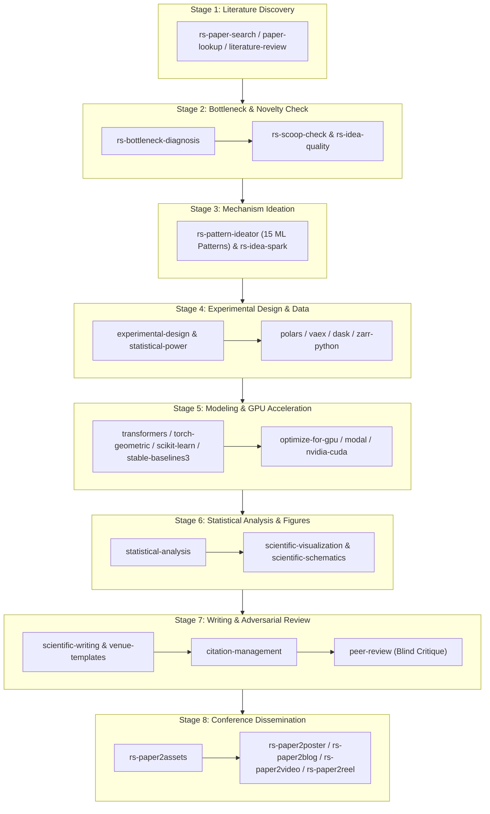
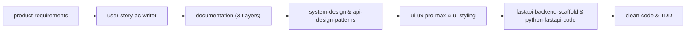

# Antigravity & AI Agent Engineering Ecosystem

> **A Battle-Tested Framework, Unified Skill Depot, and Scientific Workflow Hub for Autonomous AI Agents**  
> Supports: **Antigravity CLI (`agy`)**, **Gemini CLI**, **Claude Code**, and **Codex**  
> *Available Languages:* [English (Default)](README.md) | [Tiếng Việt (Vietnamese)](README_VN.md)

---

## 🚀 Overview

This repository provides an enterprise-ready configuration layer and a modular library of **88 specialized skills** designed to turn AI coding assistants into high-discipline, autonomous engineering and research partners.

Instead of generic chatbot answers, this setup enforces:
- **Clean Architecture & SOLID Engineering Standards** (Strict PEP 8, test-driven development, surgical code changes).
- **3-Layer Documentation System** (Business $\to$ Architecture $\to$ Implementation).
- **End-to-End Scientific Research Lifecycle** (Human-in-the-Loop orchestration across 57 research skills).
- **Context-Preserving Skill Discovery** (Meta-routing that prevents context window saturation).

---

## 📂 Repository Structure

```text
├── .agents/
│   ├── mcp_config.json        # MCP server configurations (NVIDIA CUDA, etc.)
│   └── skills/                # 30 Core Engineering, UI/UX, Architecture, and Security skills
├── research-hub/              # Meta-skill & 8-stage scientific workflow orchestrator
├── microsoft-research/        # 11 Research skills (Literature search, bottlenecks, 15 patterns, paper2poster/video)
├── cs-research-skills/        # 46 Research skills (Data scaling, ML/DL, Quantum, Bayesian, Stats, Peer Review)
├── tasks/                     # Task tracking templates (todo.md, lessons.md)
├── docs/                      # 3-Layer documentation structure (Business, Architecture, Implementation)
├── AGENTS.md                  # Project intelligence file (Core philosophy & execution rules)
├── README.md                  # English documentation (This file)
└── README_VN.md               # Vietnamese documentation
```

---

## 🔬 Scientific Research Skills Guide

The repository includes a state-of-the-art scientific research suite consisting of **58 research skills** (`research-hub` + 11 in `microsoft-research` + 46 in `cs-research-skills`).

### 1. How Research Skills Work (Context-Optimized Routing)
Loading 58 separate `SKILL.md` files at once consumes over **150,000 tokens**, overwhelming the LLM's context window.  
To prevent this, `research-hub` acts as a **Master Index & Meta-Skill**:
1. The AI Agent reads **only** `research-hub/SKILL.md` at session initialization.
2. When the user requests a research task (e.g., *"Search papers on KV cache compression"*, *"Diagnose SOTA bottlenecks"*, or *"Render a conference poster"*), the agent routes directly to the specific skill directory.

---

### 2. How to Copy Research Skills into Your Target Project

When creating a new research workspace or integrating these skills into an existing repository, skills should be located inside your target project's `.agents/skills/` (or `.claude/skills/`).

#### Option A: Copy the Entire Research Depot (Recommended)
In PowerShell from your target repository root:

```powershell
# 1. Create target skills directory
New-Item -ItemType Directory -Force -Path ".agents\skills"

# 2. Copy the research-hub meta-orchestrator
Copy-Item -Recurse "E:\gemini\agent_setup\research-hub" ".agents\skills\"

# 3. Copy all Microsoft Research skills
Copy-Item -Recurse "E:\gemini\agent_setup\microsoft-research\*" ".agents\skills\"

# 4. Copy all Computer Science research skills
Copy-Item -Recurse "E:\gemini\agent_setup\cs-research-skills\*" ".agents\skills\"
```

*(On Linux / macOS bash):*
```bash
mkdir -p .agents/skills
cp -r /path/to/agent_setup/research-hub .agents/skills/
cp -r /path/to/agent_setup/microsoft-research/* .agents/skills/
cp -r /path/to/agent_setup/cs-research-skills/* .agents/skills/
```

#### Option B: Selective Copying (Pick Only What You Need)
If you only need specific skills (e.g., paper search and poster generation):
```powershell
New-Item -ItemType Directory -Force -Path ".agents\skills"
Copy-Item -Recurse "E:\gemini\agent_setup\research-hub" ".agents\skills\"
Copy-Item -Recurse "E:\gemini\agent_setup\microsoft-research\rs-paper-search" ".agents\skills\"
Copy-Item -Recurse "E:\gemini\agent_setup\microsoft-research\rs-paper2assets" ".agents\skills\"
Copy-Item -Recurse "E:\gemini\agent_setup\microsoft-research\rs-paper2poster" ".agents\skills\"
```

---

### 3. Isolated Environment Setup (`uv` & `.venv`)

According to the workspace engineering rules, **never install packages globally**. All research skill dependencies are centralized inside `research-hub/pyproject.toml`.

```powershell
# 1. Create a dedicated Python 3.10+ virtual environment in your project root
uv venv --python 3.10

# 2. Activate the virtual environment
# On Windows:
.venv\Scripts\activate
# On Linux / macOS:
# source .venv/bin/activate

# 3. Install research dependencies in editable mode
uv pip install -e .agents\skills\research-hub

# 4. Install headless Chromium browser for academic poster rendering (Playwright)
uv run python -m playwright install chromium

# 5. Configure API credentials
Copy-Item ".agents\skills\research-hub\.env.template" ".env"
```

Edit your `.env` file to add your API keys:
```env
# Optional but recommended for higher rate limits:
SEMANTIC_SCHOLAR_API_KEY=your_key_here
OPENALEX_API_KEY=your_key_here
CROSSREF_MAILTO=your_email@domain.com
```

---

### 4. How the Agent Executes Research Scripts

All scripts inside the skills use relative discovery based on `Path(__file__)`. When invoking CLI tools:
- **Within your target project**:  
  `uv run python .agents/skills/<skill-name>/scripts/<script-name>.py [args]`
- **Inside this central repository**:  
  `uv run python microsoft-research/<skill-name>/scripts/<script-name>.py [args]`  
  or `uv run python cs-research-skills/<skill-name>/scripts/<script-name>.py [args]`

---

## 🔄 End-to-End Workflow Blueprints

### Blueprint 1: 8-Stage Scientific Research Lifecycle



- **Collaborative Human-in-the-Loop (HITL):** Every stage contains mandatory stop checkpoints where the agent presents structured findings (deduplicated paper matrix, bottleneck diagnosis, delta statement, poster draft) and waits for human feedback before proceeding.

---

### Blueprint 2: Enterprise Full-Stack Product Delivery



1. **Requirements & Scope:** Use `product-requirements` to elicit scope and build PRDs; break down into INVEST user stories with `user-story-ac-writer`.
2. **Architecture:** Formulate schemas with `system-design` and standard REST patterns with `api-design-patterns`.
3. **Frontend:** Prototype with `html-wireframe` $\to$ `html-prototype` $\to$ `ui-ux-pro-max` + `ui-styling`.
4. **Backend:** Scaffold isolated architecture with `fastapi-backend-scaffold`, implement async services with `python-fastapi-code`, and audit with `clean-code`.

---

## 📊 Comprehensive Skills Directory (All 88 Skills)

### 1. Software Architecture, Backend, Security & Clean Code (In `.agents/skills/`)

| Skill Name | When to Use (Triggers) | Core Capabilities | Workflow Synergy |
| :--- | :--- | :--- | :--- |
| **`clean-code`** | Writing, editing, reviewing, or refactoring code in any language. | Enforces 66 canonical Clean Code rules (C1-C5, F1-F4, G1-G36, N1-N7, T1-T9), Boy Scout Rule, and offline static analysis. | Pair with `python-fastapi-code` or any code generation task. |
| **`security-audit`** | Security guidance, vulnerability review, codebase audits, pen tests, triage. | 6-phase defensive audit workflow, reconnaissance, attack classes (memory safety, auth, crypto, AI/LLM), candidate validation, and report schema. | Pairs with `clean-code` and backend development workflows. |
| **`fastapi-backend-scaffold`** | Starting a new backend, creating a microservice, or reorganizing a Python project. | Enforces `backend/` root, `pyproject.toml`, isolated `.venv`, strict Controller-Service-Repository separation, and cross-cutting middleware. | Precedes `python-fastapi-code`. Follows `api-design-patterns`. |
| **`python-fastapi-code`** | Writing or reviewing production FastAPI code, async SQLAlchemy, Pydantic V2, WebSockets. | Applies SOLID principles, Repository pattern, JWT/OAuth2 authentication, async pytest suites, and performance optimization. | Works with `fastapi-backend-scaffold` and `clean-code`. |
| **`api-design-patterns`** | Designing or reviewing RESTful APIs, pagination, versioning, filtering. | Implements 7 enterprise REST patterns: Versioning, Pagination, Filtering, Field Selection, Expansion, Async Job Request, Consistent Response. | Pairs with `system-design` and `fastapi-backend-scaffold`. |
| **`system-design`** | Designing distributed systems, high availability, database sharding, caching strategies, rate limiters. | Provides capacity estimation, SLA/SLO math, CAP theorem tradeoffs, architecture topologies, and cloud infrastructure patterns. | Integrates with `documentation` (Layer 2 ADR) and `diagram-design`. |
| **`stm32-embedded-workflow`** | STM32 MCU development, HAL drivers, CubeMX checklists, pin mapping, embedded C. | Generates complete hardware design dossiers, timer/clock calculation, peripheral register rationales, and verified `main.c`. | Pair with `nvidia-cuda` for edge-AI or `clean-code` for firmware. |

---

### 2. UI/UX, Design Systems & Frontend Prototypes (In `.agents/skills/`)

| Skill Name | When to Use (Triggers) | Core Capabilities | Workflow Synergy |
| :--- | :--- | :--- | :--- |
| **`ui-ux-pro-max`** | Designing web/mobile/desktop UI, color palettes, typography, accessibility audits. | 79 design styles, 192 product palettes, 74 font pairings, 119 UX guidelines, 25 chart specs, 22 frontend stacks. | Feed design tokens into `ui-styling` or `html-prototype`. |
| **`ui-styling`** | Building interfaces with Tailwind CSS, shadcn/ui components, and Radix UI. | Responsive layouts, accessible components (dialogs, forms, dropdowns), dark mode, design tokens. | Pairs with `ui-ux-pro-max` and `html-prototype`. |
| **`design-system`** | Building enterprise design systems, token architecture, component specs. | 3-layer design tokens (primitive $\to$ semantic $\to$ component), CSS variable maps, spacing scales. | Foundation for `ui-styling` and `slides`. |
| **`design-artifact`** | Creating standalone visual HTML artifacts, executive briefs, landing pages. | Art direction, typography pairing, responsive layout, avoiding generic "AI look". | Works with `html` and `design-system`. |
| **`html`** | Creating single-file HTML reports, explainers, tools, landing pages. | Self-contained HTML/CSS/JS generator with zero build step dependencies. | Implicit router for `html-wireframe`, `html-prototype`, `html-plan`. |
| **`html-wireframe`** | Early-stage layout planning, content hierarchy, and UX flows before styling. | Low-fidelity, structural HTML wireframes focusing purely on usability and navigation. | Precursor to `html-prototype`. |
| **`html-prototype`** | High-fidelity interactive mockups and client-ready prototypes. | Polished, interactive single-file prototypes grounded in user design language. | Evolves from `html-wireframe`, styling via `ui-ux-pro-max`. |
| **`html-plan`** | Multi-phase project plans, roadmaps, dependency trackers. | Clear, self-contained HTML plans with sequence, ownership, milestones, and review gates. | Pairs with `product-requirements` and `documentation`. |
| **`html-diagram`** | Interactive diagrams showing topology, sequence, state, or hierarchy. | Self-contained interactive HTML diagrams with notation and layout controls. | Alternative/companion to `diagram-design`. |
| **`diagram-design`** | Creating technical diagrams (architecture, sequence, ER, flowcharts, Gantt). | Generates HTML, SVG, PNG, Draw.io, and Excalidraw-compatible diagrams. | Integrates with `system-design` and `documentation`. |
| **`3dviz-pro-max`** | 3D web visualizations, WebGL, Three.js interactive scenes, dioramas. | 223 recipes, 440 knowledge records, 22 lighting rigs, Vite+Three.js scaffolds, shader configs. | Used in scientific tools, landing pages, and `lecture-visualizer`. |
| **`banner-design`** | Designing social banners, hero banners, ad creatives, print assets. | Multi-platform sizing (Twitter, LinkedIn, YouTube, Web Hero) across 13 aesthetic styles. | Pairs with `brand` and `design-system`. |
| **`brand`** | Establishing brand voice, visual identity, messaging compliance. | Brand tone guidelines, messaging matrices, visual guardrails, and compliance audits. | Enforced across `banner-design`, `slides`, and documentation. |
| **`slides`** | Creating executive and technical HTML presentations. | Presentation slides with Chart.js, responsive layouts, copywriting formulas. | Complements `scientific-slides` for business presentations. |
| **`lecture-visualizer`** | Academic lecture builder, pedagogical visualizer, dual-reading papers. | Single-file interactive HTML lectures, 2D/3D simulations, line-by-line paper translations. | Bridges scientific research with educational outreach. |

---

### 3. AI Agent Engineering, RAG & LLMs (In `.agents/skills/`)

| Skill Name | When to Use (Triggers) | Core Capabilities | Workflow Synergy |
| :--- | :--- | :--- | :--- |
| **`agent-harness`** | Designing long-running, multi-turn AI agent architectures for production. | Session persistence, context window management, safe execution hooks, human-in-the-loop gates. | Foundation for building autonomous bots and pipelines. |
| **`rag-architect`** | Building RAG systems, vector search, chunking strategies, document retrieval. | Chunking optimization, hybrid search (dense+sparse), reranking, vector DB selection, evaluation. | Works with `langchain-skills` and `liteparse`/`markitdown`. |
| **`langchain-skills`** | Implementing LangChain, LangGraph, or Deep Agent multi-agent graphs. | State graph patterns, memory persistence, tool node integration, human approval checkpoints. | Pairs with `rag-architect` and `agent-harness`. |
| **`prompt-engineer`** | Designing, optimizing, or evaluating LLM prompts. | Few-shot prompting, Chain-of-Thought (CoT), structured JSON outputs, prompt regression testing. | Optimizes prompts across all agent workflows. |
| **`nvidia-cuda`** | Developing CUDA C/C++, GPU memory management, kernel optimization, cuBLAS/cuDNN. | Official live NVIDIA developer documentation corpus for GPU parallel computing. | Synergizes with `optimize-for-gpu` and high-performance DL skills. |

---

### 4. Requirements & Documentation Architecture (In `.agents/skills/`)

| Skill Name | When to Use (Triggers) | Core Capabilities | Workflow Synergy |
| :--- | :--- | :--- | :--- |
| **`product-requirements`** | Requirements gathering, PRD drafting, scope definition, open question (OQ) management. | Interactive BA/PO guidance, PRD scoring, scope diagrams, 3-layer doc alignment. | Directly feeds `user-story-ac-writer` and `system-design`. |
| **`user-story-ac-writer`** | Generating agile user stories and acceptance criteria. | INVEST criteria, Gherkin syntax (`Given-When-Then`), sequence diagram extraction, architecture guardrails. | Feeds implementation tasks into `tasks/todo.md`. |
| **`documentation`** | Organizing project documentation, establishing architecture guardrails. | Enforces 3-layer architecture: Business (`docs/business/`), Architecture (`docs/architecture/`), Implementation (`docs/implementation/`). | Single Source of Truth governing all project artifacts. |

---

### 5. Scientific Literature Discovery & Survey (Research Suite)

| Skill Name | When to Use (Triggers) | Core Capabilities | Workflow Synergy |
| :--- | :--- | :--- | :--- |
| **`research-hub`** | **Master Meta-Skill**: Start any scientific research task here. | Indexes all 57 research skills, provides zero-context-overhead lookup, and enforces 8-stage lifecycle. | Routes requests to any `microsoft-research` or `cs-research-skills`. |
| **`rs-paper-search`** | Concurrent multi-source scientific paper search. | Queries arXiv, OpenReview, Semantic Scholar, DBLP, OpenAlex, and Crossref; deduplicates and ranks results. | Stage 1 anchor. Outputs to `rs-bottleneck-diagnosis`. |
| **`paper-lookup`** | Finding citations, full-text PDFs, DOIs across 18 scholarly APIs. | Supports PubMed, PMC, Europe PMC, bioRxiv, arXiv, Crossref, Unpaywall, Zenodo, DOAJ. | Complements `rs-paper-search` for deep single-paper retrieval. |
| **`literature-review`** | Conducting systematic, scoping, or narrative reviews. | Search synthesis, screening protocols, citation matrices, Markdown/PDF synthesis. | Pairs with `citation-management` and `scientific-writing`. |

---

### 6. Research Ideation, Bottlenecks & Novelty Verification (Microsoft Research Suite)

| Skill Name | When to Use (Triggers) | Core Capabilities | Workflow Synergy |
| :--- | :--- | :--- | :--- |
| **`rs-bottleneck-diagnosis`** | Diagnosing core weaknesses and load-bearing obstacles of SOTA papers. | Distinguishes fundamental theoretical/algorithmic bottlenecks from soft superficial issues. | Connects Stage 1 survey to Stage 3 mechanism design. |
| **`rs-pattern-ideator`** | Formulating novel algorithmic mechanisms. | Maps bottlenecks to 15 empirical ML patterns & 31 sub-patterns from 1,947 ICLR/ICML/NeurIPS Oral papers. | Generates concrete mathematical proposals for `rs-idea-spark`. |
| **`rs-scoop-check`** | Verifying if an idea overlaps with published work. | 4-axis collision analysis (Framing, Mechanism, Insight, Domain) to establish a distinct Delta Statement. | Validates proposals from `rs-pattern-ideator`. |
| **`rs-idea-spark`** | Full end-to-end ideation pipeline orchestrator. | Chained execution: Literature Grounding $\to$ Bottleneck $\to$ 15 Patterns $\to$ Scoop Check with HITL gates. | Produces reviewer-defensible idea cards. |
| **`rs-idea-quality`** | Scoring a research idea before running experiments. | Evaluates idea proposals on a 0-100 scale or performs blind head-to-head comparisons. | Decision gate before committing compute and experiments. |

---

### 7. Experimental Design, Power Analysis & Data Engineering (CS Research Suite)

| Skill Name | When to Use (Triggers) | Core Capabilities | Workflow Synergy |
| :--- | :--- | :--- | :--- |
| **`experimental-design`** | Planning trials, randomized controlled trials (RCTs), blocking, factorial designs. | Controls confounding variables, factorial/fractional designs, split-plot, Latin squares. | Must be paired with `statistical-power` before data collection. |
| **`statistical-power`** | Calculating required sample sizes and minimum detectable effect (MDE). | Closed-form and Monte Carlo power calculations for t-tests, ANOVA, regressions, cluster trials. | Validates sample size requirements for `experimental-design`. |
| **`exploratory-data-analysis`** | Initial auditing of scientific data files (CSV, HDF5, NumPy, FASTA). | Missingness/leakage audits, distribution checks, outlier sensitivity, local EDA scaffolds. | Precursor to ETL scaling via `polars` or `vaex`. |
| **`polars`** | Fast in-memory and out-of-core tabular data processing. | Lazy query execution, Arrow interoperability, streaming data, multi-threaded pipelines. | High-speed data manipulation for ML datasets. |
| **`vaex`** | Analyzing massive tabular datasets larger than RAM. | Memory-mapped operations on billions of rows without copying, virtual columns, fast binning. | Ideal for astronomical, genomics, and large tabular ML data. |
| **`dask`** | Scaling pandas, NumPy, and custom Python across multiple cores or clusters. | Distributed dataframes, arrays, task graphs, parallel futures. | Bridges single-node code to cluster compute. |
| **`zarr-python`** | Storing and querying large chunked N-dimensional arrays. | Chunked, compressed array storage for S3/GCS, integration with NumPy/Xarray. | Storage backend for spatial, imaging, and climate data. |
| **`liteparse`** | Local document and PDF extraction with spatial bounding boxes. | Extracts text, bounding boxes, OCR, and page rasters for RAG and literature ingestion. | Input processor for `rag-architect` and paper ingestion. |
| **`markitdown`** | Converting Office, PDF, and diverse media into clean Markdown. | Microsoft MarkItDown extraction for LLM ingestion, vision OCR, and search indexing. | Text preparation for literature surveys and RAG. |

---

### 8. Machine Learning, Deep Learning, GNNs & Reinforcement Learning (CS Research Suite)

| Skill Name | When to Use (Triggers) | Core Capabilities | Workflow Synergy |
| :--- | :--- | :--- | :--- |
| **`transformers`** | Fine-tuning, training, or inferencing Hugging Face foundation models. | AutoModel pipelines, Trainer configurations, tokenizers, quantization, multimodal models. | Connects to `optimize-for-gpu` and `modal`. |
| **`pytorch-lightning`** | Structuring scalable PyTorch training loops. | LightningModules, multi-GPU/TPU training, DDP/FSDP/DeepSpeed, logging callbacks. | Core training harness for neural networks. |
| **`hugging-science`** | Discovering specialized scientific models and datasets. | Curated catalog across biology, chemistry, genomics, materials, climate, and physics. | Finding foundation models for domain science. |
| **`torch-geometric`** | Building Graph Neural Networks (GNNs). | Message passing (GCN, GAT, GraphSAGE, GIN), heterogeneous graphs, neighbor sampling. | Pairs with `networkx` for topological preprocessing. |
| **`networkx`** | Graph algorithms and network science analysis. | Centrality metrics, community detection, shortest paths, synthetic network generation. | Topological feature generation for `torch-geometric`. |
| **`scikit-learn`** | Classical machine learning algorithms and preprocessing. | Supervised/unsupervised models, cross-validation, hyperparameter tuning, ML pipelines. | Baseline modeling before deep learning. |
| **`shap`** | Feature attribution and explainable AI (XAI). | TreeSHAP, KernelSHAP, DeepSHAP, local and global explanation plots. | Audits models built with `scikit-learn` or `transformers`. |
| **`umap-learn`** | Nonlinear manifold dimensionality reduction. | 2D/3D embeddings, supervised UMAP, Parametric UMAP, clustering preprocessing. | Pairs with `scientific-visualization` for latent space exploration. |
| **`timesfm-forecasting`** | Zero-shot foundation model time-series forecasting. | Google TimesFM checkpoint execution, quantile forecasts, covariate handling. | Alternative to `aeon` for zero-shot forecasting. |
| **`aeon`** | Time-series classification, regression, and anomaly detection. | Scikit-learn compatible algorithms for temporal and sequential data. | Specialized companion to `timesfm-forecasting`. |
| **`stable-baselines3`** | Single-agent reinforcement learning (RL). | Implementations of PPO, SAC, DQN, TD3, A2C; custom Gymnasium environments. | Standard baseline runner for RL benchmarks. |
| **`pufferlib`** | High-throughput vectorized RL environments. | C/CUDA-vectorized game and simulation rollouts running millions of steps/sec. | Accelerates `stable-baselines3` rollouts. |

---

### 9. Probabilistic Modeling, Optimization, Symbolic Math & Quantum (CS Research Suite)

| Skill Name | When to Use (Triggers) | Core Capabilities | Workflow Synergy |
| :--- | :--- | :--- | :--- |
| **`pymc`** | Bayesian inference and probabilistic programming. | NUTS MCMC sampling, variational inference, hierarchical models, posterior predictive checks. | Quantifies uncertainty for experimental results. |
| **`pymoo`** | Multi-objective Pareto optimization. | NSGA-II, NSGA-III, MOEA/D, constraint handling, Pareto frontier benchmarking. | Resolves multi-parameter trade-offs. |
| **`sympy`** | Exact symbolic mathematics and algebraic derivations. | Symbolic calculus, equation solving, matrix algebra, LaTeX/code generation. | Formulates theoretical proofs during Stage 3 ideation. |
| **`simpy`** | Discrete-event simulation. | Process-based event scheduling, shared resource queues, queueing network analysis. | Simulates operational workflows and logistics. |
| **`qiskit`** | Quantum computing on IBM hardware & simulators. | Quantum circuit synthesis, Qiskit 2.x primitives (Sampler, Estimator), error mitigation. | Works alongside `cirq` and `pennylane`. |
| **`cirq`** | Quantum algorithms targeting Google Quantum AI hardware. | Noise-aware circuit design, hardware characterization experiments. | Complements `qiskit`. |
| **`pennylane`** | Quantum Machine Learning (QML) and hybrid quantum-classical models. | Automatic differentiation of quantum circuits with PyTorch/JAX, VQE, QAOA. | Bridges quantum computing with PyTorch. |
| **`arbor`** | Hypothesis tree refinement and systematic experiment branching. | Persistent hypothesis tracking, isolated trial sandboxing, multi-experiment runs. | Manages hypothesis evolution during exploration. |

---

### 10. Hardware Acceleration, Scaling & Agent Infrastructure (CS Research Suite)

| Skill Name | When to Use (Triggers) | Core Capabilities | Workflow Synergy |
| :--- | :--- | :--- | :--- |
| **`optimize-for-gpu`** | Accelerating Python workloads on NVIDIA GPUs. | CUDA profiling, CuPy, cuDF, cuML, memory transfer bottleneck elimination. | Pairs with `nvidia-cuda` for massive speedups. |
| **`get-available-resources`** | Detecting host CPU, RAM, GPU, disk, and scheduler limits. | Generates redacted hardware inventory snapshots for conservative workload sizing. | Pre-flight check before running heavy training jobs. |
| **`modal`** | Running serverless GPU workloads in the cloud. | On-demand cloud execution for training, fine-tuning, or batch inference. | Offloads compute when local GPUs are insufficient. |
| **`pi-agent`** | Minimal terminal coding harness operations. | Terminal UI, local model routing via llama.cpp, subagent delegations. | Standalone terminal execution engine. |
| **`consciousness-council`** | Deliberating complex research trade-offs via a council of archetypes. | Multi-perspective devil's advocate panel simulating critical evaluation archetypes. | Resolves architectural and research dilemmas. |
| **`autoskill`** | Mining repetitive user workflows to synthesize new agent skills. | Analyzes screenpipe interaction logs to stage new reusable skills. | Self-extending skill generator. |

---

### 11. Statistical Hypothesis Testing & Scientific Visualization (CS Research Suite)

| Skill Name | When to Use (Triggers) | Core Capabilities | Workflow Synergy |
| :--- | :--- | :--- | :--- |
| **`statistical-analysis`** | Hypothesis testing, p-value corrections, effect size calculations. | Parametric & non-parametric tests, ANOVA, regression, APA-formatted summaries. | Stage 6 validation before paper drafting. |
| **`scientific-visualization`** | Creating publication-quality scientific charts. | Matplotlib, Seaborn, and Plotly layouts; colorblind safety; multi-panel figures. | Pairs with `statistical-analysis` to produce paper figures. |
| **`scientific-schematics`** | Generating publication-grade architectural diagrams and flowcharts. | Neural network architectures, biochemical pathways, system diagrams. | Provides Figure 1 system schematics for papers. |

---

### 12. Academic Writing, Venue Formatting, Citation & Peer Review (CS Research Suite)

| Skill Name | When to Use (Triggers) | Core Capabilities | Workflow Synergy |
| :--- | :--- | :--- | :--- |
| **`scientific-writing`** | Drafting, structuring, and auditing research manuscripts. | Adheres to scientific reporting guidelines, traceable claims, consistent notation. | Core authoring skill for Stage 7. |
| **`venue-templates`** | Formatting papers for NeurIPS, ICLR, ICML, CVPR, IEEE, ACM. | LaTeX template selection, page limits, double-blind compliance checks. | Prepares publication-compliant LaTeX source. |
| **`citation-management`** | Validating citations and generating clean BibTeX entries. | DOI-to-BibTeX conversion, metadata verification across OpenAlex and PubMed. | Cleans references before manuscript submission. |
| **`peer-review`** | Adversarial pre-submission peer review. | Rigorous simulated reviewer critique: claim-evidence audits, methodology scrutiny. | Quality gate before submitting to conferences. |

---

### 13. Conference Outreach, Posters, Video & Dissemination (Microsoft Research Suite)

| Skill Name | When to Use (Triggers) | Core Capabilities | Workflow Synergy |
| :--- | :--- | :--- | :--- |
| **`rs-paper2assets`** | Ingesting accepted research PDFs into structured assets. | Extracts 432 dpi high-res figures, raw text, metadata, and 9-section `paper_spec.md`. | Prerequisite for all downstream media generation skills. |
| **`rs-paper2poster`** | Generating conference posters and native editable PPTX. | Produces print-ready HTML/PDF/PNG posters and native shape `.pptx` via `html2pptx`. | Consumes `rs-paper2assets` deliverables. |
| **`latex-posters`** | Creating academic posters in LaTeX. | Templates for `beamerposter`, `tikzposter`, and `baposter` with multi-column layouts. | Alternative to `rs-paper2poster` for LaTeX purists. |
| **`scientific-slides`** | Creating research presentation slide decks. | PowerPoint and LaTeX Beamer slide templates for conference talks and thesis defenses. | Complements `slides` for academic talks. |
| **`rs-paper2blog`** | Transforming academic papers into bilingual blog articles. | Authors `blog_en.docx` and `blog_zh.docx` while preserving exact quantitative numbers. | Disseminates research to tech communities. |
| **`rs-paper2video`** | Generating narrated walkthrough videos from papers. | Produces 1080p MP4 videos with synchronized bottom-bar subtitles and laser spotlight cues. | Multimedia outreach for conferences and social platforms. |
| **`rs-paper2reel`** | Building an interactive web showcase viewer. | Generates `reel.html` aligning poster, slides, audio/video, and text seamlessly. | Web presentation for research project homepages. |

---

## 🛠 Quick Start for New Projects

To equip any new project repository with this agent setup:

1. **Copy the core files into your project root:**
   - `.agents/` (or `.gemini/` / `.claude/`)
   - `tasks/` (`todo.md` and `lessons.md`)
   - `AGENTS.md` (Update project goals and tech stack)

2. **Select and copy the skills you need:**
   - For web/full-stack projects: Copy skills from `.agents/skills/`.
   - For scientific research projects: Follow the [Scientific Research Skills Guide](#-scientific-research-skills-guide) above.

3. **Launch your Agent:**
   - Start Antigravity CLI (`agy`), Gemini CLI, or Claude Code. The agent will read `AGENTS.md` and immediately enforce these project standards.

---

## 📄 License & Acknowledgments

- **License:** MIT License. See [LICENSE](LICENSE) for full details.
- **Acknowledgments:** Inspired by the open-source community efforts around autonomous AI agents, including Andrej Karpathy's coding insights, Microsoft Research tools, and community skill depots.
