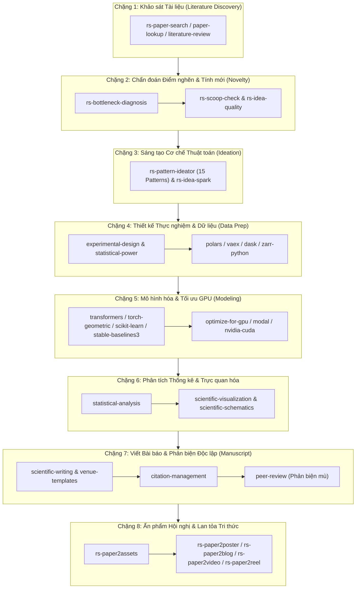
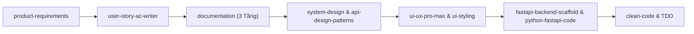

# Hệ Sinh Thái Kỹ Năng & Cấu Hình AI Agent (Antigravity & Gemini CLI)

> **Bộ khung chuẩn hoá, kho kỹ năng chuyên sâu và trung tâm điều phối nghiên cứu khoa học cho AI Coding Agent**  
> Tương thích: **Antigravity CLI (`agy`)**, **Gemini CLI**, **Claude Code**, và **OpenAI Codex**  
> *Ngôn ngữ:* [English (Bản tiếng Anh)](README.md) | [Tiếng Việt (Bản hiện tại)](README_VN.md)

---

## 🚀 Giới Thiệu Tổng Quan

Repository này cung cấp một cấu hình hoàn chỉnh cùng thư viện đồ sộ gồm **88 kỹ năng chuyên biệt (skills)**, biến các trợ lý lập trình AI thông thường thành những kỹ sư phần mềm và cộng sự nghiên cứu khoa học có tính kỷ luật cao, làm việc có phương pháp và tự chủ.

Thay vì đưa ra các câu trả lời chung chung hoặc phỏng đoán mò, hệ thống này thiết lập:
- **Tiêu chuẩn công nghệ chuẩn Clean Architecture & SOLID** (PEP 8 nghiêm ngặt, TDD, sửa code chính xác từng dòng - surgical changes).
- **Hệ thống tài liệu 3 tầng (3-Layer Documentation)**: Business $\to$ Architecture $\to$ Implementation, bảo vệ các bất biến của hệ thống.
- **Quy trình Nghiên cứu Khoa học 8 chặng chuẩn mực (8-Stage Research Lifecycle)**: Điều phối 57 kỹ năng nghiên cứu khoa học với cơ chế con người tham gia phản biện (Human-in-the-Loop - HITL).
- **Cơ chế định tuyến kỹ năng tối ưu Context Window**: Tránh tràn bộ nhớ ngữ cảnh của LLM thông qua meta-skill `research-hub`.

---

## 📂 Cấu Trúc Kho Lưu Trữ

```text
├── .agents/
│   ├── mcp_config.json        # Cấu hình các MCP server (NVIDIA CUDA, v.v.)
│   └── skills/                # 30 kỹ năng cốt lõi về Backend, Frontend, Kiến trúc, Bảo mật, UI/UX
├── research-hub/              # Meta-skill & Trình điều phối chu trình NCKH 8 chặng
├── microsoft-research/        # 11 kỹ năng NCKH (Tìm bài báo, chẩn đoán điểm nghẽn, 15 pattern sáng tạo, xuất poster/video)
├── cs-research-skills/        # 46 kỹ năng NCKH máy tính (Xử lý dữ liệu lớn, ML/DL, Lượng tử, Bayesian, Thống kê, Phản biện)
├── tasks/                     # Quản lý tiến độ công việc (todo.md, lessons.md)
├── docs/                      # Hệ thống tài liệu 3 tầng (Business, Architecture, Implementation)
├── AGENTS.md                  # Tệp điều khiển trí tuệ cốt lõi (Triết lý lập trình & quy tắc thực thi)
├── README.md                  # Hướng dẫn bản tiếng Anh
└── README_VN.md               # Hướng dẫn bản tiếng Việt (Tệp này)
```

---

## 🔬 Hướng Dẫn Sử Dụng Các Kỹ Năng Nghiên Cứu (Research Skills Guide)

Kho lưu trữ tích hợp một bộ kỹ năng nghiên cứu khoa học chuyên sâu gồm **58 kỹ năng** (`research-hub` + 11 kỹ năng trong `microsoft-research` + 46 kỹ năng trong `cs-research-skills`).

### 1. Cơ Chế Hoạt Động & Tối Ưu Hóa Bộ Nhớ Ngữ Cảnh
Nếu nạp đồng thời 58 tệp `SKILL.md` vào bộ nhớ của AI Agent, lượng token tiêu tốn sẽ vượt quá **150.000 tokens**, làm cạn kiệt context window và gây lãng phí chi phí API.

Để giải quyết vấn đề này, `research-hub` đóng vai trò là **Mục Lục Tổng & Meta-Skill**:
1. AI Agent chỉ cần đọc duy nhất tệp [research-hub/SKILL.md](research-hub/SKILL.md) khi bắt đầu phiên làm việc.
2. Tệp này chứa bảng tra cứu nhanh vị trí, chức năng và quy trình 8 chặng. Khi người dùng yêu cầu một tác vụ cụ thể (ví dụ: *"Tìm các bài báo về nén KV cache"*, *"Chẩn đoán điểm nghẽn của SOTA"*, hoặc *"Thiết kế poster hội nghị"*), Agent sẽ tự động trỏ thẳng tới thư mục kỹ năng tương ứng mà không làm rác context.

---

### 2. Hướng Dẫn Copy Kỹ Năng Vào Dự Án Mới (`.agents/skills/`)

Khi bạn khởi tạo một đề tài/dự án nghiên cứu mới và muốn sử dụng các skill này, bạn cần đưa chúng vào thư mục `.agents/skills/` (hoặc `.claude/skills/`) tại thư mục gốc của dự án đích.

#### Lựa chọn A: Copy toàn bộ bộ kỹ năng nghiên cứu (Khuyên dùng)
Mở PowerShell tại thư mục gốc của dự án đích:

```powershell
# 1. Tạo thư mục skills trong dự án của bạn
New-Item -ItemType Directory -Force -Path ".agents\skills"

# 2. Copy meta-orchestrator research-hub
Copy-Item -Recurse "E:\gemini\agent_setup\research-hub" ".agents\skills\"

# 3. Copy toàn bộ kỹ năng Microsoft Research
Copy-Item -Recurse "E:\gemini\agent_setup\microsoft-research\*" ".agents\skills\"

# 4. Copy toàn bộ kỹ năng Computer Science Research
Copy-Item -Recurse "E:\gemini\agent_setup\cs-research-skills\*" ".agents\skills\"
```

*(Đối với người dùng Linux / macOS sử dụng Terminal Bash):*
```bash
mkdir -p .agents/skills
cp -r /path/to/agent_setup/research-hub .agents/skills/
cp -r /path/to/agent_setup/microsoft-research/* .agents/skills/
cp -r /path/to/agent_setup/cs-research-skills/* .agents/skills/
```

> **Lưu ý:** Toàn bộ cấu hình `pyproject.toml` và `.env.template` đã được gói gọn sạch sẽ bên trong `research-hub/`, vì vậy lệnh copy wildcard `*` sẽ đưa đúng các thư mục skill chuẩn vào `.agents/skills/` mà không để sót tệp rác.

#### Lựa chọn B: Copy chọn lọc từng kỹ năng
Nếu dự án của bạn chỉ cần một số tính năng cụ thể (ví dụ: tìm kiếm bài báo và xuất poster hội nghị tự động):
```powershell
New-Item -ItemType Directory -Force -Path ".agents\skills"
Copy-Item -Recurse "E:\gemini\agent_setup\research-hub" ".agents\skills\"
Copy-Item -Recurse "E:\gemini\agent_setup\microsoft-research\rs-paper-search" ".agents\skills\"
Copy-Item -Recurse "E:\gemini\agent_setup\microsoft-research\rs-paper2assets" ".agents\skills\"
Copy-Item -Recurse "E:\gemini\agent_setup\microsoft-research\rs-paper2poster" ".agents\skills\"
```

---

### 3. Thiết Lập Môi Trường Python Độc Lập Cách Ly (`uv` & `.venv`)

Tuân thủ nghiêm ngặt quy tắc cách ly môi trường trong `AGENTS.md` (**tuyệt đối không cài đặt gói vào môi trường toàn cục của máy tính**):

```powershell
# 1. Khởi tạo môi trường ảo Python 3.10+ ngay tại thư mục dự án
uv venv --python 3.10

# 2. Kích hoạt môi trường ảo
# Trên Windows:
.venv\Scripts\activate
# Trên Linux/macOS:
# source .venv/bin/activate

# 3. Cài đặt các thư viện phục vụ nghiên cứu thông qua research-hub (chế độ editable)
uv pip install -e .agents\skills\research-hub

# 4. Cài đặt trình duyệt Chromium không giao diện để render poster học thuật (Playwright)
uv run python -m playwright install chromium

# 5. Cấu hình khóa API cho các kho học thuật
Copy-Item ".agents\skills\research-hub\.env.template" ".env"
```

Mở tệp `.env` vừa tạo để điền các API Key tương ứng (giúp tăng giới hạn tốc độ truy vấn):
```env
# Tùy chọn nhưng khuyến khích để tìm kiếm bài báo không bị giới hạn rate limit:
SEMANTIC_SCHOLAR_API_KEY=your_key_here
OPENALEX_API_KEY=your_key_here
CROSSREF_MAILTO=your_email@domain.com
```

---

### 4. Cơ Chế Chạy Script Không Lo Lệch Đường Dẫn

Tất cả các script trong các skill đều được viết với cơ chế tự động nhận diện đường dẫn tương đối thông qua `Path(__file__)`. Khi gọi script:
- **Nếu đang làm việc trong dự án đích đã copy skill:**  
  `uv run python .agents/skills/<tên-skill>/scripts/<tên-script>.py [tham số]`
- **Nếu đang thực thi trực tiếp trong kho tổng `agent_setup`:**  
  `uv run python microsoft-research/<tên-skill>/scripts/<tên-script>.py [tham số]`  
  hoặc `uv run python cs-research-skills/<tên-skill>/scripts/<tên-script>.py [tham số]`

---

## 🔄 Các Luồng Công Việc Phối Hợp Mẫu (Workflows)

### Luồng 1: Vòng Đời Nghiên Cứu Khoa Học Hoàn Chỉnh 8 Chặng



- **Quy tắc Con người là Trung tâm (HITL):** Ở mỗi chặng, AI Agent luôn có điểm dừng (Stop Gate) để trình bày bảng tổng hợp cho nhà nghiên cứu duyệt (ví dụ: duyệt danh sách bài báo tham chiếu, xác nhận điểm khác biệt Delta Statement, duyệt layout poster) trước khi sang bước kế tiếp.

---

### Luồng 2: Phát Triển Sản Phẩm Phần Mềm Doanh Nghiệp (Full-Stack)



1. **Khảo sát Yêu cầu:** Dùng `product-requirements` để phỏng vấn BA/PO, làm rõ Open Questions và tạo PRD; dùng `user-story-ac-writer` bóc tách thành User Story chuẩn INVEST + Gherkin.
2. **Thiết kế Kiến trúc:** Dùng `system-design` lập mô hình dữ liệu, tính toán SLA, phân mảnh DB; dùng `api-design-patterns` chuẩn hoá REST API.
3. **Thiết kế Giao diện:** Lên khung với `html-wireframe` $\to$ dựng mockup tương tác với `html-prototype` $\to$ áp dụng hệ thống màu và typography với `ui-ux-pro-max` + `ui-styling`.
4. **Triển khai Backend:** Khởi tạo kiến trúc với `fastapi-backend-scaffold`, viết mã nguồn async với `python-fastapi-code`, và rà soát chất lượng với `clean-code`.

---

## 📊 Bảng Tra Cứu Toàn Diện Tất Cả 88 Skills Hiện Có

### 1. Kiến Trúc Phần Mềm, Backend, Bảo Mật & Clean Code (Trong `.agents/skills/`)

| Tên Skill | Khi Nào Sử Dụng? (Triggers) | Làm Được Những Gì? (Capabilities) | Cách Phối Hợp Trong Luồng Công Việc |
| :--- | :--- | :--- | :--- |
| **`clean-code`** | Khi viết mới, sửa đổi, review, hoặc tái cấu trúc mã nguồn ở bất kỳ ngôn ngữ nào. | Áp dụng 66 quy tắc Clean Code kinh điển, Boy Scout Rule, phát hiện dead code, code smells, phân tích tĩnh ngoại tuyến. | Kết hợp với mọi skill viết code (`python-fastapi-code`, `stm32-embedded-workflow`). |
| **`security-audit`** | Khi đánh giá lỗ hổng bảo mật, kiểm thử mã nguồn, pen-test, phân tích rủi ro an ninh mạng. | Quy trình audit phòng thủ 6 giai đoạn, trinh sát luồng dữ liệu, phân loại tấn công (memory safety, auth, crypto, AI/LLM), xác thực giả định và xuất báo cáo. | Kết hợp với `clean-code` và luồng phát triển backend/microservice. |
| **`fastapi-backend-scaffold`** | Khi khởi tạo dự án backend mới, tạo microservice Python, hoặc sắp xếp lại cấu trúc thư mục. | Thiết lập chuẩn thư mục `backend/`, cấu hình `pyproject.toml`, `.venv` cô lập, phân tách Controller-Service-Repository, middleware tập trung. | Đi trước `python-fastapi-code`. Nhận đầu vào từ `api-design-patterns`. |
| **`python-fastapi-code`** | Khi viết API endpoint, async SQLAlchemy, Pydantic V2, xác thực JWT, WebSockets, background tasks. | Triển khai Clean Code & SOLID trong Python, áp dụng Repository/Service Pattern, Depends injection, viết async test với pytest. | Kết hợp chặt chẽ với `fastapi-backend-scaffold` và `clean-code`. |
| **`api-design-patterns`** | Khi thiết kế endpoint REST, phân trang, lọc dữ liệu, quản lý versioning API. | Hướng dẫn 7 mẫu thiết kế REST chuẩn: Versioning, Pagination, Filtering, Field Selection, Expansion, Async Request-Response, Consistent Response. | Định hướng thiết kế trước khi code trong `python-fastapi-code`. |
| **`system-design`** | Khi thiết kế hệ thống phân tán, xử lý tải cao, sharding database, caching, message queue, CAP theorem. | Tính toán tải (capacity planning), đo lường SLA/SLO/latency, thiết kế topo hệ thống, chọn kiến trúc Cloud/Microservice. | Ghi kết quả vào tầng Kiến trúc của `documentation` và vẽ bằng `diagram-design`. |
| **`stm32-embedded-workflow`** | Khi lập trình vi điều khiển STM32, cấu hình ngoại vi HAL, tra cứu datasheet, viết code C nhúng. | Phân tích bài toán, tính toán xung nhịp/timer, lập checklist STM32CubeMX, giải thích thanh ghi, sinh mã nguồn `main.c` chuẩn. | Kết hợp với `clean-code` cho firmware hoặc `nvidia-cuda` cho hệ thống nhúng AI. |

---

### 2. Giao Diện UI/UX, Design Systems & Mẫu Thử Frontend (Trong `.agents/skills/`)

| Tên Skill | Khi Nào Sử Dụng? (Triggers) | Làm Được Những Gì? (Capabilities) | Cách Phối Hợp Trong Luồng Công Việc |
| :--- | :--- | :--- | :--- |
| **`ui-ux-pro-max`** | Khi thiết kế giao diện web, mobile, desktop, phối màu, chọn font chữ, kiểm tra accessibility. | 79 phong cách thiết kế, 192 bảng màu sản phẩm kèm lý do chọn màu, 74 cặp font, 119 chỉ dẫn UX, 25 dạng biểu đồ. | Cung cấp định hướng thị giác cho `ui-styling` và `html-prototype`. |
| **`ui-styling`** | Khi xây dựng giao diện với Tailwind CSS, shadcn/ui components (Radix UI), dark mode. | Dựng layout responsive, tích hợp component chuẩn accessibility (modal, dropdown, table, form), quản lý theme màu. | Nhận design token từ `ui-ux-pro-max` để triển khai giao diện thực tế. |
| **`design-system`** | Khi xây dựng hệ thống thiết kế đồng nhất cho doanh nghiệp, chuẩn hoá design tokens. | Thiết kế 3 lớp token (primitive $\to$ semantic $\to$ component), biến CSS, thang đo khoảng cách, component spec. | Đặt nền tảng cho `ui-styling` và slide trình chiếu `slides`. |
| **`design-artifact`** | Khi tạo báo cáo, landing page hoặc tài liệu HTML độc lập cần tính thẩm mỹ cao. | Định hướng nghệ thuật, kết hợp font, bố cục màu sắc, giúp sản phẩm không bị cảm giác "do AI tạo ra". | Đi kèm với `html` để tinh chỉnh tính thẩm mỹ. |
| **`html`** | Khi cần tạo sản phẩm bàn giao là một tệp HTML duy nhất (báo cáo, landing page, công cụ nhỏ). | Tạo tệp HTML/CSS/JS độc lập hoàn chỉnh, chạy ngay không cần cài đặt môi trường hay build step. | Đóng vai trò bộ định tuyến chuyển sang `html-wireframe`, `html-prototype`, `html-plan`. |
| **`html-wireframe`** | Khi cần phác thảo khung layout, phân cấp thông tin và luồng thao tác trước khi đổ màu. | Dựng khung wireframe HTML đơn sắc, tập trung vào cấu trúc dữ liệu, điều hướng và độ khả dụng. | Bước đệm trước khi chuyển sang `html-prototype`. |
| **`html-prototype`** | Khi cần làm bản mẫu tương tác sống động, hoàn chỉnh để demo cho khách hàng hoặc kiểm thử. | Dựng mockup/prototype HTML tương tác mượt mà, phản hồi tốt trên mobile/desktop theo đúng nhận diện thương hiệu. | Phát triển từ `html-wireframe`, nhận styling từ `ui-ux-pro-max`. |
| **`html-plan`** | Khi lập kế hoạch dự án nhiều giai đoạn, theo dõi lộ trình và phụ thuộc công việc. | Dựng kế hoạch HTML trực quan, phân chia thứ tự, người phụ trách, mốc bàn giao và cổng nghiệm thu. | Kết hợp với `product-requirements` để trực quan hóa tiến độ. |
| **`html-diagram`** | Khi cần sơ đồ trực quan tương tác thể hiện cấu trúc, tô-pô, trạng thái hoặc phân cấp. | Tạo sơ đồ HTML độc lập có tương tác, kiểm soát layout và ký hiệu trực quan. | Bổ trợ cho `diagram-design`. |
| **`diagram-design`** | Khi cần vẽ sơ đồ kỹ thuật (kiến trúc, tuần tự, ER, luồng dữ liệu, Gantt, UML). | Xuất sơ đồ định dạng HTML, SVG, PNG, hỗ trợ nhập vào Draw.io và Excalidraw. | Đi kèm với `system-design` để trực quan hóa kiến trúc hệ thống. |
| **`3dviz-pro-max`** | Khi xây dựng không gian 3D tương tác trên web, WebGL, Three.js, sa bàn số, mô hình cơ khí. | 223 công thức (recipes), 440 hồ sơ tri thức, 22 kịch bản chiếu sáng, khung scaffold Vite+Three.js. | Sử dụng trong các mô phỏng học thuật của `lecture-visualizer` hoặc landing page. |
| **`banner-design`** | Khi thiết kế banner quảng cáo, ảnh bìa mạng xã hội, hero image website, ấn phẩm in ấn. | Hỗ trợ kích thước chuẩn đa nền tảng (Twitter, LinkedIn, YouTube, Web Hero) qua 13 phong cách đồ họa. | Đi kèm với `brand` để đảm bảo nhận diện thương hiệu. |
| **`brand`** | Khi xây dựng tiếng nói thương hiệu (brand voice), định vị thông điệp và quy chuẩn hình ảnh. | Thiết lập quy tắc giọng văn, ma trận thông điệp tiếp thị, giám sát tính tuân thủ thương hiệu. | Định hướng cho `banner-design`, `slides`, và tài liệu dự án. |
| **`slides`** | Khi tạo bài thuyết trình chiến lược, báo cáo điều hành dưới dạng HTML tương tác. | Thiết kế slide với Chart.js, responsive, công thức viết nội dung thuyết phục, hiệu ứng chuyển trang. | Phục vụ thuyết trình kinh doanh; bổ trợ cho `scientific-slides`. |
| **`lecture-visualizer`** | Khi soạn bài giảng đại học/cao học chuyên sâu, trực quan hóa thuật toán 2D/3D. | Single-file HTML sư phạm "cho người học chậm", mô phỏng từng bước, đọc song song bài báo khoa học dịch. | Kết hợp nghiên cứu khoa học với công tác giảng dạy, phổ biến kiến thức. |

---

### 3. Kỹ Thuật AI Agent, RAG & Mô Hình Ngôn Ngữ (Trong `.agents/skills/`)

| Tên Skill | Khi Nào Sử Dụng? (Triggers) | Làm Được Những Gì? (Capabilities) | Cách Phối Hợp Trong Luồng Công Việc |
| :--- | :--- | :--- | :--- |
| **`agent-harness`** | Khi thiết kế hệ thống AI Agent chạy dài hạn, đa lượt (multi-turn) trong doanh nghiệp. | Quản lý phiên làm việc bền vững (session persist), chống tràn context, cơ chế an toàn và Human-in-the-Loop. | Nền tảng cốt lõi để xây dựng các agent tự chủ trong sản xuất. |
| **`rag-architect`** | Khi xây dựng hệ thống RAG, tìm kiếm ngữ nghĩa, cơ sở dữ liệu vector. | Tối ưu chiến lược cắt đoạn (chunking), tìm kiếm lai (hybrid search), reranking, chọn lựa vector database. | Kết hợp với `langchain-skills` và các skill bóc tách văn bản `liteparse`/`markitdown`. |
| **`langchain-skills`** | Khi phát triển ứng dụng với LangChain, LangGraph hoặc Deep Agents. | Mẫu thiết kế đồ thị trạng thái (state graph), bộ nhớ dài hạn, định tuyến công cụ, điểm dừng phê duyệt. | Đi cùng với `rag-architect` và `agent-harness`. |
| **`prompt-engineer`** | Khi thiết kế, tối ưu hoặc đánh giá prompt cho các mô hình LLM. | Kỹ thuật Few-shot, Chain-of-Thought, cấu trúc hóa đầu ra JSON, kiểm thử hồi quy cho prompt. | Tối ưu hóa hiệu năng prompt cho mọi agent trong hệ thống. |
| **`nvidia-cuda`** | Khi lập trình tăng tốc phần cứng GPU NVIDIA, CUDA C/C++, cuBLAS, cuDNN, tối ưu kernel. | Tra cứu kho tài liệu chính hãng trực tiếp từ kỹ sư NVIDIA, kiểm soát bộ nhớ GPU, tối ưu luồng tính toán. | Phối hợp với `optimize-for-gpu` khi giải quyết các bài toán AI nặng. |

---

### 4. Thu Thập Yêu Cầu & Kiến Trúc Tài Liệu (Trong `.agents/skills/`)

| Tên Skill | Khi Nào Sử Dụng? (Triggers) | Làm Được Những Gì? (Capabilities) | Cách Phối Hợp Trong Luồng Công Việc |
| :--- | :--- | :--- | :--- |
| **`product-requirements`** | Khi phỏng vấn lấy yêu cầu dự án, lập PRD, làm rõ các câu hỏi mở (Open Questions). | Đóng vai trò BA/PO chuyên nghiệp, chấm điểm chất lượng PRD, vẽ sơ đồ phạm vi, xuất tài liệu chuẩn. | Cung cấp đầu vào trực tiếp cho `user-story-ac-writer` và `system-design`. |
| **`user-story-ac-writer`** | Khi phân rã yêu cầu thành các User Story và Tiêu chí chấp nhận (Acceptance Criteria). | Viết Story chuẩn INVEST, kịch bản Gherkin (`Given-When-Then`), thiết lập rào chắn kiến trúc (Architecture Guardrails). | Chuyển giao các đầu việc cụ thể vào `tasks/todo.md`. |
| **`documentation`** | Khi tổ chức kho tài liệu dự án, quản lý Single Source of Truth (SSOT). | Áp dụng cấu trúc 3 tầng: Business (`docs/business/`), Architecture (`docs/architecture/`), Implementation (`docs/implementation/`). | Đảm bảo tính nhất quán cho toàn bộ mã nguồn và tài liệu trong repo. |

---

### 5. Khảo Sát Tài Liệu Khoa Học & Tra Cứu Bài Báo (Bộ Kỹ Năng Nghiên Cứu)

| Tên Skill | Khi Nào Sử Dụng? (Triggers) | Làm Được Những Gì? (Capabilities) | Cách Phối Hợp Trong Luồng Công Việc |
| :--- | :--- | :--- | :--- |
| **`research-hub`** | **Meta-Skill khởi đầu**: Bắt đầu mọi tác vụ nghiên cứu khoa học tại đây. | Chỉ mục tra cứu 57 kỹ năng nghiên cứu, định tuyến không tốn token, dẫn dắt quy trình 8 chặng chuẩn mực. | Điều hướng yêu cầu đến các skill trong `microsoft-research` và `cs-research-skills`. |
| **`rs-paper-search`** | Khi tìm kiếm bài báo khoa học đồng thời từ nhiều nguồn học thuật uy tín. | Quét đồng thời arXiv, OpenReview, Semantic Scholar, DBLP, OpenAlex, Crossref; lọc trùng và xếp hạng liên quan. | Mũi nhọn Chặng 1. Cung cấp dữ liệu cho `rs-bottleneck-diagnosis`. |
| **`paper-lookup`** | Khi cần tra cứu DOI, trích xuất PDF mở, tìm trích dẫn qua 18 API học thuật. | Hỗ trợ PubMed, PMC, bioRxiv, arXiv, Crossref, Unpaywall, Zenodo, DOAJ, OpenCitations. | Bổ trợ cho `rs-paper-search` khi cần tải sâu toàn văn một bài báo cụ thể. |
| **`literature-review`** | Khi thực hiện tổng quan tài liệu có hệ thống (systematic review) hoặc tường thuật. | Xây dựng ma trận bằng chứng, theo dõi độ bao phủ tài liệu, lập dàn ý tổng quan dạng Markdown/PDF. | Đi cùng với `citation-management` và `scientific-writing`. |

---

### 6. Sáng Tạo Ý Tưởng, Điểm Nghẽn & Kiểm Tra Tính Mới (Microsoft Research Suite)

| Tên Skill | Khi Nào Sử Dụng? (Triggers) | Làm Được Những Gì? (Capabilities) | Cách Phối Hợp Trong Luồng Công Việc |
| :--- | :--- | :--- | :--- |
| **`rs-bottleneck-diagnosis`** | Khi muốn tìm ra điểm yếu cốt lõi, rào cản nền tảng của các bài báo SOTA hiện tại. | Phân biệt điểm nghẽn chịu lực (load-bearing) với các hạn chế bề mặt không đáng kể. | Cầu nối từ khảo sát tài liệu Chặng 1 sang sáng tạo cơ chế ở Chặng 3. |
| **`rs-pattern-ideator`** | Khi xây dựng cơ chế thuật toán mới để vượt qua điểm nghẽn đã xác định. | Ánh xạ điểm nghẽn vào 15 Pattern & 31 Sub-pattern kinh nghiệm rút ra từ 1.947 bài báo Oral tại ICLR/ICML/NeurIPS. | Đề xuất 2-3 công thức toán/kiến trúc cụ thể cho `rs-idea-spark`. |
| **`rs-scoop-check`** | Khi cần kiểm tra xem ý tưởng mới có bị trùng lặp với các công trình đã xuất bản không. | Phân tích va chạm trên 4 trục (Cách đặt vấn đề, Cơ chế cốt lõi, Insight chính, Miền ứng dụng); tạo Delta Statement sắc bén. | Xác nhận tính độc bản trước khi thực hiện thí nghiệm. |
| **`rs-idea-spark`** | Khi muốn chạy toàn bộ quy trình ươm tạo ý tưởng khoa học từ đầu đến cuối. | Xâu chuỗi: Bám rễ tài liệu $\to$ Chẩn đoán điểm nghẽn $\to$ Khớp 15 Pattern $\to$ Kiểm tra va chạm với các chốt chặn HITL. | Xuất ra các thẻ ý tưởng (Idea Cards) có tính thuyết phục cao trước hội đồng. |
| **`rs-idea-quality`** | Khi cần chấm điểm chất lượng của một ý tưởng/đề xuất trước khi bắt tay làm thực nghiệm. | Đánh giá ý tưởng theo thang điểm 0-100 kèm bằng chứng trích dẫn hoặc so sánh đối đầu mù giữa hai ý tưởng. | Giúp nhà nghiên cứu quyết định có nên đầu tư tài nguyên GPU cho ý tưởng đó hay không. |

---

### 7. Thiết Kế Thực Nghiệm, Tính Cỡ Mẫu & Dữ Liệu Lớn (CS Research Suite)

| Tên Skill | Khi Nào Sử Dụng? (Triggers) | Làm Được Những Gì? (Capabilities) | Cách Phối Hợp Trong Luồng Công Việc |
| :--- | :--- | :--- | :--- |
| **`experimental-design`** | Khi lập kế hoạch thử nghiệm, phân bổ mẫu ngẫu nhiên, chia nhóm kiểm soát. | Kiểm soát biến gây nhiễu (confounding), thiết kế giai tầng, thiết kế giai thừa (factorial), Latin squares. | Phải kết hợp với `statistical-power` TRƯỚC KHI thu thập dữ liệu. |
| **`statistical-power`** | Khi cần tính cỡ mẫu tối thiểu cần thiết để đạt độ mạnh thống kê (ví dụ 80% power). | Tính closed-form và mô phỏng Monte Carlo cho t-test, ANOVA, hồi quy, thử nghiệm cụm (cluster RCT). | Đảm bảo tính hợp lệ về mặt thống kê cho `experimental-design`. |
| **`exploratory-data-analysis`** | Khi rà soát sơ bộ tệp dữ liệu khoa học mới (CSV, HDF5, NumPy, FASTA). | Kiểm tra rò rỉ dữ liệu (data leakage), phân phối khuyết thiếu, độ nhạy ngoại lai (outliers), sinh khung báo cáo EDA. | Chuẩn bị dữ liệu trước khi đẩy vào pipeline với `polars` hoặc `vaex`. |
| **`polars`** | Khi xử lý dữ liệu dạng bảng tốc độ cao trong bộ nhớ và out-of-core. | Thực thi truy vấn lười (lazy execution), tương thích chuẩn Arrow, xử lý dữ liệu streaming đa luồng. | Chuẩn hóa dữ liệu nhanh chóng cho các mô hình học máy. |
| **`vaex`** | Khi phân tích dữ liệu dạng bảng khổng lồ vượt quá dung lượng RAM của máy tính. | Xử lý hàng tỷ dòng qua bộ nhớ ảo (memory-mapped) không cần copy, tính toán thống kê và binning tức thì. | Chuyên dụng cho dữ liệu thiên văn, gen sinh học và bảng dữ liệu cực lớn. |
| **`dask`** | Khi cần mở rộng tính toán pandas/NumPy ra nhiều lõi CPU hoặc cụm máy chủ phân tán. | Phân tán DataFrames, Arrays, đồ thị tác vụ (task graphs), xử lý song song với Futures. | Nâng cấp mã nguồn chạy đơn máy lên cụm máy tính tính toán song song. |
| **`zarr-python`** | Khi lưu trữ và truy vấn mảng dữ liệu khoa học N chiều chia khối (chunked). | Lưu trữ nén mảng N chiều trên đĩa cứng hoặc đám mây S3/GCS, tích hợp mượt với NumPy/Xarray. | Định dạng lưu trữ chuẩn cho dữ liệu ảnh khoa học, khí hậu và không gian. |
| **`liteparse`** | Khi cần bóc tách văn bản từ PDF giữ nguyên tọa độ hộp bao (bounding box). | Trích xuất văn bản có tọa độ không gian, OCR quét tài liệu, xuất JSON cấu trúc phục vụ RAG. | Cung cấp dữ liệu văn bản sạch cho `rag-architect` và đọc tài liệu nghiên cứu. |
| **`markitdown`** | Khi chuyển đổi tài liệu Office, PDF sang định dạng Markdown sạch sẽ. | Sử dụng Microsoft MarkItDown, hỗ trợ OCR hình ảnh, trích xuất dữ liệu bảng biểu cho LLM. | Tiền xử lý tài liệu cho việc khảo sát và tìm kiếm văn bản. |

---

### 8. Học Máy, Học Sâu, Mạng Đồ Thị & Học Tăng Cường (CS Research Suite)

| Tên Skill | Khi Nào Sử Dụng? (Triggers) | Làm Được Những Gì? (Capabilities) | Cách Phối Hợp Trong Luồng Công Việc |
| :--- | :--- | :--- | :--- |
| **`transformers`** | Khi huấn luyện, tinh chỉnh (fine-tune) hoặc suy luận mô hình nền tảng Hugging Face. | Cấu hình AutoModel, Trainer, Tokenizer, lượng tử hóa mô hình (quantization), mô hình đa phương thức. | Kết hợp với `optimize-for-gpu` và `modal` để chạy mô hình lớn. |
| **`pytorch-lightning`** | Khi cấu trúc mã nguồn PyTorch phục vụ huấn luyện phân tán quy mô lớn. | Đóng gói LightningModules, cấu hình huấn luyện multi-GPU/TPU, DDP, FSDP, DeepSpeed, checkpoint callbacks. | Chuẩn hóa quy trình huấn luyện mạng nơ-ron sâu. |
| **`hugging-science`** | Khi tìm kiếm mô hình và bộ dữ liệu khoa học chuyên sâu trên Hugging Face. | Kho tài nguyên tuyển chọn trong sinh học, hóa học, vật lý, thiên văn học, khí hậu, mô hình PDE. | Tìm kiếm foundation models phù hợp cho từng chuyên ngành khoa học. |
| **`torch-geometric`** | Khi phát triển mạng nơ-ron đồ thị (Graph Neural Networks - GNN). | Triển khai truyền thông điệp (GCN, GAT, GraphSAGE, GIN), đồ thị không đồng nhất (heterogeneous), lấy mẫu lân cận. | Đi cùng `networkx` để xử lý tô-pô đồ thị đầu vào. |
| **`networkx`** | Khi phân tích cấu trúc mạng phức tạp và thuật toán đồ thị. | Tính toán chỉ số trung tâm (centrality), phát hiện cộng đồng, tìm đường đi ngắn nhất, tạo đồ thị tổng hợp. | Sinh đặc trưng cấu trúc đồ thị cho `torch-geometric`. |
| **`scikit-learn`** | Khi huấn luyện các mô hình học máy truyền thống và tiền xử lý dữ liệu. | Phân loại, hồi quy, phân cụm, tinh chỉnh siêu tham số, xây dựng pipeline biến đổi đặc trưng. | Xây dựng baseline chuẩn mực trước khi chuyển sang mạng nơ-ron sâu. |
| **`shap`** | Khi giải thích mô hình hộp đen và phân tích tầm quan trọng của đặc trưng (XAI). | Tính toán giá trị Shapley qua TreeSHAP, KernelSHAP, vẽ biểu đồ giải thích cục bộ và toàn cục. | Kiểm toán tính minh bạch cho mô hình của `scikit-learn` hoặc `transformers`. |
| **`umap-learn`** | Khi giảm chiều dữ liệu phi tuyến tính để trực quan hóa hoặc tiền xử lý phân cụm. | Nhúng dữ liệu không gian 2D/3D, UMAP có giám sát (supervised UMAP), Parametric UMAP. | Phối hợp với `scientific-visualization` để vẽ biểu đồ không gian ẩn (latent space). |
| **`timesfm-forecasting`** | Khi dự báo chuỗi thời gian zero-shot bằng Foundation Model của Google. | Chạy checkpoint TimesFM 2.5, dự báo phân vị (quantile forecasting), xử lý biến phụ thuộc (covariates). | Giải pháp dự báo chuỗi thời gian không cần huấn luyện lại từ đầu. |
| **`aeon`** | Khi thực hiện phân loại, phân đoạn hoặc phát hiện bất thường trên chuỗi thời gian. | Cung cấp thuật toán chuyên biệt cho dữ liệu tuần tự tương thích hoàn toàn với API scikit-learn. | Bổ trợ chuyên sâu cho các bài toán phân loại chuỗi thời gian. |
| **`stable-baselines3`** | Khi triển khai các thuật toán học tăng cường (RL) đơn tác nhân. | Triển khai chuẩn PPO, SAC, DQN, TD3, A2C; môi trường tùy biến theo chuẩn Gymnasium. | Công cụ baseline chuẩn cho các bài báo nghiên cứu về RL. |
| **`pufferlib`** | Khi cần vector hóa môi trường mô phỏng RL để đạt tốc độ lấy mẫu hàng triệu bước/giây. | Vector hóa môi trường game/mô phỏng bằng C/CUDA, tối ưu bộ nhớ đệm cho quá trình huấn luyện RL. | Tăng tốc độ lấy mẫu kinh nghiệm cực lớn cho `stable-baselines3`. |

---

### 9. Mô Hình Xác Suất, Tối Ưu Hóa, Toán Biểu Thức & Lượng Tử (CS Research Suite)

| Tên Skill | Khi Nào Sử Dụng? (Triggers) | Làm Được Những Gì? (Capabilities) | Cách Phối Hợp Trong Luồng Công Việc |
| :--- | :--- | :--- | :--- |
| **`pymc`** | Khi xây dựng mô hình suy luận Bayes và lập trình xác suất (probabilistic programming). | Lấy mẫu NUTS MCMC, suy luận biến phân (VI), mô hình phân cấp, kiểm tra hậu nghiệm (posterior checks). | Đo lường độ không chắc chắn (uncertainty) cho kết quả nghiên cứu. |
| **`pymoo`** | Khi giải quyết các bài toán tối ưu hóa đa mục tiêu tìm mặt biên Pareto. | Thuật toán NSGA-II, NSGA-III, MOEA/D, xử lý ràng buộc, đo lường mặt biên Pareto. | Cân bằng đánh đổi giữa nhiều mục tiêu mâu thuẫn nhau trong thiết kế. |
| **`sympy`** | Khi cần tính toán giải tích biểu thức chính xác và chứng minh công thức toán học. | Đạo hàm, tích phân, giải hệ phương trình vi phân, đại số ma trận biểu thức, sinh mã LaTeX. | Hỗ trợ phát triển lý thuyết toán học chặt chẽ ở Chặng 3. |
| **`simpy`** | Khi mô phỏng sự kiện rời rạc cho các quy trình vận hành và hàng đợi. | Điều phối lịch trình sự kiện, mô hình hóa hàng đợi tài nguyên chia sẻ, phân tích độ trễ. | Mô phỏng hệ thống mạng, logistics và quy trình công nghiệp. |
| **`qiskit`** | Khi lập trình máy tính lượng tử trên phần cứng và mô phỏng của IBM Quantum. | Thiết kế mạch lượng tử, dùng các primitive Sampler/Estimator V2 của Qiskit 2.x, giảm thiểu lỗi. | Phối hợp với `cirq` và `pennylane`. |
| **`cirq`** | Khi lập trình thuật toán lượng tử hướng tới phần cứng Google Quantum AI. | Thiết kế mạch nhận biết nhiễu phần cứng, mô phỏng đặc tính vật lý của qubit Google. | Bổ trợ cho `qiskit`. |
| **`pennylane`** | Khi nghiên cứu Học máy Lượng tử (Quantum ML) và mô hình lai lượng tử - cổ điển. | Tính đạo hàm tự động cho mạch lượng tử liên kết với PyTorch/JAX, giải thuật VQE, QAOA. | Cầu nối giữa mạng nơ-ron PyTorch và tính toán lượng tử. |
| **`arbor`** | Khi quản lý quá trình tinh chỉnh cây giả thuyết và phân nhánh thí nghiệm. | Theo dõi giả thuyết bền vững, cô lập môi trường thử nghiệm, so sánh các phiên bản ứng viên. | Quản lý tiến trình phân nhánh thử nghiệm trong các bài toán phức tạp. |

---

### 10. Tăng Tốc Phần Cứng & Hạ Tầng Agent (CS Research Suite)

| Tên Skill | Khi Nào Sử Dụng? (Triggers) | Làm Được Những Gì? (Capabilities) | Cách Phối Hợp Trong Luồng Công Việc |
| :--- | :--- | :--- | :--- |
| **`optimize-for-gpu`** | Khi mã nguồn Python chạy chậm và muốn tăng tốc trên GPU NVIDIA. | Phân tích profiling CUDA, chuyển đổi sang CuPy/cuDF/cuML, triệt tiêu nút thắt truyền nhận RAM-VRAM. | Đi cùng `nvidia-cuda` để tối ưu hóa hiệu năng tính toán tối đa. |
| **`get-available-resources`** | Khi cần kiểm tra tài nguyên CPU, RAM, GPU, ổ đĩa trước khi chạy tác vụ nặng. | Tạo bản chụp kiểm toán phần nguyên an toàn để ước tính quy mô công việc phù hợp với máy. | Bước kiểm tra an toàn trước khi chạy các script huấn luyện nặng. |
| **`modal`** | Khi máy cục bộ không đủ tài nguyên và cần đẩy tính toán lên GPU đám mây serverless. | Triển khai mã Python chạy GPU theo nhu cầu (on-demand), huấn luyện mô hình, chạy inference theo đợt. | Giải pháp cứu cánh khi máy cá nhân không có đủ GPU VRAM. |
| **`pi-agent`** | Khi vận hành hệ thống terminal agent tối giản Pi. | Giao diện dòng lệnh TUI, định tuyến mô hình cục bộ qua llama.cpp, điều phối subagent. | Hệ thống thực thi dòng lệnh độc lập. |
| **`consciousness-council`** | Khi cần một hội đồng đa góc nhìn phản biện các quyết định thiết kế khó khăn. | Mô phỏng các hình mẫu tư duy đối nghịch (Devil's Advocate), tách biệt dữ kiện và định kiến để ra quyết định. | Giúp lựa chọn kiến trúc hoặc hướng đi nghiên cứu khi có nhiều ngã rẽ. |
| **`autoskill`** | Khi muốn phát hiện các thao tác lặp lại của người dùng để đóng gói thành skill mới. | Phân tích nhật ký tương tác để tự động đề xuất và dựng khung kỹ năng mới. | Công cụ tự mở rộng kho kỹ năng cho hệ thống. |

---

### 11. Kiểm Định Thống Kê & Trực Quan Hóa Đồ Họa Khoa Học (CS Research Suite)

| Tên Skill | Khi Nào Sử Dụng? (Triggers) | Làm Được Những Gì? (Capabilities) | Cách Phối Hợp Trong Luồng Công Việc |
| :--- | :--- | :--- | :--- |
| **`statistical-analysis`** | Khi kiểm định giả thuyết khoa học, hiệu chỉnh p-value, tính effect size. | Kiểm định tham số và phi tham số, ANOVA, hồi quy đa biến, định dạng báo cáo chuẩn APA. | Kiểm chứng tính tin cậy của thực nghiệm Chặng 6 trước khi viết bài báo. |
| **`scientific-visualization`** | Khi tạo biểu đồ khoa học chất lượng cao sẵn sàng để gửi xuất bản bài báo. | Bố cục đa khung hình (multi-panel), phối màu an toàn cho người mù màu, chuẩn hóa nhãn trục và DPI. | Đi cùng với `statistical-analysis` để hoàn thiện các biểu đồ kết quả trong bài báo. |
| **`scientific-schematics`** | Khi cần vẽ sơ đồ kiến trúc hệ thống hoặc lưu đồ mô tả cơ chế thuật toán cho bài báo. | Tạo bản vẽ kiến trúc mạng nơ-ron, quy trình sinh học hoặc luồng hệ thống thông qua AI chuyên dụng. | Cung cấp Figure 1 kiến trúc tổng quan bài báo ở Chặng 7. |

---

### 12. Viết Bản Thảo, Định Dạng Kỷ Yếu, Trích Dẫn & Phản Biện (CS Research Suite)

| Tên Skill | Khi Nào Sử Dụng? (Triggers) | Làm Được Những Gì? (Capabilities) | Cách Phối Hợp Trong Luồng Công Việc |
| :--- | :--- | :--- | :--- |
| **`scientific-writing`** | Khi soạn thảo toàn văn bài báo khoa học từ phần Giới thiệu đến Kết luận. | Bám sát hướng dẫn xuất bản quốc tế, đối chiếu bằng chứng với tuyên bố, đồng nhất ký hiệu toán học. | Kỹ năng ngòi bút chủ đạo ở Chặng 7. |
| **`venue-templates`** | Khi định dạng bài báo theo mẫu kỷ yếu của NeurIPS, ICLR, ICML, CVPR, IEEE, ACM. | Cung cấp khung LaTeX chính thức, kiểm tra quy tắc giấu tên (double-blind) và giới hạn số trang. | Đảm bảo mã nguồn LaTeX không vi phạm quy chế hội nghị. |
| **`citation-management`** | Khi kiểm tra tính chính xác của tài liệu tham khảo và xuất tệp BibTeX chuẩn xác. | Chuyển đổi DOI sang BibTeX, kiểm tra chéo metadata qua OpenAlex và PubMed, tránh trích dẫn ma. | Làm sạch danh mục tài liệu tham khảo trước khi nộp bài. |
| **`peer-review`** | Khi muốn chạy phản biện độc lập giả lập trước khi nộp bài chính thức. | Đóng vai trò Reviewer khó tính: soi xét từng luận điểm, kiểm tra tính tái lập của phương pháp và thống kê. | Giúp phát hiện lỗ hổng bài báo để khắc phục trước kỳ nộp bài thật. |

---

### 13. Ấn Phẩm Hội Nghị, Poster, Video & Lan Tỏa Nghiên Cứu (Microsoft Research Suite)

| Tên Skill | Khi Nào Sử Dụng? (Triggers) | Làm Được Những Gì? (Capabilities) | Cách Phối Hợp Trong Luồng Công Việc |
| :--- | :--- | :--- | :--- |
| **`rs-paper2assets`** | Khi bài báo đã được chấp nhận và cần bóc tách tài sản từ tệp PDF để làm truyền thông. | Trích xuất hình ảnh độ phân giải cực cao 432 dpi, văn bản, siêu dữ liệu, tệp tóm tắt 9 mục `paper_spec.md`. | Đầu vào bắt buộc cho toàn bộ các skill tạo ấn phẩm truyền thông phía sau. |
| **`rs-paper2poster`** | Khi cần tạo poster hội nghị khổ lớn và tệp PowerPoint (.pptx) có thể chỉnh sửa hình khối. | Xuất poster in ấn (HTML/PDF/PNG) và tệp `.pptx` với shape vector bản địa qua công cụ `html2pptx`. | Nhận nguyên liệu từ `rs-paper2assets` để dựng poster thuyết trình. |
| **`latex-posters`** | Khi muốn thiết kế poster nghiên cứu học thuật thuần túy bằng LaTeX. | Mẫu chuẩn `beamerposter`, `tikzposter`, `baposter` với bố cục chia cột và tích hợp công thức toán. | Lựa chọn thay thế cho `rs-paper2poster` đối với người quen dùng LaTeX. |
| **`scientific-slides`** | Khi làm slide thuyết trình báo cáo đề tài, bảo vệ luận văn hoặc báo cáo tại hội nghị. | Cung cấp mẫu slide PowerPoint và LaTeX Beamer với cấu trúc nội dung khoa học chặt chẽ. | Bổ trợ cho `slides` khi đối tượng khán giả là giới học thuật. |
| **`rs-paper2blog`** | Khi muốn chuyển thể bài báo thành bài viết blog khoa học song ngữ (Anh - Trung/Việt). | Soạn bài viết `blog_en.docx` diễn giải đại chúng nhưng vẫn giữ chuẩn xác tuyệt đối các con số thực nghiệm. | Lan tỏa kết quả nghiên cứu tới cộng đồng công nghệ trên Medium, LinkedIn, v.v. |
| **`rs-paper2video`** | Khi muốn tạo video thuyết minh tự động dài 10-15 phút giới thiệu bài báo. | Tạo video MP4 1080p có giọng đọc thuyết minh, phụ đề khớp từng từ, hiệu ứng đèn laser soi điểm nhấn. | Giới thiệu công trình tại hội nghị trực tuyến hoặc tải lên YouTube. |
| **`rs-paper2reel`** | Khi cần làm trang web tương tác giới thiệu toàn cảnh công trình nghiên cứu. | Tạo tệp `reel.html` đồng bộ hóa khung hình poster, video clip thuyết minh và bài viết giải thích. | Đặt lên website giới thiệu dự án nghiên cứu của nhóm. |

---

## 🛠 Hướng Dẫn Bắt Đầu Nhanh Cho Dự Án Mới (Quick Start)

Để trang bị bộ khung này cho bất kỳ dự án mới nào của bạn:

1. **Copy các tệp nền tảng vào thư mục gốc của dự án:**
   - Thư mục `.agents/` (hoặc `.gemini/` / `.claude/`)
   - Thư mục `tasks/` (chứa `todo.md` và `lessons.md`)
   - Tệp `AGENTS.md` (Cập nhật tên dự án, Tech Stack và Mục tiêu hiện tại)

2. **Chọn và copy các skill phù hợp:**
   - Dự án làm Web / Full-Stack: Copy các skill từ `.agents/skills/`.
   - Đề tài Nghiên cứu Khoa học: Làm theo hướng dẫn tại [Mục Hướng Dẫn Kỹ Năng Nghiên Cứu](#-hướng-dẫn-sử-dụng-các-kỹ-năng-nghiên-cứu-research-skills-guide).

3. **Khởi động AI Agent:**
   - Chạy lệnh `agy`, `gemini`, hoặc `claude`. Agent sẽ tự động đọc `AGENTS.md` và áp dụng toàn bộ các tiêu chuẩn kỹ thuật trên trong suốt phiên làm việc.

---

## 📄 Bản Quyền & Lời Cảm Ơn

- **Bản quyền:** Mã nguồn được phân phối theo giấy phép **MIT License**. Chi tiết xem tại [LICENSE](LICENSE).
- **Lời cảm ơn:** Trân trọng cảm ơn những đóng góp từ cộng đồng mã nguồn mở, đặc biệt là các đúc kết của Andrej Karpathy về lập trình với AI, các công cụ nghiên cứu từ Microsoft Research, và cộng đồng Claude/Gemini CLI.
