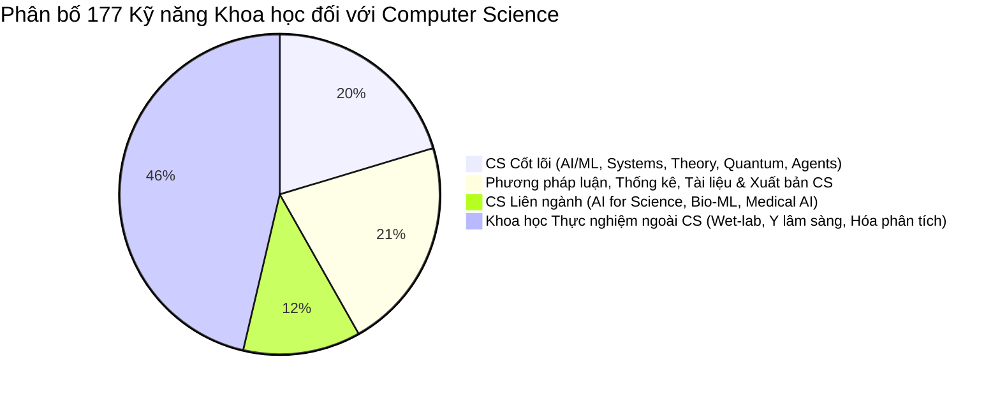
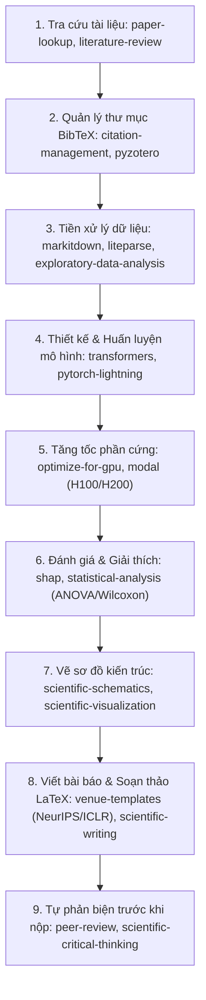
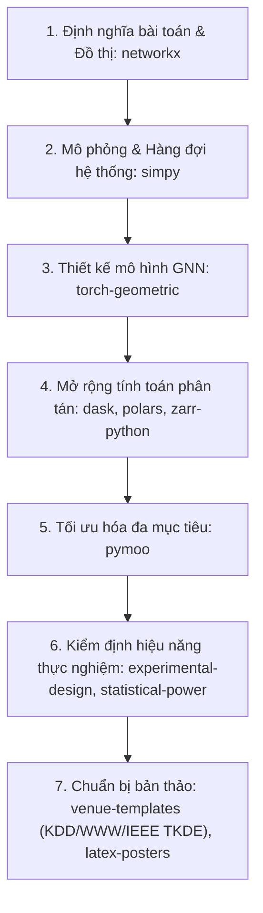
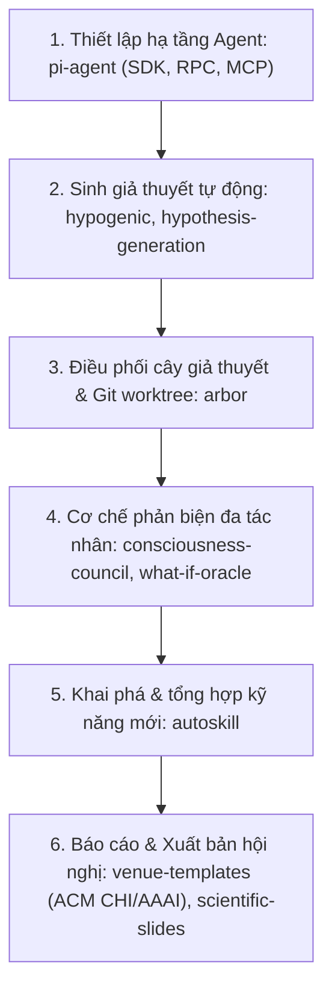

# BÁO CÁO ĐÁNH GIÁ VÀ HỆ THỐNG HÓA CÁC SCIENTIFIC AGENT SKILLS PHỤC VỤ NGHIÊN CỨU KHOA HỌC TRONG LĨNH VỰC COMPUTER SCIENCE (KHOA HỌC MÁY TÍNH)

> **Ngày thực hiện:** Tháng 10/2026  
> **Phạm vi khảo sát:** Toàn bộ 177 kỹ năng trong kho tri thức `scientific-agent-skills/skills/` và tài liệu hướng dẫn tương ứng `scientific-agent-skills/docs/skill-guides/`.  
> **Đối tượng thụ hưởng:** Các nhà nghiên cứu, nghiên cứu sinh, kỹ sư R&D trong lĩnh vực Khoa học Máy tính (Computer Science - CS), Trí tuệ nhân tạo (AI/ML), Hệ thống máy tính (Computer Systems/HPC), Lý thuyết tính toán, và các ngành liên ngành liên quan.

---

## 1. TỔNG QUAN VÀ KHUNG PHÂN TÍCH (EXECUTIVE SUMMARY)

Kho tài nguyên **Scientific Agent Skills** chứa tổng cộng **177 kỹ năng chuyên sâu** được thiết kế dưới dạng agent skills nhằm hỗ trợ tự động hóa, thực thi và chuẩn hóa nghiên cứu khoa học có kiểm chứng.

Qua khảo sát toàn diện mã nguồn (`SKILL.md`, scripts, references) và tài liệu hướng dẫn chuyên môn (`docs/skill-guides/*.md`), các kỹ năng không chỉ phục vụ các ngành khoa học tự nhiên (Sinh học phân tử, Hóa dược, Khoa học vật liệu), mà còn cung cấp một hệ sinh thái đặc biệt mạnh mẽ cho **Nghiên cứu Khoa học Máy tính (Computer Science Research)**.

### Phân bố tổng thể 177 kỹ năng đối với Computer Science

- **36 Kỹ năng CS Cốt lõi (Core CS)**: Phục vụ trực tiếp việc xây dựng mô hình AI, huấn luyện học sâu quy mô lớn, tối ưu hóa phần cứng GPU/CUDA, tính toán song song & phân tán, cấu trúc dữ liệu đồ thị, thuật toán tiến hóa, tính toán lượng tử và kiến trúc hệ thống tác nhân thông minh (Agentic AI).
- **38 Kỹ năng Phương pháp luận, Thống kê, Dữ liệu & Xuất bản học thuật (Research Methodology, Data & Publishing)**: Đóng vai trò sống còn trong việc thiết lập chuẩn mực thực nghiệm (empirical rigor), kiểm định giả thuyết thống kê, truy vấn tài liệu học thuật (arXiv, Semantic Scholar), sinh trích dẫn BibTeX, kết xuất sơ đồ kiến trúc nơ-ron và chuẩn bị bản thảo bài báo theo đúng định dạng hội nghị đỉnh cao (NeurIPS, ICML, ICLR, CVPR, ACL, IEEE, ACM).
- **21 Kỹ năng CS Liên ngành (Interdisciplinary CS / AI for Science)**: Áp dụng các mô hình học sâu, thị giác máy tính, biểu diễn đồ thị vào dữ liệu y sinh, ảnh y khoa, đồ thị tri thức và hệ gen học.
- **82 Kỹ năng ngoài CS (Domain-specific Wet-lab / Clinical / Chemistry)**: Tập trung vào thiết kế primer PCR, chuẩn độ hóa học, robot hút mẫu sinh học, vận hành lab ướt hoặc phác đồ điều trị lâm sàng tại giường bệnh.

---

## 2. PHÂN LOẠI CHI TIẾT CÁC KỸ NĂNG PHỤC VỤ COMPUTER SCIENCE

Dưới đây là bảng phân loại hệ thống theo các chuyên ngành chuẩn của Khoa học Máy tính:

### Phân hệ 1: Trí tuệ nhân tạo, Học máy & Học sâu (AI, Machine Learning & Deep Learning)

Các kỹ năng trong phân hệ này hỗ trợ toàn bộ vòng đời nghiên cứu mô hình: từ học có giám sát, học tăng cường, mô hình chuỗi thời gian, đồ thị nơ-ron đến giải thích mô hình (Explainable AI - XAI).

| Tên Skill | Tài liệu Guide | Thư viện / Nền tảng | Ứng dụng cụ thể trong Nghiên cứu CS |
| :--- | :--- | :--- | :--- |
| **`transformers`** | [transformers.md](file:///E:/gemini/agent_setup/scientific-agent-skills/docs/skill-guides/transformers.md) | Hugging Face Transformers, PyTorch | Tải, tinh chỉnh (fine-tuning) và đánh giá các mô hình nền tảng (LLMs, Vision Transformers, Multimodal). Hỗ trợ quản lý checkpoint, pipeline inference, generation parameters và ngăn ngừa rò rỉ dữ liệu (data leakage). |
| **`pytorch-lightning`** | [pytorch-lightning.md](file:///E:/gemini/agent_setup/scientific-agent-skills/docs/skill-guides/pytorch-lightning.md) | PyTorch Lightning, Lightning Fabric | Chuẩn hóa mã nguồn Deep Learning, tách biệt logic nghiên cứu và kỹ thuật hệ thống; cấu hình huấn luyện phân tán đa GPU/TPU (DDP, FSDP, DeepSpeed), logging và tái lập thí nghiệm. |
| **`torch-geometric`** | [torch-geometric.md](file:///E:/gemini/agent_setup/scientific-agent-skills/docs/skill-guides/torch-geometric.md) | PyTorch Geometric (PyG) | Nghiên cứu Graph Neural Networks (GNNs), cơ chế truyền tin (message passing: GCN, GAT, GraphSAGE, GIN), biểu diễn đồ thị không đồng nhất (heterogeneous graphs) và phân loại nút/cạnh/đồ thị. |
| **`stable-baselines3`** | [stable-baselines3.md](file:///E:/gemini/agent_setup/scientific-agent-skills/docs/skill-guides/stable-baselines3.md) | Stable-Baselines3, Gymnasium | Nghiên cứu Học tăng cường (Reinforcement Learning) đơn tác nhân với các thuật toán chuẩn (PPO, SAC, DQN, TD3, DDPG, A2C), custom Gym environments, đánh giá chính sách và chuẩn hóa phần thưởng. |
| **`pufferlib`** | [pufferlib.md](file:///E:/gemini/agent_setup/scientific-agent-skills/docs/skill-guides/pufferlib.md) | PufferLib, C/CUDA toolchain | Nghiên cứu Reinforcement Learning hiệu năng siêu cao: vector hóa môi trường hàng loạt bằng C/CUDA, tối ưu hóa thông lượng mẫu (sample throughput) cho các bài toán RL phức tạp. |
| **`scikit-learn`** | [scikit-learn.md](file:///E:/gemini/agent_setup/scientific-agent-skills/docs/skill-guides/scikit-learn.md) | scikit-learn, NumPy, SciPy | Các thuật toán ML truyền thống (SVM, Random Forest, GBDT, K-Means), tiền xử lý đặc trưng, pipeline đóng gói, phân chia tập dữ liệu phân tầng (stratified splitting) và baseline benchmarks. |
| **`shap`** | [shap.md](file:///E:/gemini/agent_setup/scientific-agent-skills/docs/skill-guides/shap.md) | SHAP (SHapley Additive exPlanations) | Nghiên cứu Trí tuệ nhân tạo có thể giải thích (Explainable AI - XAI), phân tích đóng góp đặc trưng (feature attribution), đánh giá độ công bằng (fairness) và tính minh bạch của mô hình hộp đen. |
| **`umap-learn`** | [umap-learn.md](file:///E:/gemini/agent_setup/scientific-agent-skills/docs/skill-guides/umap-learn.md) | UMAP, Numba | Nghiên cứu Học biểu diễn (Representation Learning), giảm chiều phi tuyến tính (nonlinear dimensionality reduction), trực quan hóa không gian tiềm ẩn (latent space embeddings) 2D/3D. |
| **`aeon`** | [aeon.md](file:///E:/gemini/agent_setup/scientific-agent-skills/docs/skill-guides/aeon.md) | aeon, scikit-learn API | Học máy chuyên sâu cho chuỗi thời gian: phân loại chuỗi thời gian (time series classification), phân cụm, phát hiện bất thường (anomaly detection) và phân đoạn chuỗi. |
| **`timesfm-forecasting`** | [timesfm-forecasting.md](file:///E:/gemini/agent_setup/scientific-agent-skills/docs/skill-guides/timesfm-forecasting.md) | Google TimesFM, PyTorch/JAX | Nghiên cứu Time-Series Foundation Models: dự báo chuỗi thời gian zero-shot với mô hình pretrained của Google Research, đánh giá khoảng tin cậy phân vị (quantiles). |
| **`pymc`** | [pymc.md](file:///E:/gemini/agent_setup/scientific-agent-skills/docs/skill-guides/pymc.md) | PyMC, PyTensor | Học máy xác suất (Probabilistic ML), suy diễn Bayes, lấy mẫu MCMC (No-U-Turn Sampler - NUTS), xấp xỉ biến phân (Variational Inference) và định lượng độ bất định (uncertainty quantification). |
| **`scikit-survival`** | [scikit-survival.md](file:///E:/gemini/agent_setup/scientific-agent-skills/docs/skill-guides/scikit-survival.md) | scikit-survival | Phân tích sống sót (Survival Analysis) và học máy trên dữ liệu bị kiểm duyệt (censored time-to-event data). |
| **`hugging-science`** | [hugging-science.md](file:///E:/gemini/agent_setup/scientific-agent-skills/docs/skill-guides/hugging-science.md) | Hugging Face Hub API | Khám phá, đánh giá và đối chuẩn (benchmark) các mô hình khoa học, bộ dữ liệu mở và Gradio Spaces trên hệ sinh thái Hugging Face. |

---

### Phân hệ 2: Tính toán hiệu năng cao (HPC), Hệ thống máy tính & Tối ưu hóa GPU (Computer Systems, HPC & Big Data)

Các kỹ năng cốt lõi cho các nhà nghiên cứu trong lĩnh vực Kiến trúc máy tính, Hệ thống phân tán, Điện toán đám mây và Tối ưu hóa biên dịch:

| Tên Skill | Tài liệu Guide | Thư viện / Nền tảng | Ứng dụng cụ thể trong Nghiên cứu CS |
| :--- | :--- | :--- | :--- |
| **`optimize-for-gpu`** | [optimize-for-gpu.md](file:///E:/gemini/agent_setup/scientific-agent-skills/docs/skill-guides/optimize-for-gpu.md) | CUDA, CuPy, RAPIDS (cuDF, cuML, cuGraph), Numba-CUDA | Tối ưu hóa hiệu năng tính toán trên GPU NVIDIA; profiling tắc nghẽn bộ nhớ/kernel (bandwidth & latency bottlenecks), đo đạc gia tốc thực tế (speedup) có kiểm soát sai số số học. |
| **`modal`** | [modal.md](file:///E:/gemini/agent_setup/scientific-agent-skills/docs/skill-guides/modal.md) | Modal Serverless SDK | Điện toán đám mây không máy chủ (Serverless Cloud Computing): mở rộng quy mô tính toán lên hàng nghìn container, cấp phát GPU mạnh mẽ (H100, H200, B200) theo nhu cầu nghiên cứu AI/HPC. |
| **`dask`** | [dask.md](file:///E:/gemini/agent_setup/scientific-agent-skills/docs/skill-guides/dask.md) | Dask Distributed, Dask Array/DataFrame | Tính toán phân tán và xử lý song song vượt giới hạn RAM (out-of-core computing), lập lịch đồ thị tác vụ động (dynamic task graph scheduling) trên cụm máy chủ (cluster). |
| **`polars`** | [polars.md](file:///E:/gemini/agent_setup/scientific-agent-skills/docs/skill-guides/polars.md) | Polars, Apache Arrow, Rust engine | Kỹ thuật xử lý dữ liệu dạng cột (Columnar Data Processing) hiệu năng cao, tối ưu hóa câu truy vấn lười biếng (lazy query optimization), đa luồng song song không khóa. |
| **`vaex`** | [vaex.md](file:///E:/gemini/agent_setup/scientific-agent-skills/docs/skill-guides/vaex.md) | Vaex, Memory Mapping | Phân tích tập dữ liệu dạng bảng khổng lồ (hàng tỷ dòng) bằng kỹ thuật ánh xạ bộ nhớ (memory mapping - mmap), không sao chép bộ nhớ (zero-copy) cho dữ liệu cực lớn. |
| **`zarr-python`** | [zarr-python.md](file:///E:/gemini/agent_setup/scientific-agent-skills/docs/skill-guides/zarr-python.md) | Zarr v3, N-D chunked storage | Nghiên cứu lưu trữ và truy xuất mảng đa chiều nén theo khối (chunked, compressed N-D arrays), hỗ trợ lưu trữ đám mây (S3, GCS) trong các hệ thống lưu trữ phân tán. |
| **`nextflow`** | [nextflow.md](file:///E:/gemini/agent_setup/scientific-agent-skills/docs/skill-guides/nextflow.md) | Nextflow DSL2, nf-core | Hệ thống điều phối luồng công việc (Workflow Management Systems), luồng thực thi dữ liệu hướng sự kiện (data-driven pipelines), tích hợp Docker/Singularity/SLURM HPC. |
| **`get-available-resources`** | [get-available-resources.md](file:///E:/gemini/agent_setup/scientific-agent-skills/docs/skill-guides/get-available-resources.md) | Python OS/Hardware introspection | Thăm dò cấu hình phần cứng thời gian thực (CPU affinity, RAM, GPU VRAM, cgroups, swap limits) để thiết lập các thuật toán thích ứng tài nguyên (resource-aware scheduling). |
| **`datalad`** | [datalad.md](file:///E:/gemini/agent_setup/scientific-agent-skills/docs/skill-guides/datalad.md) | DataLad, git-annex | Quản lý phiên bản dữ liệu khoa học (Data Version Control), theo dõi nguồn gốc tính toán (computational provenance capture) thông qua `datalad run/rerun`. |

---

### Phân hệ 3: Lý thuyết đồ thị, Toán rời rạc & Thuật toán mô phỏng (Graph Theory, Discrete Math & Simulation)

Dành cho nghiên cứu Cấu trúc dữ liệu & Giải thuật, Khoa học mạng, Toán tin và Mô phỏng hệ thống:

| Tên Skill | Tài liệu Guide | Thư viện / Nền tảng | Ứng dụng cụ thể trong Nghiên cứu CS |
| :--- | :--- | :--- | :--- |
| **`networkx`** | [networkx.md](file:///E:/gemini/agent_setup/scientific-agent-skills/docs/skill-guides/networkx.md) | NetworkX | Phân tích mạng phức tạp (Complex Networks), cài đặt giải thuật đồ thị (đường đi ngắn nhất, độ trung tâm - centrality, phát hiện cộng đồng - community detection, đồ thị ngẫu nhiên). |
| **`pymoo`** | [pymoo.md](file:///E:/gemini/agent_setup/scientific-agent-skills/docs/skill-guides/pymoo.md) | pymoo | Tối ưu hóa đa mục tiêu và siêu đa mục tiêu (Multi- & Many-objective Optimization) sử dụng các thuật toán tiến hóa (NSGA-II, NSGA-III, MOEA/D), xấp xỉ mặt tiền Pareto. |
| **`sympy`** | [sympy.md](file:///E:/gemini/agent_setup/scientific-agent-skills/docs/skill-guides/sympy.md) | SymPy | Hệ đại số máy tính (Computer Algebra Systems - CAS): tính toán ký hiệu chính xác, giải phương trình giải tích, kiểm chứng hình thức (formal verification) và sinh mã tự động. |
| **`simpy`** | [simpy.md](file:///E:/gemini/agent_setup/scientific-agent-skills/docs/skill-guides/simpy.md) | SimPy | Mô phỏng sự kiện rời rạc hướng tiến trình (Process-based Discrete-Event Simulation): nghiên cứu lý thuyết hàng đợi (queueing theory), lập lịch CPU, định tuyến gói tin mạng và tắc nghẽn hệ thống. |
| **`matlab`** | [matlab.md](file:///E:/gemini/agent_setup/scientific-agent-skills/docs/skill-guides/matlab.md) | MATLAB / GNU Octave | Tính toán ma trận số học, xử lý tín hiệu số, kiểm thử giải thuật số và tương thích hai chiều với môi trường Python. |

---

### Phân hệ 4: Tính toán lượng tử & Khoa học thông tin lượng tử (Quantum Computing & QIS)

Lĩnh vực mũi nhọn giao thoa giữa Khoa học Máy tính lý thuyết và Vật lý lượng tử:

| Tên Skill | Tài liệu Guide | Thư viện / Nền tảng | Ứng dụng cụ thể trong Nghiên cứu CS |
| :--- | :--- | :--- | :--- |
| **`qiskit`** | [qiskit.md](file:///E:/gemini/agent_setup/scientific-agent-skills/docs/skill-guides/qiskit.md) | IBM Qiskit 2.x, IBM Quantum Runtime | Thiết kế và biên dịch mạch lượng tử (quantum circuits), thuật toán lượng tử (Shor, Grover, QFT), giảm thiểu lỗi lượng tử (error mitigation), giả lập trên bộ xử lý QPU thực tế. |
| **`cirq`** | [cirq.md](file:///E:/gemini/agent_setup/scientific-agent-skills/docs/skill-guides/cirq.md) | Google Cirq | Khung tính toán lượng tử của Google Quantum AI: thiết kế mạch lượng tử nhận biết nhiễu (noise-aware circuits), thuật toán NISQ và thí nghiệm đặc trưng hóa phần cứng lượng tử. |
| **`pennylane`** | [pennylane.md](file:///E:/gemini/agent_setup/scientific-agent-skills/docs/skill-guides/pennylane.md) | Xanadu PennyLane, PyTorch/JAX | Học máy lượng tử (Quantum Machine Learning - QML): tính đạo hàm tự động cho mạch lượng tử biến phân (Variational Quantum Circuits), thuật toán lượng tử lai VQE, QAOA. |
| **`qutip`** | [qutip.md](file:///E:/gemini/agent_setup/scientific-agent-skills/docs/skill-guides/qutip.md) | QuTiP 5 | Mô phỏng động học hệ lượng tử mở (open quantum systems), phương trình chủ Lindblad, ma trận mật độ và cổng lượng tử trong môi trường có nhiễu. |

---

### Phân hệ 5: Hệ thống tác nhân tự trị & Kỹ nghệ Agent (Autonomous Agents & Agentic Systems)

Dành cho nghiên cứu hiện đại về LLM-based Agents, Multi-agent Systems và Cognitive Architectures:

| Tên Skill | Tài liệu Guide | Thư viện / Nền tảng | Ứng dụng cụ thể trong Nghiên cứu CS |
| :--- | :--- | :--- | :--- |
| **`pi-agent`** | [pi-agent.md](file:///E:/gemini/agent_setup/scientific-agent-skills/docs/skill-guides/pi-agent.md) | Pi Agent Harness, TypeScript/Node | Kiến trúc agent đầu cuối: cơ chế điều phối subagent, định tuyến mô hình cục bộ (`llama.cpp router`), giao thức RPC/JSON event streams và kiến trúc MCP (Model Context Protocol). |
| **`arbor`** | [arbor.md](file:///E:/gemini/agent_setup/scientific-agent-skills/docs/skill-guides/arbor.md) | Arbor Hypothesis Tree Framework | Cấu trúc tác nhân tự động tối ưu hóa giả thuyết nghiên cứu (Hypothesis Tree Refinement), cô lập thí nghiệm qua worktree git, truyền lan bằng chứng và tự động cải thiện benchmark. |
| **`autoskill`** | [autoskill.md](file:///E:/gemini/agent_setup/scientific-agent-skills/docs/skill-guides/autoskill.md) | Autoskill, Screenpipe | Khai phá quy trình làm việc (workflow mining), tự động phát hiện mẫu lặp và tổng hợp thành các kỹ năng phần mềm mới cho agent từ nhật ký hoạt động. |
| **`consciousness-council`** | [consciousness-council.md](file:///E:/gemini/agent_setup/scientific-agent-skills/docs/skill-guides/consciousness-council.md) | Multi-perspective deliberation | Mô hình suy luận đa tác nhân (Multi-agent debate / Devil's advocate): phân tách giả định, quan điểm đối lập để đưa ra quyết định kiến trúc hệ thống chặt chẽ. |
| **`what-if-oracle`** | [what-if-oracle.md](file:///E:/gemini/agent_setup/scientific-agent-skills/docs/skill-guides/what-if-oracle.md) | Counterfactual scenario engine | Phân tích kịch bản phản thực tế (counterfactual analysis), kiểm thử độ bền vững của kế hoạch nghiên cứu dưới các biến số bất định. |

---

### Phân hệ 6: Xử lý tài liệu, NLP & Đồ họa kiến trúc hệ thống (Document Processing, Multimodal & Schematics)

Hỗ trợ nghiên cứu trong lĩnh vực Information Retrieval, RAG và biểu diễn trực quan:

| Tên Skill | Tài liệu Guide | Thư viện / Nền tảng | Ứng dụng cụ thể trong Nghiên cứu CS |
| :--- | :--- | :--- | :--- |
| **`markitdown`** | [markitdown.md](file:///E:/gemini/agent_setup/scientific-agent-skills/docs/skill-guides/markitdown.md) | Microsoft MarkItDown | Chuyển đổi tài liệu không đồng nhất (PDF, Word, PPTX, HTML, Excel) sang định dạng Markdown chuẩn phục vụ tiền xử lý RAG (Retrieval-Augmented Generation) và NLP. |
| **`liteparse`** | [liteparse.md](file:///E:/gemini/agent_setup/scientific-agent-skills/docs/skill-guides/liteparse.md) | LiteParse, Spatial OCR | Trích xuất văn bản nhận biết bố cục không gian (spatial layout & bounding boxes), OCR và kết xuất trang thành ảnh phục vụ các tác nhân đa phương thức (Multimodal Document AI). |
| **`hypogenic`** | [hypogenic.md](file:///E:/gemini/agent_setup/scientific-agent-skills/docs/skill-guides/hypogenic.md) | ChicagoHAI HypoGeniC | Khung sinh giả thuyết tự động từ tập dữ liệu văn bản có nhãn thông qua LLM, đánh giá trên bộ benchmark HypoBench. |
| **`markdown-mermaid-writing`** | [markdown-mermaid-writing.md](file:///E:/gemini/agent_setup/scientific-agent-skills/docs/skill-guides/markdown-mermaid-writing.md) | Mermaid.js, Markdown | Vẽ sơ đồ kiến trúc phần mềm, luồng dữ liệu (Dataflow), máy trạng thái (State machine) và biểu đồ tuần tự (Sequence diagram) trực tiếp bằng mã nguồn. |
| **`scientific-schematics`** | [scientific-schematics.md](file:///E:/gemini/agent_setup/scientific-agent-skills/docs/skill-guides/scientific-schematics.md) | Nano Banana 2 + Gemini 3.7 Review | Tự động thiết kế bản vẽ trực quan kiến trúc mạng nơ-ron (Neural Network Architectures), sơ đồ khối hệ sinh thái phần mềm và luồng pipeline khoa học đạt chuẩn bài báo. |

---

### Phân hệ 7: Phương pháp luận thực nghiệm, Thống kê & Thiết kế Benchmark (Empirical Research Methodology & Benchmarking)

Rất nhiều bài báo CS bị từ chối tại các hội nghị hạng A* vì thiếu kiểm định thống kê hoặc thiết kế benchmark sai lệch. Nhóm kỹ năng này giải quyết triệt để vấn đề đó:

| Tên Skill | Tài liệu Guide | Ứng dụng cụ thể trong Nghiên cứu CS |
| :--- | :--- | :--- |
| **`experimental-design`** | [experimental-design.md](file:///E:/gemini/agent_setup/scientific-agent-skills/docs/skill-guides/experimental-design.md) | Thiết kế thí nghiệm (DOE): phân nhóm ngẫu nhiên, chặn khối (blocking), thử nghiệm nhân tố (factorial design), A/B testing cho thuật toán nhằm loại bỏ yếu tố gây nhiễu (confounding variables). |
| **`statistical-analysis`** | [statistical-analysis.md](file:///E:/gemini/agent_setup/scientific-agent-skills/docs/skill-guides/statistical-analysis.md) | Hướng dẫn chọn kiểm định thống kê chuẩn xác (t-test, ANOVA, Wilcoxon, Mann-Whitney U, Friedman test), tính toán kích thước hiệu ứng (effect size) và báo cáo p-value chuẩn APA cho so sánh hiệu năng thuật toán. |
| **`statistical-power`** | [statistical-power.md](file:///E:/gemini/agent_setup/scientific-agent-skills/docs/skill-guides/statistical-power.md) | Tính toán cỡ mẫu tối thiểu và công suất thống kê (power analysis) cần thiết để đảm bảo kết quả so sánh benchmark có ý nghĩa thực chất thay vì do ngẫu nhiên. |
| **`statsmodels`** | [statsmodels.md](file:///E:/gemini/agent_setup/scientific-agent-skills/docs/skill-guides/statsmodels.md) | Khớp và chẩn đoán mô hình hồi quy (OLS, GLM, ARIMA/SARIMAX), phân tích chuỗi thời gian số học và kiểm định sai số. |
| **`exploratory-data-analysis`** | [exploratory-data-analysis.md](file:///E:/gemini/agent_setup/scientific-agent-skills/docs/skill-guides/exploratory-data-analysis.md) | Khảo sát phân bố dữ liệu benchmark, phát hiện rò rỉ thông tin (data leakage) giữa tập train/test và xử lý ngoại lai (outliers). |
| **`scientific-critical-thinking`** | [scientific-critical-thinking.md](file:///E:/gemini/agent_setup/scientific-agent-skills/docs/skill-guides/scientific-critical-thinking.md) | Đánh giá độ tin cậy của bằng chứng thực nghiệm, phát hiện thiên vị benchmark (benchmark bias) và các cạm bẫy phương pháp luận. |
| **`scientific-brainstorming`** | [scientific-brainstorming.md](file:///E:/gemini/agent_setup/scientific-agent-skills/docs/skill-guides/scientific-brainstorming.md) | Định hình ý tưởng nghiên cứu mới, phản biện đối kháng (adversarial review) trước khi tiến hành code thí nghiệm. |
| **`hypothesis-generation`** | [hypothesis-generation.md](file:///E:/gemini/agent_setup/scientific-agent-skills/docs/skill-guides/hypothesis-generation.md) | Xây dựng câu hỏi nghiên cứu, giả thuyết kiểm định được (falsifiable hypotheses) và kế hoạch tiền đăng ký (preregistration). |

---

### Phân hệ 8: Truy vấn học thuật, Quản lý tài liệu & Xuất bản bài báo CS (Scholarly Retrieval, LaTeX & CS Publishing)

Tập trung vào công tác chuẩn bị bài báo khoa học, tra cứu tài liệu liên quan (Related Work) và nộp bài:

| Tên Skill | Tài liệu Guide | Ứng dụng cụ thể trong Nghiên cứu CS |
| :--- | :--- | :--- |
| **`venue-templates`** | [venue-templates.md](file:///E:/gemini/agent_setup/scientific-agent-skills/docs/skill-guides/venue-templates.md) | **Đặc biệt quan trọng cho CS:** Tích hợp bộ hướng dẫn định dạng chi tiết cho các hội nghị hàng đầu: **ML conferences** (NeurIPS, ICML, ICLR, CVPR), **CS/NLP/HCI conferences** (ACL, EMNLP, NAACL, CHI, CSCW, KDD, WWW, SIGIR) và tạp chí IEEE/ACM. Kiểm tra số trang, ẩn danh (double-blind review), font chữ nhúng trong PDF. |
| **`paper-lookup`** | [paper-lookup.md](file:///E:/gemini/agent_setup/scientific-agent-skills/docs/skill-guides/paper-lookup.md) | Truy vấn đồng thời 18 API học thuật: **arXiv**, Semantic Scholar, Crossref, OpenAlex, PubMed, Unpaywall. Tải PDF Open Access, tra cứu đồ thị trích dẫn (citation graph). |
| **`citation-management`** | [citation-management.md](file:///E:/gemini/agent_setup/scientific-agent-skills/docs/skill-guides/citation-management.md) | Quản lý trích dẫn học thuật, tự động chuyển đổi DOI/arXiv ID thành bản ghi BibTeX chuẩn xác phục vụ biên soạn bài báo bằng LaTeX/Overleaf. |
| **`scientific-writing`** | [scientific-writing.md](file:///E:/gemini/agent_setup/scientific-agent-skills/docs/skill-guides/scientific-writing.md) | Soạn thảo các phần của bài báo CS (Abstract, Methodology, Experimental Setup, Results), viết bản phản hồi phản biện (Rebuttal letter). |
| **`peer-review`** | [peer-review.md](file:///E:/gemini/agent_setup/scientific-agent-skills/docs/skill-guides/peer-review.md) | Soạn thảo nhận xét phản biện mang tính xây dựng theo đúng tiêu chuẩn các hội nghị lớn (NeurIPS/ICML/ACL Reviewer Guidelines). |
| **`literature-review`** | [literature-review.md](file:///E:/gemini/agent_setup/scientific-agent-skills/docs/skill-guides/literature-review.md) | Thực hiện tổng quan tài liệu có hệ thống (Systematic Literature Review - SLR) trong khoa học máy tính. |
| **`scientific-visualization`** | [scientific-visualization.md](file:///E:/gemini/agent_setup/scientific-agent-skills/docs/skill-guides/scientific-visualization.md) | Thiết kế biểu đồ khoa học chuẩn mực xuất bản: phối màu tương phản thân thiện người khiếm thị màu, hiển thị khoảng tin cậy (error bars), lưu trữ vector PDF/SVG. |
| **`latex-posters`** | [latex-posters.md](file:///E:/gemini/agent_setup/scientific-agent-skills/docs/skill-guides/latex-posters.md) | Thiết kế poster báo cáo hội nghị bằng mã nguồn LaTeX (`tikzposter`, `beamerposter`). |
| **`scientific-slides`** | [scientific-slides.md](file:///E:/gemini/agent_setup/scientific-agent-skills/docs/skill-guides/scientific-slides.md) | Thiết kế slide thuyết trình bảo vệ luận án / báo cáo hội nghị bằng LaTeX Beamer hoặc PowerPoint. |
| **`pyzotero`** | [pyzotero.md](file:///E:/gemini/agent_setup/scientific-agent-skills/docs/skill-guides/pyzotero.md) | Tự động hóa đồng bộ và trích xuất thư viện tài liệu tham khảo Zotero bằng Python. |
| **`open-notebook`** | [open-notebook.md](file:///E:/gemini/agent_setup/scientific-agent-skills/docs/skill-guides/open-notebook.md) | Nền tảng tự lưu trữ tương tự NotebookLM: nhập nguồn tài liệu (PDF, web), hỗ trợ hỏi đáp vector search có trích dẫn nguồn gốc. |
| **`exa-search`** & **`parallel-web`** | [exa-search.md](file:///E:/gemini/agent_setup/scientific-agent-skills/docs/skill-guides/exa-search.md) | Tìm kiếm ngữ nghĩa học thuật chuyên sâu trên web kỹ thuật, GitHub repos, blog kỹ thuật của các phòng lab AI lớn. |
| **`matplotlib`** & **`seaborn`** | [matplotlib.md](file:///E:/gemini/agent_setup/scientific-agent-skills/docs/skill-guides/matplotlib.md) | Các thư viện nền tảng vẽ biểu đồ phân bố, ma trận nhầm lẫn (confusion matrix), đường cong ROC-AUC, training loss curves. |

---

### Phân hệ 9: Lĩnh vực liên ngành trọng điểm ứng dụng CS (Interdisciplinary AI for Science)

Nếu hướng nghiên cứu CS của bạn là **Ứng dụng AI/Học máy vào các ngành khoa học tự nhiên và y tế (AI for Science / Bio-ML)**, các kỹ năng sau đây là những công cụ tối quan trọng:

- **`pyhealth`**: Học sâu cho dữ liệu y tế lâm sàng (EHR, tín hiệu sinh học, ảnh y khoa, dữ liệu MIMIC-IV).
- **`deepchem`**: Mô hình học máy đồ thị phân tử (MoleculeNet benchmarks, dự đoán tính chất hóa học).
- **`torchdrug`**: Framework PyTorch chuyên biệt cho đồ thị phân tử, học biểu diễn protein và suy luận đồ thị tri thức.
- **`esm`**: Mô hình ngôn ngữ lớn huấn luyện trên chuỗi sinh học (Protein Language Models - ESM3, ESMC embeddings).
- **`diffdock`**: Ứng dụng mô hình khuếch tán hình học (Geometric Diffusion Models) cho bài toán docking phối tử 3D.
- **`pathml`**: Thị giác máy tính và học sâu trên ảnh bệnh học kỹ thuật số cực lớn (Whole Slide Imaging - WSI).
- **`pydicom`**: Xử lý và tiền xử lý chuẩn dữ liệu ảnh y khoa DICOM (CT, MRI) phục vụ huấn luyện mạng nơ-ron tích chập (CNNs/Vision Transformers).
- **`imaging-data-commons`**: Truy xuất các tập dữ liệu ảnh y khoa ung thư quy mô lớn phục vụ benchmark AI y tế.
- **`geomaster`** & **`geopandas`**: Phân tích dữ liệu không gian, viễn thám, xử lý ảnh vệ tinh bằng học máy địa lý.

---

## 3. PHÂN TÍCH CHUYÊN SÂU MỘT SỐ KỸ NĂNG NỔI BẬT DÀNH CHO CS RESEARCHERS

### 3.1. Nhóm Huấn luyện Mô hình & Tinh chỉnh LLM (`transformers` & `pytorch-lightning`)
- **Điểm mạnh khoa học**: 
  - `transformers` không chỉ hướng dẫn tải model mà nhấn mạnh **sự phân tách ranh giới tập dữ liệu** (partitioning document families) để tránh data contamination, và ghi nhận cấu hình sinh (generation configs) để đảm bảo tính tái lập.
  - `pytorch-lightning` giải quyết bài toán kỹ thuật hệ thống khi mở rộng huấn luyện sang nhiều GPU. Tách biệt `LightningModule` (chứa kiến trúc, hàm mất mát, optimizer) và `Trainer` (quản lý phần cứng, precision fp16/bf16, DDP/FSDP), giúp bài báo đạt chuẩn minh bạch mã nguồn.

### 3.2. Nhóm Tối ưu hóa GPU & Hệ thống Máy tính (`optimize-for-gpu` & `modal`)
- **Nguyên lý cốt lõi của `optimize-for-gpu`**:
  - Không bao giờ giả định GPU luôn nhanh hơn CPU. Kỹ năng thiết lập quy trình kiểm chứng 5 bước: (1) Đo baseline CPU thật sự; (2) Chọn thư viện RAPIDS/CuPy/Numba phù hợp nhất; (3) Hạn chế tối đa truyền dữ liệu Host-Device (PCIe bandwidth bottleneck); (4) Kiểm chứng tính tương đương số học (numerical tolerances); (5) Benchmark có đồng bộ hóa xung nhịp GPU (`cudaDeviceSynchronize`).
- **Giá trị của `modal`**:
  - Cung cấp giải pháp cho các nhóm nghiên cứu không có cụm siêu máy tính tại chỗ: triển khai tác vụ huấn luyện/fine-tuning trên các GPU thế hệ mới nhất (H100/H200/B200) hoàn toàn thông qua code Python serverless, tự động ngắt khi xong để tối ưu chi phí nghiên cứu.

### 3.3. Nhóm Nghiên cứu Tác nhân Tự trị & Tối ưu hóa Thực nghiệm (`pi-agent` & `arbor`)
- **`pi-agent`**:
  - Là bộ công cụ hoàn chỉnh để nghiên cứu và xây dựng AI Coding Agents. Hỗ trợ hệ thống định tuyến LLM cục bộ (`llama.cpp router`), kiến trúc đa tác nhân (`pi-subagents`), tích hợp MCP server, và ghi nhật ký luồng sự kiện JSONL.
- **`arbor` (Hypothesis Tree Refinement)**:
  - Cực kỳ hữu ích cho các bài toán tối ưu benchmark mô hình học máy: Thay vì thử nghiệm mò mẫm qua hội thoại chat, Arbor xây dựng một cây giả thuyết liên tục (persistent hypothesis tree). Mỗi giả thuyết được thử nghiệm trong một Git worktree độc lập; kết quả kiểm thử trên tập held-out sẽ quyết định việc tỉa cành (prune) hoặc mở rộng nhánh giả thuyết tiếp theo.

### 3.4. Nhóm Chuẩn bị Bản thảo Hội nghị CS & Đồ họa (`venue-templates` & `scientific-schematics`)
- **`venue-templates`**:
  - Cung cấp cẩm nang và template LaTeX chuyên sâu cho hội nghị CS:
    - **Hội nghị AI/ML**: NeurIPS, ICML, ICLR, CVPR (các yêu cầu về số trang, checklist tác động xã hội, chính sách công bố mã nguồn).
    - **Hội nghị CS/NLP/HCI**: ACL ARR (ACL Rolling Review, quy định về mục Limitations), ACM CHI (định dạng `acmart`, chính sách nộp bài một cột ẩn danh), KDD, WWW, SIGIR.
- **`scientific-schematics`**:
  - Tự động sinh bản phác thảo kiến trúc mạng nơ-ron (như Transformer blocks, encoder-decoder pipelines, GNN layers) hoặc sơ đồ khối hệ thống máy tính. Đặc biệt tích hợp cơ chế đánh giá chất lượng tự động bằng Gemini Flash nhằm đảm bảo độ sắc nét, nhãn chú thích chính xác trước khi đưa vào bài báo.

---

## 4. QUY TRÌNH NGHIÊN CỨU MẪU ĐẦU-CUỐI TRONG COMPUTER SCIENCE (END-TO-END WORKFLOWS)

Dưới đây là 3 kịch bản thực tế minh họa cách kết hợp các skills nói trên trong một vòng đời nghiên cứu CS hoàn chỉnh:

### Kịch bản A: Nghiên cứu Mô hình Ngôn ngữ / Vision-Language Model mới

### Kịch bản B: Nghiên cứu Thuật toán Đồ thị / Mạng phức tạp quy mô lớn

### Kịch bản C: Nghiên cứu Hệ thống Tác nhân Tự trị & Lập luận (Agentic AI)

---

## 5. DANH MỤC CÁC KỸ NĂNG NGOÀI PHẠM VI CS (NON-CS SKILLS) VÀ LÝ DO LOẠI TRỪ

Để tránh việc nhầm lẫn hoặc sử dụng sai mục đích trong các đề tài thuần túy Computer Science, 82 kỹ năng sau đây được phân loại là **thuần khoa học thực nghiệm ngoại ngành (Domain-specific Experimental Sciences)**:

1. **Sinh học phân tử & Thiết kế thí nghiệm Lab ướt (Wet-lab Biology)**:  
   `primer-design` (thiết kế mồi PCR), `mageck` (phân tích màn hình CRISPR), `qiime2-amplicon` (khuếch đại 16S vi sinh vật), `bulk-rnaseq`, `pydeseq2`, `pathway-enrichment`, `flowio`, `flowkit` (đo dòng tế bào), `cellxgene-census`, `scanpy`, `scvelo`, `tiledbvcf`, `deeptools`, `pysam`, `biopython`, `bioservices`, `gtars`, `onekgpd`, `folklore-variant-evidence`, `pathogen-variant-surveillance`.
2. **Tự động hóa phòng thí nghiệm sinh hóa thực nghiệm (Lab Automation & Robotics)**:  
   `opentrons-integration` (điều khiển robot pipet Opentrons), `pylabrobot`, `ginkgo-cloud-lab`, `benchling-integration` (hệ thống LIMS phòng lab), `labarchive-integration`, `protocolsio-integration`.
3. **Hóa học, Hóa dược & Vật liệu thuần túy (Pure Chemistry & Materials)**:  
   `rdkit`, `datamol`, `medchem`, `nmrglue` (quang phổ cộng hưởng từ hạt nhân NMR), `rowan`, `cantera` (động học đốt cháy), `pycalphad` (nhiệt động học pha hợp kim), `pymatgen` (cấu trúc tinh thể vật liệu), `pybamm` (mô phỏng pin Li-ion), `matchms`, `pyopenms` (quang phổ khối lượng Proteomics/Metabolomics), `molecular-dynamics` (OpenMM mô phỏng động lực học phân tử).
4. **Y học lâm sàng, Dược động học & Phúc lợi động vật (Clinical & Pharmacometrics)**:  
   `clinical-decision-support`, `clinical-reports`, `treatment-plans`, `pkpd-modeling` (dược động học/dược lực học), `relsa-severity-assessment` (đánh giá mức độ nghiêm trọng trên động vật thí nghiệm).
5. **Khoa học Trái đất & Môi trường thực nghiệm (Earth & Environmental Sciences)**:  
   `marine-carbonate-chemistry` (hóa học carbonate đại dương), `astropy` (thiên văn học thuần túy), `openpiv`, `fluidsim` (thủy động lực học chất lỏng CFD chuyên sâu).
6. **Hành chính, Tài chính công & Tiêu chuẩn cơ sở**:  
   `usfiscaldata` (truy vấn nợ công Bộ Tài chính Mỹ), `iso-standards-readiness` (tiêu chuẩn phòng lab ISO 17025/15189), `analytical-method-validation`.

> [!NOTE]  
> Các kỹ năng trên vẫn có thể được tích hợp gián tiếp nếu đề tài của bạn là **Nghiên cứu Liên ngành (Interdisciplinary CS)**, ví dụ: viết giải thuật nén dữ liệu mới cho tập tin gen (`pysam`), hoặc thiết kế thuật toán tối ưu hóa điều phối robot phòng thí nghiệm (`opentrons-integration`). Tuy nhiên, bản thân các thư viện này giải quyết bài toán chuyên môn của sinh học/hóa học chứ không thuộc lý thuyết hay kỹ thuật máy tính thuần túy.

---

## 6. MA TRẬN TRA CỨU NHANH KỸ NĂNG DÀNH CHO NHÀ NGHIÊN CỨU CS (MASTER QUICK REFERENCE MATRIX)

| Tên Skill | Phân ngành CS chính | Mức độ ưu tiên | Vai trò chính trong nghiên cứu CS |
| :--- | :--- | :---: | :--- |
| **`transformers`** | AI / NLP / Deep Learning | **Tier 1 (Core)** | Tinh chỉnh & suy luận mô hình ngôn ngữ lớn, mô hình đa phương thức. |
| **`pytorch-lightning`** | AI / Hệ thống Deep Learning | **Tier 1 (Core)** | Kỹ thuật mở rộng quy mô huấn luyện mạng nơ-ron phân tán. |
| **`optimize-for-gpu`** | HPC / Kiến trúc máy tính | **Tier 1 (Core)** | Profiling CUDA, tối ưu bộ nhớ GPU, gia tốc thuật toán tính toán. |
| **`venue-templates`** | Phương pháp luận & Xuất bản | **Tier 1 (Core)** | Định dạng chuẩn xác bài báo hội nghị AI/CS (NeurIPS, ICML, ACL, ACM). |
| **`paper-lookup`** | Truy vấn học thuật / Khai phá tri thức | **Tier 1 (Core)** | Khảo sát tài liệu liên quan từ 18 kho học thuật (arXiv, Semantic Scholar). |
| **`torch-geometric`** | AI / Graph Learning | **Tier 1 (Core)** | Nghiên cứu và cài đặt Graph Neural Networks (GNNs). |
| **`stable-baselines3`** | AI / Học tăng cường (RL) | **Tier 1 (Core)** | Huấn luyện và đánh giá chính sách RL chuẩn hóa. |
| **`modal`** | Hệ thống / Điện toán đám mây | **Tier 1 (Core)** | Triển khai tính toán AI không máy chủ trên GPU H100/H200. |
| **`networkx`** | Lý thuyết đồ thị / Khoa học mạng | **Tier 1 (Core)** | Cài đặt và phân tích các giải thuật đồ thị kinh điển & phức tạp. |
| **`scientific-schematics`** | Trực quan hóa kiến trúc hệ thống | **Tier 1 (Core)** | Tự động vẽ sơ đồ kiến trúc mạng nơ-ron và hệ thống phần mềm. |
| **`pufferlib`** | AI / Tối ưu hóa RL | **Tier 2 (High)** | Môi trường mô phỏng RL song song cực lớn bằng C/CUDA. |
| **`dask`** | Hệ thống tính toán phân tán | **Tier 2 (High)** | Lập lịch tác vụ song song, tính toán out-of-core vượt giới hạn RAM. |
| **`polars`** | Kỹ thuật dữ liệu / Hệ thống | **Tier 2 (High)** | Xử lý dữ liệu bảng dạng cột hiệu năng cao (Rust-powered). |
| **`shap`** | AI / Explainable AI (XAI) | **Tier 2 (High)** | Giải thích quyết định của mô hình học máy thông qua giá trị Shapley. |
| **`qiskit`** | Tính toán lượng tử | **Tier 2 (High)** | Xây dựng thuật toán và mô phỏng mạch lượng tử trên IBM Quantum. |
| **`pennylane`** | Quantum Machine Learning | **Tier 2 (High)** | Học máy lượng tử vi phân và thuật toán lai lượng tử - cổ điển. |
| **`pi-agent`** | Hệ thống tác nhân tự trị | **Tier 2 (High)** | Thiết kế hệ thống AI Agent, subagent orchestration và MCP integration. |
| **`arbor`** | AI thực nghiệm / Tự động nghiên cứu | **Tier 2 (High)** | Quản lý cây giả thuyết nghiên cứu tự động với Git worktrees. |
| **`simpy`** | Lý thuyết mô phỏng / Hàng đợi | **Tier 2 (High)** | Mô phỏng sự kiện rời rạc cho tài nguyên mạng, hệ điều hành. |
| **`citation-management`** | Xuất bản học thuật | **Tier 2 (High)** | Tự động hóa tạo và kiểm định bản ghi BibTeX từ DOI/arXiv. |
| **`statistical-analysis`** | Phương pháp luận thực nghiệm | **Tier 2 (High)** | Kiểm định thống kê so sánh hiệu năng benchmark chuẩn khoa học. |
| **`timesfm-forecasting`** | AI / Chuỗi thời gian | **Tier 3 (Medium)** | Dự báo chuỗi thời gian zero-shot với Time-Series Foundation Models. |
| **`aeon`** | AI / Khai phá dữ liệu thời gian | **Tier 3 (Medium)** | Phân loại và phân cụm chuỗi thời gian chuyên sâu. |
| **`cirq`** | Tính toán lượng tử | **Tier 3 (Medium)** | Thiết kế mạch lượng tử Google Cirq nhận biết nhiễu. |
| **`sympy`** | Hệ đại số máy tính | **Tier 3 (Medium)** | Toán biểu tượng chính xác và kiểm chứng hình thức. |
| **`pymoo`** | Thuật toán tối ưu hóa | **Tier 3 (Medium)** | Tối ưu hóa tiến hóa đa mục tiêu (NSGA-II/III). |
| **`markitdown`** | Kỹ thuật NLP / RAG | **Tier 3 (Medium)** | Tiền xử lý chuyển đổi tài liệu thô sang Markdown cho LLMs. |
| **`liteparse`** | Thị giác máy tính / Tài liệu | **Tier 3 (Medium)** | Trích xuất văn bản nhận biết bố cục không gian (Spatial OCR). |
| **`latex-posters`** | Xuất bản học thuật | **Tier 3 (Medium)** | Thiết kế poster hội nghị bằng mã nguồn LaTeX. |
| **`scientific-slides`** | Truyền thông khoa học | **Tier 3 (Medium)** | Soạn slide báo cáo luận án / hội nghị bằng Beamer/PowerPoint. |
| **`deepchem`** | CS Liên ngành (Bio-ML) | **Tier 3 (Medium)** | Graph Neural Networks cho dữ liệu phân tử sinh hóa. |
| **`pyhealth`** | CS Liên ngành (Medical AI) | **Tier 3 (Medium)** | Học sâu trên dữ liệu bệnh án điện tử EHR và tín hiệu y tế. |

---

## 7. KẾT LUẬN VÀ KHUYẾN NGHỊ TRIỂN KHAI

### 7.1. Kết luận
Kho lưu trữ `scientific-agent-skills` không chỉ đơn thuần là bộ công cụ cho khoa học tự nhiên, mà thực chất là một **hạ tầng hỗ trợ nghiên cứu Khoa học Máy tính hiện đại toàn diện**. Bộ công cụ này giải quyết đồng thời cả 3 trụ cột lớn của một công trình nghiên cứu CS chất lượng cao:
1. **Trụ cột Kỹ thuật & Mô hình hóa (Implementation & Modeling)**: Cung cấp đầy đủ công cụ từ AI/ML hiện đại, HPC/GPU, Lý thuyết đồ thị đến Lượng tử.
2. **Trụ cột Thực nghiệm & Đảm bảo Tính khoa học (Empirical Rigor)**: Kiểm định thống kê, quản lý độ bất định, thiết kế benchmark không thiên vị.
3. **Trụ cột Công bố & Truyền thông Khoa học (Scholarly Publishing)**: Tự động hóa tìm kiếm tài liệu, chuẩn hóa BibTeX, xuất bản bản thảo theo đúng quy định ngặt nghèo của các hội nghị hàng đầu thế giới (NeurIPS, ICML, CVPR, ACL, IEEE, ACM).

### 7.2. Khuyến nghị thực hiện cho các đề tài CS
1. **Thiết lập môi trường làm việc cô lập**:  
   Tuân thủ nghiêm ngặt nguyên tắc môi trường ảo (`uv venv` hoặc `python -m venv .venv`). Khi sử dụng các kỹ năng tăng tốc phần cứng như `optimize-for-gpu` hoặc `pufferlib`, hãy đảm bảo cài đặt driver CUDA tương thích trước khi chạy mã nguồn.
2. **Khai thác cặp kỹ năng `paper-lookup` + `citation-management` + `venue-templates`**:  
   Đây là bộ ba công cụ giúp tiết kiệm hàng chục giờ định dạng bản thảo và tra cứu tài liệu khi chuẩn bị nộp bài cho các hội nghị top-tier.
3. **Ứng dụng `arbor` cho các đề tài tối ưu hóa benchmark**:  
   Nên tích hợp sớm `arbor` nếu nhóm nghiên cứu đang cần tinh chỉnh hyperparameters hoặc kiến trúc mô hình nhiều lần, nhằm lưu vết lịch sử thử nghiệm một cách minh bạch và khoa học.
