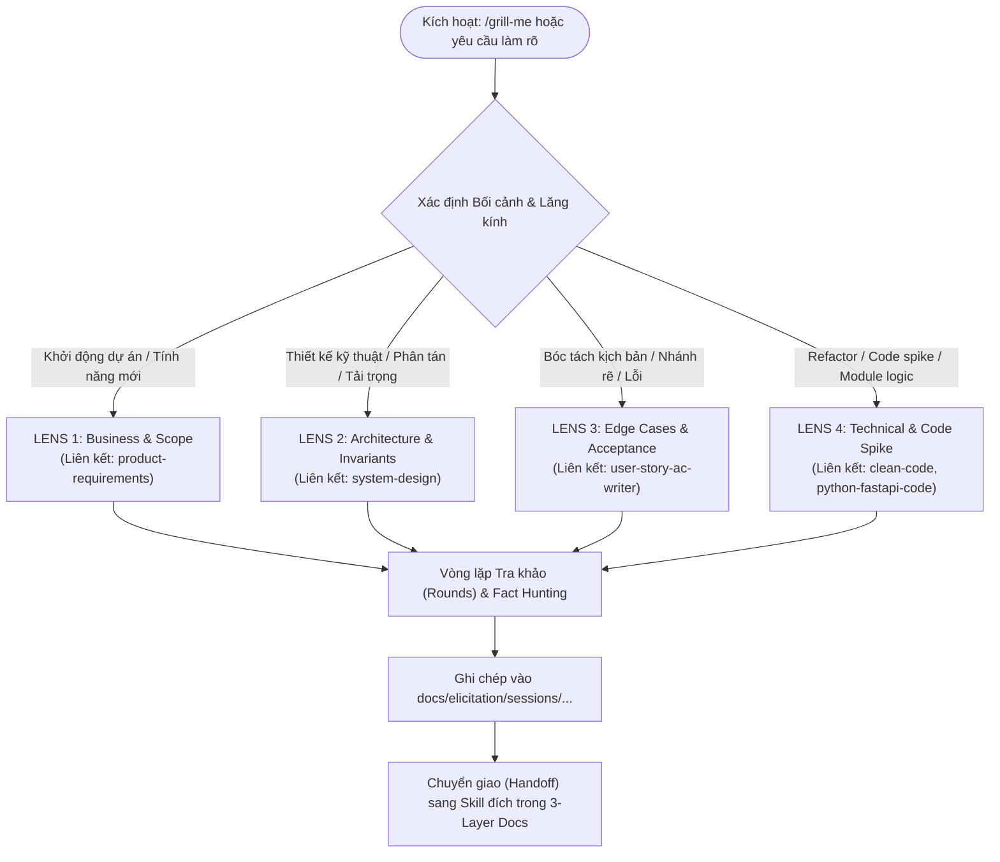
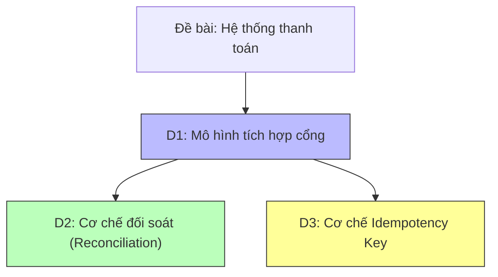

# Kế hoạch Hoàn thiện & Cá nhân hóa Skill Grilling (Elicitation Engine)

> **Mã kế hoạch:** PLAN-AI-GRILLING-01  
> **Vị trí lưu trữ:** `docs/ai/grilling-elicitation-plan.md`  
> **Trạng thái:** Bản thảo đề xuất (Draft for Review)  
> **Áp dụng cho:** Hệ sinh thái Kỹ năng Antigravity (`.agents/skills/`) & Kiến trúc Tài liệu 3 Tầng (`docs/`)

---

## 1. Hiện trạng & Đánh giá Skill Gốc (`mattpocock/grilling/SKILL.md`)

Bản skill gốc của Matt Pocock mang lại triết lý phỏng vấn làm rõ yêu cầu rất mạnh mẽ:
- **Design Tree (Cây quyết định):** Biểu diễn tư duy thành dạng cây, mọi quyết định rẽ nhánh thành các quyết định con phụ thuộc.
- **Frontier (Biên quyết định):** Chỉ phỏng vấn các câu hỏi mà tiền đề đã được giải quyết; không hỏi mò khi chưa có dữ liệu đầu vào của bước trước.
- **Vòng hỏi (Rounds) & "Yes-Accepts-Recommended":** Gom các câu hỏi tại frontier vào từng round, đánh số `Q1`, `Q2` kèm câu trả lời khuyến nghị để người dùng chỉ cần gõ "yes" là chấp thuận.
- **Fact-finding vs Decision-making:** Agent tự đi tìm sự thật (Facts) từ mã nguồn, tài liệu, công cụ; chỉ hỏi người dùng khi cần ra quyết định (Decisions/Trade-offs).

### Điểm yếu & Khoảng trống cần hoàn thiện:
1. **Thiếu cơ chế lưu trữ phiên làm việc (Session Persistence):** Hiện tại toàn bộ quá trình hỏi đáp chỉ diễn ra trên cửa sổ chat. Khi hội thoại dài hoặc bị nén ngữ cảnh (Context Compression), các quyết định đã chốt sẽ bị mất dấu, dẫn đến vi phạm nguyên tắc "No-re-ask".
2. **Chưa có cấu trúc thư mục/file `Elicitation`:** Người dùng yêu cầu lưu trữ các bản ghi hỏi đáp và kết quả vào thư mục/file có tên `Elicitation` để dễ dàng tra cứu, kiểm toán và tái sử dụng.
3. **Thiếu liên kết với các Kỹ năng trong Workspace:** Repo đang có hệ thống kỹ năng rất hoàn chỉnh (`product-requirements`, `system-design`, `user-story-ac-writer`, `documentation`, `clean-code`), nhưng skill gốc hoạt động cô lập, không biết kết quả sau khi grill xong sẽ bàn giao đi đâu.
4. **Thiếu phân hóa theo Lăng kính chuyên môn (Elicitation Lenses):** Câu hỏi phỏng vấn còn chung chung, chưa có ngân hàng câu hỏi mồi riêng biệt cho từng giai đoạn (Business BA, Kiến trúc Hệ thống, Bóc tách Edge Case của User Story, hay Kỹ thuật Code).
5. **Vị trí cài đặt:** Đang nằm ngoài `.agents/skills/`, chưa tuân thủ tiêu chuẩn đóng gói tự trị (Self-contained encapsulation) của workspace.

---

## 2. Mục tiêu & Định vị Sau Nâng cấp

Biến `grilling` thành **Master Elicitation & Grilling Engine (Agent-Safe & 3-Layer Edition)**:
1. **Tên gọi & Tương thích:** Giữ định danh skill là `grilling` (tận dụng tương thích trực tiếp với slash command `/grill-me` của Antigravity) và bổ sung alias / từ khóa kích hoạt cho `elicitation`, `tra khảo`, `làm rõ yêu cầu`.
2. **Cá nhân hóa sâu cho Workspace:**
   - Kết nối trực tiếp với Kiến trúc Tài liệu 3 Tầng (`docs/business/`, `docs/architecture/`, `docs/implementation/`).
   - Tự động đóng vai trò **Bộ kích hoạt đầu nguồn (Upstream Catalyst)** và **Bộ kiểm tra chuyên sâu (Inline Stress-Tester)** cho các skill khác.
3. **Chuẩn hóa Khu vực Lưu trữ `Elicitation`:**
   - Tạo thư mục `docs/elicitation/` (hoặc `Elicitation/` theo lựa chọn của người dùng) chứa:
     - `README.md`: Sổ cái theo dõi toàn bộ các phiên phỏng vấn (Index of Sessions).
     - `sessions/YYYY-MM-DD_<topic-slug>.md`: Bản ghi chi tiết của từng phiên tra khảo (Design tree, Q&A Rounds, Decisions Registry, Downstream Handoff).

---

## 3. Kiến trúc Thư mục Đóng gói Tự trị

Toàn bộ skill mới sẽ được thiết kế theo chuẩn tự trị (Self-contained) theo bài học từ [`tasks/lessons.md`](file:///E:/gemini/agent_setup/tasks/lessons.md):

```
E:\gemini\agent_setup\
├── .agents/skills/
│   └── grilling/
│       ├── SKILL.md                             # Orchestrator chính của skill
│       ├── assets/
│       │   └── elicitation-session-template.md  # Template mẫu cho file ghi chép phiên Elicitation
│       └── references/
│           ├── design-tree-protocol.md          # Thuật toán duyệt cây quyết định & tính Frontier
│           ├── elicitation-lenses.md            # Chi tiết 4 lăng kính tra khảo chuyên sâu
│           └── fact-hunting-protocol.md         # Quy chuẩn Agent tự quét tìm Fact trước khi hỏi
│
├── docs/
│   ├── ai/
│   │   └── grilling-elicitation-plan.md         # File kế hoạch hiện tại
│   └── elicitation/                             # Thư mục lưu kết quả tra khảo & hỏi đáp
│       ├── README.md                            # Sổ cái tổng hợp các phiên tra khảo
│       └── sessions/
│           └── YYYY-MM-DD_<topic-slug>.md       # Bản ghi từng phiên phỏng vấn cụ thể
│
└── mattpocock/grilling/
    └── SKILL.md                                 # Bản gốc đối chiếu (Upstream reference)
```

---

## 4. Bốn Lăng kính Tra khảo Chuyên sâu (4 Elicitation Lenses)

Khi bắt đầu một phiên phỏng vấn, Agent sẽ tự động nhận diện hoặc cho phép người dùng chọn 1 trong 4 Lăng kính (Lens):



### Lens 1: Business & Scope Elicitation (Phối hợp với `product-requirements`)
- **Ngữ cảnh:** Dự án mới (Greenfield) hoặc phát triển một tính năng lớn chưa có PRD.
- **Bộ câu hỏi khai phá:**
  - Mục tiêu kinh doanh cốt lõi (Core Business Value) & Nỗi đau của người dùng.
  - Ranh giới phạm vi: In-scope (Hệ thống làm gì) vs Out-of-scope (Hệ thống tuyệt đối không làm gì).
  - Actor chính và quyền hạn nghiệp vụ.
  - Chỉ số đo lường thành công (KPIs/Success Metrics) cụ thể, đo đếm được.
  - Phân kỳ phát hành: Đâu là phạm vi tối thiểu cho MVP?
- **Handoff:** Bàn giao sang `product-requirements` để hoàn thiện `docs/business/brd.md` và `docs/implementation/{release}/prd.md`.

### Lens 2: Architecture & Invariants Elicitation (Phối hợp với `system-design`)
- **Ngữ cảnh:** Thiết kế phân tán, tích hợp bên thứ ba, lựa chọn cơ sở dữ liệu, tối ưu hiệu năng.
- **Bộ câu hỏi khai phá:**
  - Ước lượng định lượng sơ bộ (BOTEC): DAU, QPS đọc/ghi trung bình & đỉnh, dung lượng lưu trữ 1-3 năm.
  - Đánh đổi CAP: Cần Strong Consistency (Tiền tệ, giao dịch) hay Eventual Consistency (Mạng xã hội, log)?
  - SLA/SLO về độ trễ (Latency P95/P99) và Độ sẵn sàng (High Availability).
  - Điểm chết đơn lẻ (Single Point of Failure - SPOF) và kịch bản sập nguồn/mạng.
  - Công nghệ mới: Giải quyết vấn đề gì (Solves), làm phức tạp thêm cái gì (Worsens), và khi nào phải thay đổi (Change it when)?
- **Handoff:** Bàn giao sang `system-design` để tạo ADR tại `docs/architecture/adr/` và cập nhật `docs/architecture/`.

### Lens 3: Edge Cases & Acceptance Criteria Elicitation (Phối hợp với `user-story-ac-writer`)
- **Ngữ cảnh:** Đã có PRD/Technical Design nhưng cần bóc tách User Story và viết AC không có lỗ hổng.
- **Bộ câu hỏi khai phá:**
  - Nhánh lỗi từ sơ đồ Sequence (`alt`/`opt` paths): Xử lý thế nào khi cổng thanh toán timeout hoặc trả mã lỗi không xác định?
  - Điều kiện biên (Boundary conditions): Số lượng tối thiểu/tối đa, giới hạn độ dài ký tự, rate limit theo IP/User.
  - Xung đột đồng thời (Race conditions): Hai người dùng cùng ấn nút mua chiếc vé cuối cùng tại cùng một giây.
  - Phân quyền & Bảo mật: Khi user bị thu hồi quyền giữa phiên làm việc thì UI và API phản ứng ra sao?
- **Handoff:** Bàn giao sang `user-story-ac-writer` để sinh backlog và kịch bản Gherkin chuẩn INVEST vào `docs/implementation/{release}/backlog/`.

### Lens 4: Technical & Code Spike Elicitation (Phối hợp với `clean-code` & `python-fastapi-code`)
- **Ngữ cảnh:** Chuẩn bị viết code, refactor module, hoặc tạo microservice mới.
- **Bộ câu hỏi khai phá:**
  - Thay đổi này có gây Breaking Change cho API cũ hay database migration không?
  - Cấu trúc module có tuân thủ Clean Architecture (Controller/Router $\rightarrow$ Service $\rightarrow$ Repository) không?
  - Chiến lược kiểm thử: Unit test mock những gì, Integration test kiểm thử luồng nào?
  - Dọn dẹp nợ kỹ thuật theo Boy Scout Rule: Có đoạn mã liền kề nào cần dọn dẹp không?
- **Handoff:** Bàn giao sang `clean-code`, cập nhật `tasks/todo.md` và tiến hành code an toàn.

---

## 5. Quy chuẩn Thiết kế File "Elicitation"

File ghi chép tại `docs/elicitation/sessions/{YYYY-MM-DD}_{topic-slug}.md` sẽ có cấu trúc 4 phần chuẩn hóa:

```markdown
# Elicitation Session: [Tên chủ đề / Tính năng]

- **Mã phiên:** ELICIT-20261010-01
- **Ngày thực hiện:** 2026-10-10
- **Lăng kính áp dụng:** [Business & Scope | Architecture | Edge Cases | Code Spike]
- **Trạng thái:** [Converged (Đã đồng thuận) | In-Progress]
- **Kỹ năng tiếp nhận:** [product-requirements | system-design | user-story-ac-writer | clean-code]

---

## 1. Cây quyết định & Biên câu hỏi (Design Tree & Frontier)


---

## 2. Nhật ký Vòng phỏng vấn (Q&A Rounds Transcript)

### Round 1: [Tên chủ đề vòng 1]
- **❓ Q1 - Cơ chế chống trùng lặp thanh toán (Idempotency):**
  Khách hàng có thể ấn 2 lần hoặc mạng chập chờn. Hệ thống nên dùng Idempotency Key ở tầng API Gateway hay Application Service?
  - ➡️ **Khuyến nghị:** Dùng Idempotency-Key header tại Application Service với Redis distributed lock (TTL 120s).
  - 💡 **Lý do & Đánh đổi:** Đảm bảo chính xác nghiệp vụ thanh toán; chấp nhận phụ thuộc thêm vào Redis.
  - 👤 **Phản hồi của User:** Yes.
  - 🎯 **Trạng thái:** Resolved (Chấp nhận khuyến nghị).

---

## 3. Sổ cái Quyết định đã Chốt (Decisions Registry)
| Mã QĐ | Vấn đề | Quyết định đã chốt | Lý do & Đánh đổi (Trade-off) | Ràng buộc bất biến (Guardrail) |
|---|---|---|---|---|
| DEC-01 | Idempotency | Redis distributed lock với header `Idempotency-Key` | Chấp nhận latency +2ms để triệt tiêu trừ tiền 2 lần | Khóa TTL = 120 giây |

---

## 4. Kế hoạch Bàn giao Hạ nguồn (Downstream Handoff)
- [ ] Chuyển giao sang `docs/architecture/adr/ADR-005-idempotency.md`
- [ ] Bổ sung trường hợp thử nghiệm cho `docs/implementation/release-1/backlog/US-003.md`
```

---

## 6. Quy trình Vận hành 5 Bước (The 5-Phase Operating Protocol)

1. **Bước 1: Khảo sát & Săn tìm Sự thật (Fact-Hunting First):**
   - Agent bắt buộc chạy lệnh đọc file (`view_file`), quét git, hoặc tra cứu tài liệu liên quan.
   - Tuyệt đối không hỏi người dùng những thông tin mà hệ thống đã ghi chép hoặc có thể tự suy luận từ mã nguồn.
2. **Bước 2: Dựng Cây quyết định & Tính toán Frontier:**
   - Xác định toàn bộ các nhánh rẽ cần quyết định.
   - Chỉ lọc ra các câu hỏi mà điều kiện tiên quyết đã có lời giải để đưa vào Frontier của Round hiện tại.
3. **Bước 3: Thực hiện Vòng hỏi (Frontier Interrogation):**
   - Đặt câu hỏi theo mẫu: Nêu rõ bối cảnh $\rightarrow$ Đưa ra phương án khuyến nghị sắc bén $\rightarrow$ Giải thích lý do & đánh đổi.
   - Câu hỏi được tối ưu để câu trả lời "yes" là chốt luôn giải pháp tốt nhất.
   - Kết hợp sử dụng công cụ UI `ask_question` khi câu hỏi có nhiều phương án lựa chọn phức tạp.
4. **Bước 4: Cập nhật File Elicitation & Thu hẹp Cây quyết định:**
   - Lưu vết ngay lập tức vào file `docs/elicitation/sessions/...`.
   - Recompute frontier cho Round kế tiếp.
5. **Bước 5: Bàn giao Hạ nguồn (Downstream Handoff):**
   - Khi Frontier trống và người dùng xác nhận đạt được "Đồng thuận chung (Shared Understanding)", Agent đóng phiên phỏng vấn và tự động cập nhật vào các tầng tài liệu tương ứng (`docs/business/`, `docs/architecture/`, `docs/implementation/`).

---

## 7. Các Bước Triển khai Cụ thể (Action Items)

Sau khi nhận được sự đồng thuận của bạn về kế hoạch này, các bước thực hiện tiếp theo sẽ bao gồm:

| Bước | Hạng mục thực hiện | Vị trí file | Kết quả bàn giao |
|---|---|---|---|
| **1** | Khởi tạo Thư mục & Sổ cái Elicitation | `docs/elicitation/README.md` | Chỉ mục phiên phỏng vấn sẵn sàng ghi chép |
| **2** | Tạo Template Phiên Elicitation | `.agents/skills/grilling/assets/elicitation-session-template.md` | Template chuẩn cho các phiên phỏng vấn |
| **3** | Xây dựng 3 Tài liệu Tham chiếu | `.agents/skills/grilling/references/` | `design-tree-protocol.md`, `elicitation-lenses.md`, `fact-hunting-protocol.md` |
| **4** | Biên soạn Master Orchestrator | `.agents/skills/grilling/SKILL.md` | Hướng dẫn vận hành skill hoàn chỉnh, kết nối hệ sinh thái |
| **5** | Kiểm tra Liên kết & Đồng bộ Tiến độ | `tasks/todo.md`, `tasks/lessons.md` | Đảm bảo 100% liên kết hợp lệ, không lỗi đường dẫn |

---

## 8. Các Điểm cần Thống nhất với Bạn (Clarification Points)

1. **Vị trí thư mục Elicitation:** Bạn có đồng ý đặt tại `docs/elicitation/` (để đồng nhất với toàn bộ tài liệu dự án trong `docs/`) hay bạn muốn đặt trực tiếp tại `Elicitation/` ở thư mục gốc workspace?
2. **Tên gọi của Skill:** Chúng ta sẽ đặt tên thư mục skill là `.agents/skills/grilling/` (để hoàn toàn tương thích với slash command mặc định `/grill-me`), với mô tả bao hàm cả Elicitation, Tra khảo, Khảo sát yêu cầu. Bạn có tán thành hướng này không?
