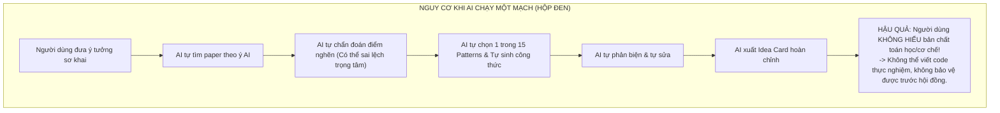
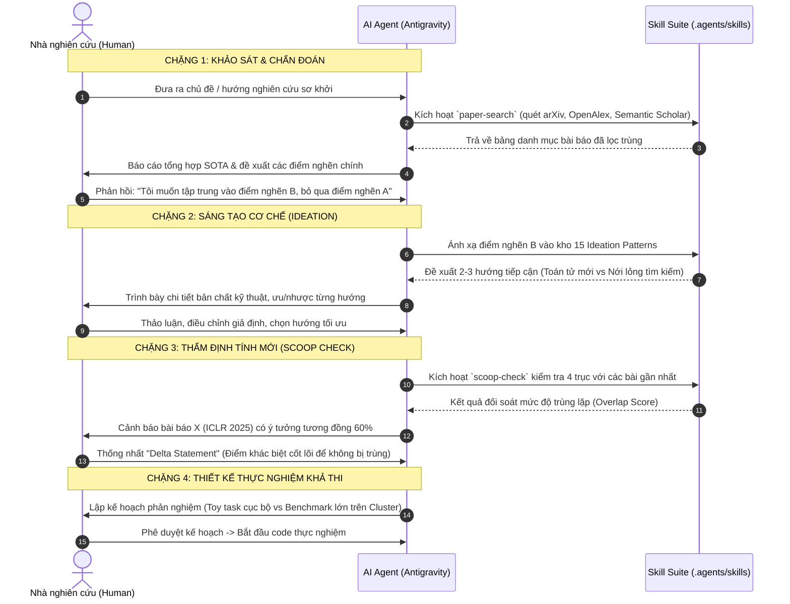
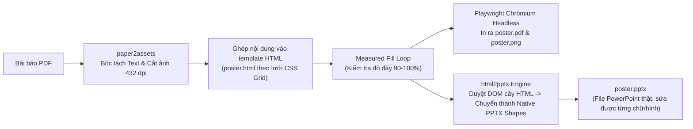
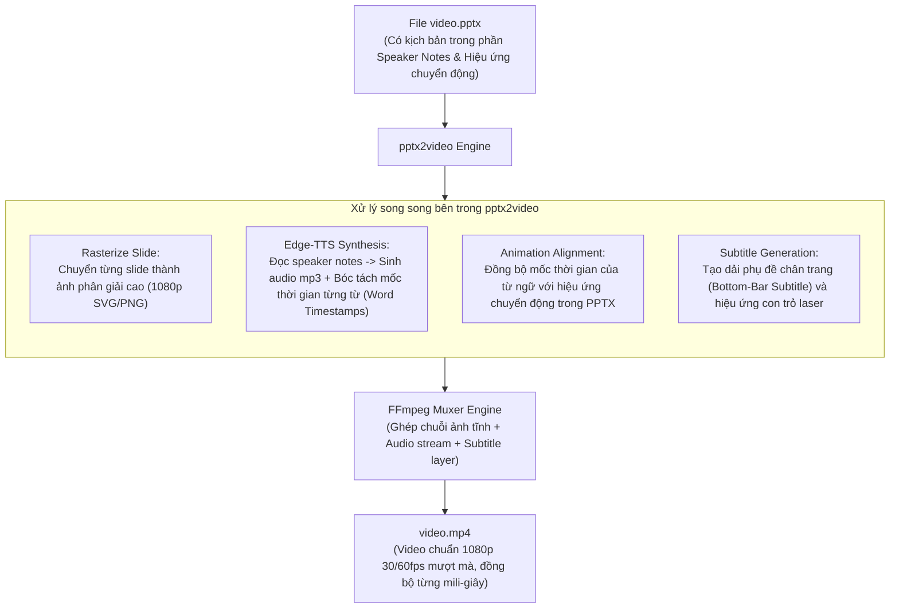

# BÁO CÁO PHÂN TÍCH: KIẾN TRÚC CỘNG TÁC HUMAN-IN-THE-LOOP, ĐIỀU KIỆN MÔI TRƯỜNG VÀ BẢN CHẤT KỸ THUẬT CỦA RESEARCHSTUDIO

> **Người yêu cầu:** Nhà nghiên cứu / Kỹ sư R&D  
> **Người thực hiện:** Antigravity AI Assistant  
> **Vị trí tài liệu:** `docs/ai/human-in-the-loop-research-framework-analysis.md`  
> **Mục tiêu:**  
> 1. Phân tích và khắc phục nhược điểm "chạy một mạch loại bỏ con người" (autonomous runaway) của ResearchStudio gốc; thiết lập quy trình **Human-in-the-Loop (HITL)** cộng tác từng bước.  
> 2. Phân tích chi tiết yêu cầu môi trường: Sự cô lập trong `.venv`, khả năng chạy trên laptop thông thường (CPU/GPU onboard, Apple Silicon) và ranh giới với phần cứng thực nghiệm (GPU cluster).  
> 3. Bóc tách bản chất kỹ thuật bên dưới của công nghệ sinh ấn phẩm (Poster, PPTX, Video walkthrough).  
> 4. Bản thiết kế cấu trúc kỹ năng dạng module chuẩn hóa (tương tự `cs-research-skills`) cho thư mục `.agents/skills/`.

---

## 1. VẤN ĐỀ CỐT LÕI: "CHẠY MỘT MẠCH" (AUTONOMOUS RUNAWAY) VÀ NGUY CƠ LOẠI BỎ CON NGƯỜI

### 1.1. Thực trạng thiết kế của ResearchStudio gốc

Trong mã nguồn gốc của Microsoft Research, `ResearchStudio-Idea` được vận hành bằng một máy trạng thái (state machine) thông qua lệnh `scripts/run.py next`. Trong tài liệu hướng dẫn (`host-runbook.md`), tác giả đưa ra quy tắc rất cứng nhắc:
> *"No mid-flow questions: infer missing intake fields honestly within the user's scope."* (Không hỏi người dùng giữa chừng: tự suy luận các trường thiếu).

Mục đích ban đầu của Microsoft là để thực hiện benchmark tự động trên 100 đề tài ICLR (như trong bài báo của họ). Tuy nhiên, **khi áp dụng vào nghiên cứu khoa học thực tế của một cá nhân hay nhóm nghiên cứu, thiết kế này bộc lộ những nhược điểm chí mạng**:



### 1.2. Tại sao nghiên cứu khoa học BẮT BUỘC phải có Human-in-the-Loop?

Như bạn đã chỉ ra một cách cực kỳ chính xác:
1. **Sự đứt gãy giữa Ý tưởng và Thực nghiệm (The Experiment Disconnect):**
   - Không có mô hình AI nào có thể "tự chạy một mạch" ra kết quả thực nghiệm của một bài báo đỉnh cao trên máy laptop cá nhân.
   - Các bài toán AI/ML lớn (huấn luyện LLM, khuếch tán hình ảnh/video, học biểu diễn đồ thị hàng trăm triệu nút, mô phỏng sinh học) đòi hỏi cụm máy chủ GPU (GPU Clusters, Slurm, RunPod, Modal, Google Cloud TPU).
   - Nếu ở giai đoạn đầu (chẩn đoán điểm nghẽn, đề xuất cơ chế) người dùng bị gạt ra ngoài, thì người dùng sẽ **hoàn toàn mù tịt về mặt phương pháp**. Khi đó, làm sao người dùng có thể viết mã nguồn thực nghiệm, thiết lập hàm loss, debug hiện tượng gradient vanishing/exploding, hay phân tích lỗi (ablation studies) trên máy chủ?
2. **Quyền tác giả và Trách nhiệm khoa học (Scientific Agency & Accountability):**
   - Người đứng tên bài báo và chịu trách nhiệm trước cộng đồng học thuật là con người.
   - Ý tưởng khoa học giá trị nhất thường đến từ **sự tương tác biện chứng**: AI gợi ý mẫu hình từ 1,947 bài báo thành công, con người dựa trên trực giác chuyên gia và kiến thức miền (domain expertise) để gạn lọc, phản biện, điều chỉnh hướng đi.
3. **Bài toán tài nguyên cục bộ (Local Resource Constraint):**
   - Laptop cá nhân (kể cả máy cấu hình mạnh) chỉ đóng vai trò là "Trạm chỉ huy" (Command Station) và môi trường phát triển mã nguồn thử nghiệm mẫu nhỏ (toy experiment / prototyping). Toàn bộ khối lượng tính toán lớn phải được lên kế hoạch để điều phối ra ngoài.

### 1.3. Mô hình Cộng tác Từng bước: Human-in-the-Loop Co-Scientist Framework

Khi trích xuất các kỹ năng từ ResearchStudio sang kho kỹ năng tác nhân, chúng ta **tuyệt đối không bê nguyên xi vòng lặp tự động đóng kín**. Thay vào đó, chúng ta chia tách thành từng kỹ năng module độc lập có **Điểm dừng phê duyệt (Human Review & Approval Gate)**:



Mỗi chặng kết thúc bằng việc ghi nhận một tài liệu Markdown vào `docs/ai/` (ví dụ: `docs/ai/01-literature-sota.md`, `docs/ai/02-bottleneck-selection.md`, `docs/ai/03-novelty-defense.md`), đảm bảo bạn luôn làm chủ 100% dòng tư duy của dự án.

---

## 2. PHÂN TÍCH YÊU CẦU MÔI TRƯỜNG, THƯ VIỆN VÀ PHẦN CỨNG

### 2.1. Laptop thông thường có chạy được các script này hay không?

> **KẾT LUẬN NGẮN GỌN: CHẠY ĐƯỢC 100% TRÊN LAPTOP THÔNG THƯỜNG!**  
> Máy chỉ có CPU, GPU onboard (Intel Iris Xe, AMD Radeon Graphics), hoặc chip Apple Silicon (MacBook Air/Pro M1/M2/M3/M4) **hoàn toàn chạy mượt mà tất cả các script của ResearchStudio**. Bạn KHÔNG CẦN GPU NVIDIA rời trên máy cá nhân để chạy bộ công cụ này.

#### Tại sao không cần GPU rời trên máy tính cá nhân?
Bản chất của các script trong `ResearchStudio` thuộc tầng **Điều phối tác nhân (Meta-Agent Orchestration & Document Processing)**, không phải tầng huấn luyện mô hình (Model Training):
1. **Phần suy luận LLM:** Hoàn toàn chạy qua **API trên Cloud** (Gemini, Claude, GPT), tiêu tốn tài nguyên mạng (HTTP/REST API) chứ không dùng GPU của máy tính.
2. **Phần tìm kiếm tài liệu:** Là các hàm gọi API HTTP tới arXiv, Semantic Scholar, OpenAlex, DBLP.
3. **Phần bóc tách PDF:** Dùng thư viện CPU (`pymupdf`, `pdftotext`, `beautifulsoup4`) để đọc text và cắt ảnh.
4. **Phần tạo Poster và Slide:** Dùng trình duyệt không giao diện (Headless Chromium) và thư viện tạo XML/OOXML (`python-pptx`), chạy 100% bằng CPU và RAM.
5. **Phần lồng tiếng Audio:** Gọi API Edge-TTS của Microsoft trên Cloud và tải file `.mp3` về.
6. **Phần ghép Video:** Dùng `ffmpeg` ghép ảnh tĩnh với âm thanh, đây là tác vụ encode nhẹ mà CPU hiện đại xử lý trong vài chục giây đến vài phút.

#### Phân định ranh giới phần cứng:
- **Laptop cá nhân (CPU / GPU onboard):** Đảm nhận toàn bộ chu trình ResearchStudio (Tìm tài liệu, sinh ý tưởng, kiểm tra trùng lặp, viết mã nguồn thử nghiệm mẫu nhỏ, tạo poster, tạo video, viết blog).
- **GPU Server / Cluster / Cloud (NVIDIA A100/H100/V100/RTX 4090):** Chỉ cần đến khi bạn bước vào giai đoạn **huấn luyện mô hình thực tế** của đề tài (ví dụ: chạy trên Slurm của trường/viện, hoặc các dịch vụ đám mây linh hoạt như Modal, RunPod, Google Colab Pro).

---

### 2.2. Vấn đề cô lập môi trường: Cài đặt vào `.venv` hay System Environment?

Bạn đã đặt ra một câu hỏi rất chuẩn xác về tính toàn vẹn của hệ thống: *Có bắt buộc cài vào system environment hay có thể đóng gói 100% vào môi trường ảo `.venv` hoặc `node_modules` của repo?*

Tuân thủ nghiêm ngặt nguyên tắc **Environment Isolation** trong [AGENTS.md](file:///E:/gemini/agent_setup/AGENTS.md):
> *"NEVER install packages, dependencies, or toolchains into the global system environment... All installations and executions MUST stay scoped to the current workspace."*

Dưới đây là ma trận phân tích nguồn gốc của tất cả các thư viện trong ResearchStudio và cách cô lập chúng:

| Nhóm công cụ | Các thư viện cụ thể | Cài trong `.venv` / Local được không? | Cơ chế thực thi cô lập an toàn |
| :--- | :--- | :---: | :--- |
| **Python Packages (Trọng số 85%)** | `feedparser`, `openreview-py`, `beautifulsoup4`, `pymupdf`, `scholarly`, `requests`, `python-docx`, `python-pptx`, `pillow`, `qrcode`, `playwright`, `edge-tts`, `numpy` | **HOÀN TOÀN ĐƯỢC (100%)** | Cài trực tiếp vào `.venv` cục bộ thông qua: `uv pip install <package>` hoặc `pip install <package>`. Tuyệt đối không chạm vào Python toàn cục. |
| **Trình duyệt render (Playwright Chromium)** | Trình duyệt Chromium không đầu (Headless Browser ~110MB) | **HOÀN TOÀN ĐƯỢC (100%)** | Cài đặt cục bộ qua lệnh: `uv run python -m playwright install chromium`. Playwright tự lưu binary vào thư mục cache của user/môi trường ảo, không thay đổi trình duyệt Chrome mặc định của máy. |
| **Trình xử lý đa phương tiện (FFmpeg)** | Binary `ffmpeg` và `ffprobe` | **CÔ LẬP ĐƯỢC** | **Phương án 1 (Khuyến nghị):** Dùng thư viện Python `imageio-ffmpeg` (nằm gọn trong `.venv`), thư viện này tự tải binary FFmpeg độc lập.<br>**Phương án 2:** Đặt file `ffmpeg.exe` portable vào thư mục `bin/` nội bộ của repo. |
| **Trình bóc tách PDF (Poppler `pdftotext`)** | `pdftotext` (cắt layout văn bản PDF) | **CÔ LẬP ĐƯỢC** | **Phương án 1 (Tối ưu nhất):** Thay thế đoạn gọi `pdftotext` bằng thư viện Python thuần `pymupdf` (FitZ) hoặc `pdfplumber` (cả hai đều nằm trong `.venv`).<br>**Phương án 2:** Tải bản Poppler binary portable đặt vào `bin/poppler/` nội bộ. |
| **Trình kiểm tra Slide (LibreOffice)** | `soffice` / `libreoffice-impress` | **KHÔNG BẮT BUỘC** | Trong `html2pptx`, LibreOffice chỉ dùng để convert PPTX sang PDF để chạy vision diff kiểm tra mắt. Trong môi trường làm việc thực tế, người dùng mở trực tiếp file `.pptx` bằng Microsoft PowerPoint trên Windows/Mac nên **hoàn toàn có thể bỏ qua** công cụ này. |
| **Trình biên dịch LaTeX (Tectonic / XeLaTeX)** | Dùng để render Idea Card từ `.tex` ra `.pdf` | **KHÔNG BẮT BUỘC** | Idea Card được xuất ra file Markdown chuẩn (`idea.std.md`). Nếu muốn xuất PDF, ta dùng Playwright in HTML ra PDF nhẹ nhàng, **không cần cài bộ TeXLive hàng chục GB vào hệ điều hành**. |

---

## 3. GIẢI MÃ BẢN CHẤT KỸ THUẬT: ẤN PHẨM HỘI NGHỊ ĐƯỢC TẠO RA NHƯ THẾ NÀO?

Bạn có thắc mắc: *"Phần làm ấn phẩm hội nghị tôi thấy là kiểu lấy nội dung PDF sau đó gen HTML animation rồi chạy trình duyệt web quay lại sau đó ghép thành video phải không?"*

Dưới đây là cơ chế bóc tách kỹ thuật thực tế bên dưới của từng ấn phẩm:

### 3.1. Cơ chế tạo Poster Hội nghị (`paper2poster`)

Quy trình này **đúng như suy đoán của bạn một phần**, nhưng có thêm bước chuyển đổi cấu trúc cực kỳ thông minh:



- **Điểm đột phá của `html2pptx`:** Nó không chụp ảnh màn hình dán vào slide! Nó dùng Chromium duyệt qua DOM của file HTML, đọc tọa độ `getBoundingClientRect()` của từng thẻ `<div>`, `<p>`, ``, sau đó dùng thư viện `python-pptx` vẽ lại chính xác thành các Text Box, khối hình học và chèn ảnh vector vào slide PowerPoint. Nhờ đó, bạn mở file `poster.pptx` lên và có thể click chuột vào chỉnh sửa nội dung y như tự tay thiết kế trên PowerPoint!

### 3.2. Cơ chế tạo Video Thuyết trình (`paper2video`)

Quy trình tạo video **KHÔNG PHẢI là quay màn hình trình duyệt (Screen Recording)**. 

Nếu quay màn hình trình duyệt, video sẽ dễ bị giật lag, phụ thuộc vào tốc độ máy tính, độ phân giải không chuẩn và không thể kiểm soát chính xác từng mili-giây hiệu ứng. Thay vào đó, nó hoạt động như sau:



- **Tại sao cách làm này tối ưu?**
  1. Chạy hoàn toàn ngầm (headless), không cần mở màn hình lên để quay.
  2. Thời gian tạo video cực nhanh (vài chục giây đến vài phút).
  3. Tiết kiệm tài nguyên: Chạy mượt mà trên bất kỳ laptop thông thường nào mà không làm nóng máy hay giật lag.

---

## 4. BẢN THIẾT KẾ CẤU TRÚC KỸ NĂNG CỘNG TÁC CHO REPO NCKH

Để đáp ứng trọn vẹn yêu cầu của bạn:
- Tổ chức dạng thư mục chuẩn hóa tương tự như `cs-research-skills`.
- Đặt vào thư mục `.agents/skills/` của repo NCKH.
- Vận hành theo mô hình **Cộng tác từng phần (Step-by-step Collaboration)**, mỗi bước đều có thảo luận và quyết định của người dùng.

Dưới đây là cấu trúc 6 kỹ năng tinh gọn được thiết kế riêng:

```
my-nckh-repo/
├── .agents/
│   └── skills/
│       │
│       │── # NHÓM 1: KHỞI TẠO Ý TƯỞNG & ĐỐI SOÁT TÍNH MỚI (HITL IDEATION)
│       ├── rs-paper-search/              # Tìm kiếm tài liệu đa nguồn (arXiv, OpenAlex, Semantic Scholar)
│       │   ├── SKILL.md                  # Hướng dẫn Agent cách tìm, gom nhóm, lọc trùng
│       │   └── scripts/search_papers.py  # Script Python chạy độc lập trong .venv
│       │
│       ├── rs-bottleneck-diagnosis/      # Chẩn đoán điểm nghẽn thực chất của các bài báo SOTA
│       │   ├── SKILL.md                  # Quy trình bóc tách điểm nghẽn & ĐẶT CÂU HỎI cho người dùng
│       │   └── references/rubrics.md     # Bộ tiêu chí phân định điểm nghẽn thật vs điểm nghẽn giả
│       │
│       ├── rs-pattern-ideator/           # Ánh xạ điểm nghẽn vào kho 15 Ideation Patterns
│       │   ├── SKILL.md                  # Quy trình đề xuất 2-3 phương án cơ chế giải pháp
│       │   └── references/patterns/      # Toàn bộ 15 mẫu hình sáng tạo từ 1,947 bài báo ICLR/NeurIPS
│       │
│       ├── rs-scoop-check/               # Rà soát nguy cơ bị trùng lặp ý tưởng qua 4 trục
│       │   ├── SKILL.md                  # Phân rã 4 trục & so sánh với các công trình gần nhất
│       │   └── scripts/check_overlap.py  # Thuật toán so sánh đối chiếu văn bản
│       │
│       │── # NHÓM 2: TỰ ĐỘNG HÓA ẤN PHẨM CÔNG BỐ (POST-PAPER OUTREACH)
│       ├── rs-paper2assets/              # Trích xuất PDF thành tài nguyên sạch dùng chung
│       │   ├── SKILL.md                  # Hướng dẫn bóc tách text, cắt ảnh độ phân giải cao
│       │   └── scripts/extract.py        # Dùng pymupdf thuần trong .venv
│       │
│       └── rs-paper2poster/              # Tạo Poster HTML + In PDF + Xuất PowerPoint có thể sửa
│           ├── SKILL.md                  # Vòng lặp canh lề tự động & xuất file
│           ├── scripts/render_poster.py  # Dùng Playwright cục bộ
│           └── html2pptx/                # Chuyển đổi sang native shapes của PowerPoint
│
├── docs/ai/                              # Sổ tay ghi chép tiến trình nghiên cứu (Human & AI cùng duyệt)
│   ├── 01-literature-survey.md           # Kết quả tìm kiếm và chọn lọc bài báo
│   ├── 02-bottleneck-and-direction.md    # Thảo luận và chốt điểm nghẽn cần giải quyết
│   ├── 03-proposed-mechanism.md          # Cơ chế thuật toán/mô hình được người dùng phê duyệt
│   └── 04-novelty-and-delta.md           # Khẳng định tính mới và kế hoạch thực nghiệm
│
├── .venv/                                # Môi trường ảo Python cô lập hoàn toàn cho dự án
└── pyproject.toml                        # Khai báo các thư viện cần thiết
```

---

## 5. BẢNG KHAI BÁO DEPENDENCY CHUẨN TRONG `pyproject.toml`

Để đảm bảo không có bất kỳ thư viện nào bị cài vào hệ thống chung, toàn bộ gói cần thiết cho các kỹ năng trên được gom gọn trong file `pyproject.toml` của repo nghiên cứu:

```toml
[project]
name = "nckh-workspace"
version = "0.1.0"
description = "Môi trường nghiên cứu khoa học cộng tác với AI Agent"
readme = "README.md"
requires-python = ">=3.10"
dependencies = [
    # Nhóm tìm kiếm & bóc tách tài liệu
    "feedparser>=6.0.12",
    "openreview-py>=2.2.3",
    "beautifulsoup4>=4.13.0",
    "pymupdf>=1.26.0",
    "scholarly>=1.7.11",
    "requests>=2.31.0",
    
    # Nhóm tạo ấn phẩm, poster & slide
    "python-docx>=1.1.2",
    "python-pptx>=0.6.23",
    "pillow>=10.0.0",
    "qrcode>=7.4.2",
    "playwright>=1.40.0",
    "edge-tts>=7.2.8",
    "imageio-ffmpeg>=0.5.1",
]

[tool.uv]
dev-dependencies = [
    "pytest>=8.0.0",
]
```

Chỉ cần một lệnh duy nhất:
```powershell
uv sync
uv run python -m playwright install chromium
```
Toàn bộ môi trường đã sẵn sàng hoạt động mà **không làm ô nhiễm bất kỳ biến môi trường nào của Windows hay macOS**.

---

## 6. QUY TẮC CỘNG TÁC (COLLABORATION PROTOCOL) DÀNH CHO AGENT

Khi bạn kích hoạt các kỹ năng này trong một phiên làm việc, Agent (tôi) bắt buộc phải tuân theo giao thức làm việc cộng tác sau:

1. **Nguyên tắc "Không đốt cháy giai đoạn" (No Premature Advance):**  
   Agent không được tự tiện chuyển từ khâu tìm kiếm sang khâu chốt cơ chế giải pháp nếu chưa nhận được xác nhận từ người dùng.
2. **Nguyên tắc "Bạch minh hóa công thức" (Transparent Reasoning):**  
   Mọi đề xuất cơ chế mới phải được giải thích rõ: Dựa trên giả định nào? Thuật toán hoạt động ra sao? Khác với SOTA ở phương trình/toán tử nào?
3. **Nguyên tắc "Thực nghiệm gắn liền với tài nguyên khả thi":**  
   Mọi thiết kế thí nghiệm phải chia làm 2 tầng rõ ràng:
   - *Tầng 1 (Local Verification):* Chạy trên máy tính cá nhân (tập dữ liệu thu nhỏ, vài trăm mẫu, kiểm tra logic code không bị crash).
   - *Tầng 2 (Full Benchmark):* Đóng gói mã nguồn (Docker / Script độc lập) sẵn sàng để người dùng đẩy lên cụm máy chủ GPU.

---

*(Bản báo cáo này đã được lưu trữ an toàn trong `docs/ai/human-in-the-loop-research-framework-analysis.md` để làm kim chỉ nam triển khai cho các dự án NCKH của bạn).*
