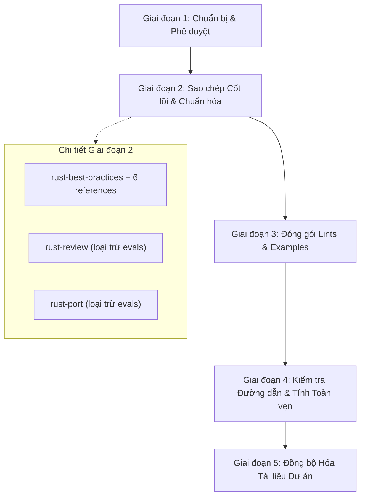

# Kế hoạch Tích hợp Bộ Kỹ năng Rust Cốt lõi (BeautifulRust) vào `.agents/skills/`

> **Tài liệu Kế hoạch Kỹ thuật**  
> **Vị trí lưu trữ**: `docs/ai/ke-hoach-tich-hop-beautiful-rust-skills.md`  
> **Ngày lập**: 2026-10-28  
> **Trạng thái**: Chờ phê duyệt (Pending Review & Decision)  
> **Nguồn trích xuất**: Thư mục nội bộ `BeautifulRust/` (Tác giả: Morgan Linton / BeautifulRust)  
> **Tuân thủ quy định**: `@AGENTS.md` (Caution Over Speed, Simplicity First, Surgical Changes, Lưu trữ `docs/ai/`)

---

## 1. Tổng quan & Bối cảnh (Context & Objectives)

### 1.1. Hiện trạng hệ thống kỹ năng `.agents/skills/`
Hệ sinh thái `.agents/skills/` của dự án hiện đã bao phủ mạnh mẽ các mảng:
- **Kiến trúc & Quy chuẩn**: `clean-code`, `system-design`, `documentation`, `api-design-patterns`, `product-requirements`, `user-story-ac-writer`.
- **Ngôn ngữ & Framework backend**: `python-fastapi-code`, `fastapi-backend-scaffold`, `agent-harness`, `langchain-skills`, `rag-architect`.
- **Hệ thống nhúng & Tăng tốc phần cứng**: `stm32-embedded-workflow`, `nvidia-cuda`.
- **Thiết kế giao diện & Đồ họa**: `ui-ux-pro-max`, `ui-styling`, `3dviz-pro-max`, `html`, `diagram-design`, `slides`.

Tuy nhiên, hệ thống **hoàn toàn chưa có bộ kỹ năng chuyên sâu và chuẩn hóa dành riêng cho ngôn ngữ Rust** — một ngôn ngữ đòi hỏi các ràng buộc nghiêm ngặt về quyền sở hữu (ownership), vòng đời (lifetimes), an toàn bộ nhớ (memory safety/soundness), thiết kế API chuẩn mực và quy tắc xử lý lỗi không khoan nhượng.

### 1.2. Giá trị của repository `BeautifulRust`
`BeautifulRust` là một bộ kỹ năng cao cấp tuân thủ chuẩn mở **Agent Skills**, được đúc kết từ 5 cẩm nang kỹ thuật hàng đầu thế giới trong cộng đồng Rust:
1. **Google Rust Style Guide**: Quy chuẩn trình bày mã nguồn và tổ chức crate của Google.
2. **Rust API Guidelines**: Bộ checklist chính thức từ đội ngũ cốt lõi của Rust (`rust-lang`).
3. **Effective Rust** (David Drysdale): Kỹ năng tư duy idiom, thiết kế type-state, tối ưu hoá bộ nhớ.
4. **Rust Design Patterns**: Các kiến trúc mẫu và phòng chống anti-patterns trong Rust.
5. **Microsoft Pragmatic Rust Guidelines**: Hướng dẫn thực dụng từ các dự án quy mô lớn của Microsoft.

Đặc biệt, bộ kỹ năng này đã giải quyết triệt để các xung đột quan điểm giữa các cẩm nang, cung cấp các giải pháp dứt khoát kèm lý do kỹ thuật rõ ràng, đồng thời tích hợp sẵn cẩm nang chuyên biệt cho **Bevy Game Engine (ECS 0.20)** — ngăn chặn các lỗi runtime panic B0001 kinh điển.

---

## 2. Phân tích Các Thành phần trong `BeautifulRust`

Dưới đây là kết quả rà soát chi tiết cấu trúc repository `BeautifulRust`:

```text
BeautifulRust/
├── .claude-plugin/              # Manifest plugin cho Claude Code (metadata, icon)
├── assets/                      # Ảnh banner đồ họa
├── benchmarks/                  # Dữ liệu đối sánh hiệu năng
├── examples/                    # Ví dụ thực tế: review-inventory.md
├── lints/                       # Cấu hình Clippy CI drop-in
│   ├── check/                   # Crate test vi phạm lints
│   ├── clippy.toml              # Quy định Clippy nghiêm ngặt
│   └── lints.toml               # Bảng lints [lints.rust] và [lints.clippy]
├── scripts/                     # Scripts kiểm tra: check-skill.py, check-lints.sh
├── skills/                      # 3 SKILLS CỐT LÕI
│   ├── rust-best-practices/     # Kỹ năng viết và tái cấu trúc Rust chuẩn mực
│   │   ├── SKILL.md             # Chỉ dẫn cốt lõi (511 dòng)
│   │   ├── references/          # 6 cẩm nang rút gọn (bevy, effective-rust, google, microsoft, api, patterns)
│   │   └── evals/               # 4 bộ test benchmark (122 files)
│   ├── rust-review/             # Kỹ năng rà soát mã nguồn Rust & pull requests
│   │   ├── SKILL.md             # Quy trình review 3 cấp độ (177 dòng)
│   │   └── evals/               # 2 bộ test benchmark
│   └── rust-port/               # Kỹ năng chuyển đổi mã nguồn từ C/C++, Python, Go, JS sang Rust
│       ├── SKILL.md             # Phương pháp test-first porting (144 dòng)
│       └── evals/               # 2 bộ test benchmark
├── tests/                       # Unit tests kiểm thử nội bộ repo
└── README.md                    # Tài liệu hướng dẫn sử dụng chi tiết
```

### 2.1. Bộ ba Skill cốt lõi (The Core Skill Trio)

| Tên Skill | Mục tiêu & Phạm vi sử dụng | Kích hoạt (Triggers) | Tài nguyên phụ thuộc |
| :--- | :--- | :--- | :--- |
| **`rust-best-practices`** | Viết mã mới, tái cấu trúc, thiết kế API, xử lý ownership/lifetimes, async, unsafe/soundness, typesystem, testing và rustdoc. | Từ khóa: `Rust`, `cargo`, `crates`, `.rs`, `borrow checker`, `lifetimes`, `traits`, `clippy`, `rustfmt`. | Kèm thư mục `references/` gồm 6 file markdown chuyên sâu. |
| **`rust-review`** | Kiểm tra, audit mã nguồn Rust hiện có, file `.rs`, crate hoặc Git Diff; xuất báo cáo 3 cấp độ (*Must fix*, *Should fix*, *Consider*) chỉ rõ `file:line`, mã quy tắc vi phạm và diff sửa đổi tối giản. | Từ khóa: `review`, `audit`, `critique`, `check Rust code`, `what is wrong with my Rust`, `make it more idiomatic`. | Tham chiếu sang `rust-best-practices` và `references/bevy.md`. |
| **`rust-port`** | Chuyển đổi mã nguồn từ C, C++, Python, Go, JavaScript, TypeScript sang Rust; phương pháp tiếp cận: chuyển đổi test trước (*test-first*), giữ nguyên hành vi quan sát được (*observable behavior*), không dịch thô ngữ pháp (*transliteration*). | Từ khóa: `port`, `translate`, `convert`, `migrate`, `rewrite in Rust`, `what would this look like in Rust`. | Tham chiếu sang quy tắc phong cách của `rust-best-practices`. |

### 2.2. Các tài nguyên giá trị đi kèm
1. **Bộ cấu hình Lints (`lints/`)**:
   - `lints.toml`: Khai báo bảng `[lints.rust]` và `[lints.clippy]` chuẩn mực, cấm `unwrap()` bừa bãi, bắt buộc giải trình `#[expect]`, cấm `unsafe` thiếu `// SAFETY:`, cảnh báo `bool` parameter lạm dụng, ép kiểm tra overflow.
   - `clippy.toml`: Giới hạn `max-fn-params-bools = 0`, cấu hình kiểm tra test.
2. **Ví dụ mẫu Báo cáo Review (`examples/review-inventory.md`)**:
   - Mẫu báo cáo đánh giá thực tế một module Rust bị lỗi kiến trúc, minh họa trực quan phong cách output của `rust-review`.
3. **Công cụ xác minh tính toàn vẹn (`scripts/check-skill.py`)**:
   - Script Python độc lập (chỉ dùng stdlib) kiểm tra YAML frontmatter, kích thước token/lines, các broken links và references.

---

## 3. Đánh giá Kiến trúc & Phương án Đưa vào `.agents/skills/`

Theo triết lý trong `@AGENTS.md` (**Caution Over Speed**, **Simplicity First**, **Surgical Changes**), chúng ta cần xác định rõ ràng các phương án kiến trúc và phân tích sự đánh đổi (tradeoffs).

### 3.1. Quyết định 1: Cấu trúc kỹ năng (Tách rời 3 Skills vs Gom thành 1 Master Skill)

- **Phương án A (Khuyến nghị - Tách 3 Skill Độc lập)**:
  - Đưa 3 thư mục `rust-best-practices`, `rust-review`, `rust-port` trực tiếp vào `.agents/skills/`.
  - *Ưu điểm*:
    - Tuân thủ nguyên tắc Single Responsibility (SRP).
    - Ngữ cảnh kích hoạt (Context Trigger) chính xác: khi người dùng chỉ muốn review một diff nhỏ, agent chỉ cần nạp `rust-review` (177 dòng) thay vì nuốt trọn cả tài liệu best practices khổng lồ.
    - Giữ trọn vẹn 100% tính tương thích với chuẩn upstream của `BeautifulRust` và cộng đồng Agent Skills toàn cầu.
  - *Nhược điểm*: Có 3 thư mục skill mới trong `.agents/skills/`.

- **Phương án B (Gom thành 1 Master Skill `rust-engineering`)**:
  - Gộp chung cả 3 kỹ năng vào một thư mục `.agents/skills/rust-engineering/` với các sub-guides.
  - *Đánh giá*: Làm tăng kích thước file `SKILL.md` vượt mức khuyến nghị (>700 dòng), làm loãng prompt trigger, phá vỡ cấu trúc nguyên bản của upstream repo. **Không nên chọn**.

### 3.2. Quyết định 2: Xử lý thư mục `evals/` (122 files, ~138 KB)

- **Đặc điểm**: Thư mục `evals/` trong BeautifulRust là các bài tập đánh giá chất lượng mô hình (benchmark evaluation crates) dành cho nhà phát triển muốn chấm điểm AI (gồm các bài toán Bevy, log summary CLI, inventory module refactor, port C config parser,...).
- **Phân tích**:
  - Trong runtime của trợ lý lập trình Antigravity, agent không cần nạp 122 file bài tập này vào ngữ cảnh.
  - Chính tài liệu `BeautifulRust/README.md` khi hướng dẫn đóng gói skill cũng loại trừ thư mục này:
    `zip -r ../rust-best-practices.zip rust-best-practices -x '*/evals/*'`
- **Đề xuất**: **Loại trừ (Omit) thư mục `evals/` khi copy vào `.agents/skills/`**. Toàn bộ mã nguồn `evals/` vẫn được bảo toàn nguyên vẹn trong thư mục `BeautifulRust/` của dự án để dùng khi cần benchmark. Điều này giữ cho `.agents/skills/` luôn tinh gọn, sạch sẽ và tối ưu bộ nhớ.

### 3.3. Quyết định 3: Vị trí lưu trữ bộ cấu hình `lints/` và `examples/`

- Để `rust-best-practices` và `rust-review` có thể gợi ý hoặc tạo trực tiếp file `clippy.toml` và `lints.toml` cho dự án của người dùng:
  - Đưa `clippy.toml` và `lints.toml` vào thư mục tài nguyên:  
    `.agents/skills/rust-best-practices/resources/lints/` (hoặc `references/lints/`).
  - Đưa file ví dụ mẫu `review-inventory.md` vào:  
    `.agents/skills/rust-review/examples/review-inventory.md`.
  - Cập nhật liên kết tương đối trong các file `SKILL.md` để đảm bảo 100% đường dẫn nội bộ đều hợp lệ.

---

## 4. Cấu trúc Dự kiến tại `.agents/skills/`

Sau khi tích hợp, cấu trúc thư mục sẽ như sau:

```text
.agents/skills/
├── rust-best-practices/
│   ├── SKILL.md                                 # Cẩm nang viết code, mindset, ownership, API design
│   ├── references/
│   │   ├── bevy.md                              # Quy chuẩn Bevy 0.20 & phòng chống ECS bugs
│   │   ├── effective-rust.md                    # Tóm lược cẩm nang Effective Rust
│   │   ├── google-rust-style-guide.md           # Tóm lược Google Rust Style Guide
│   │   ├── microsoft-rust-guidelines.md         # Tóm lược Microsoft Pragmatic Guidelines
│   │   ├── rust-api-guidelines.md               # Tóm lược Rust API Guidelines Checklist
│   │   └── rust-design-patterns.md              # Tóm lược Rust Design Patterns
│   └── resources/
│       └── lints/
│           ├── clippy.toml                      # File cấu hình mẫu clippy.toml
│           └── lints.toml                       # Bảng cấu hình lints drop-in cho Cargo.toml
│
├── rust-review/
│   ├── SKILL.md                                 # Quy trình review 3 cấp độ (Must / Should / Consider)
│   └── examples/
│       └── review-inventory.md                  # Báo cáo review mẫu thực tế
│
└── rust-port/
    └── SKILL.md                                 # Phương pháp port code từ C/C++, Python, Go, JS sang Rust
```

---

## 5. Kế hoạch Thực thi Chi tiết (Implementation Roadmap)

Quá trình tích hợp sẽ được thực hiện qua 5 giai đoạn có kiểm soát:



### Giai đoạn 1: Chuẩn bị & Phê duyệt (Approval Gate)
- Gửi tài liệu kế hoạch này tới người dùng để lấy phản hồi về các quyết định kiến trúc:
  - Đồng ý triển khai 3 skill riêng biệt?
  - Đồng ý loại trừ thư mục `evals/` để tối ưu dung lượng?
  - Vị trí đóng gói bộ lints (`resources/lints/`).

### Giai đoạn 2: Sao chép Cốt lõi & Chuẩn hóa (Surgical Extraction)
1. Tạo 3 thư mục đích trong `.agents/skills/`:
   - `.agents/skills/rust-best-practices/`
   - `.agents/skills/rust-review/`
   - `.agents/skills/rust-port/`
2. Sao chép các file `SKILL.md` và thư mục `references/` tương ứng từ `BeautifulRust/skills/`.
3. Bỏ qua hoàn toàn các thư mục `evals/`.

### Giai đoạn 3: Đóng gói Lints & Examples Bổ trợ
1. Tạo thư mục `.agents/skills/rust-best-practices/resources/lints/` và sao chép:
   - `BeautifulRust/lints/clippy.toml`
   - `BeautifulRust/lints/lints.toml`
2. Tạo thư mục `.agents/skills/rust-review/examples/` và sao chép:
   - `BeautifulRust/examples/review-inventory.md`
3. Điều chỉnh các đường dẫn tham chiếu trong `rust-best-practices/SKILL.md` và `rust-review/SKILL.md`:
   - Chuẩn hóa các liên kết tham chiếu giữa các skill lân cận (ví dụ: `rust-review` tham chiếu `../rust-best-practices/references/bevy.md`).
   - Chuẩn hóa đường dẫn đến bộ lints nội bộ (`resources/lints/`).

### Giai đoạn 4: Kiểm tra Đường dẫn & Tính Toàn vẹn (Verification Loop)
1. Chạy script kiểm tra đường dẫn markdown tương đối (Path resolution check) để đảm bảo 100% không có broken link hoặc đường dẫn tuyệt đối máy chủ cũ.
2. Kiểm tra tính hợp lệ của YAML frontmatter trên cả 3 file `SKILL.md`.
3. Đảm bảo quy tắc Clean Code và không để sót file rác/temporary files.

### Giai đoạn 5: Đồng bộ Hóa Tài liệu Dự án (Synchronization)
Tuân thủ nghiêm ngặt mục **Pre-Completion Checklist** của `@AGENTS.md`:
1. Cập nhật `tasks/todo.md`: Bổ sung tiến độ tích hợp BeautifulRust skills.
2. Cập nhật `tasks/lessons.md`: Ghi nhận bài học về việc quản lý skill dependencies (cross-skill references) và loại trừ dữ liệu benchmark (`evals/`).
3. Cập nhật `README.md` và `README_VN.md`:
   - Bổ sung 3 skill mới vào danh mục kỹ năng (nhóm Coding / Rust).
   - Mô tả vai trò, cách kích hoạt và mối quan hệ giữa 3 kỹ năng này.

---

## 6. Phân tích Rủi ro & Giải pháp Giảm thiểu (Risks & Mitigations)

| Rủi ro tiềm ẩn | Mức độ | Biện pháp giảm thiểu |
| :--- | :---: | :--- |
| **Gãy liên kết chéo giữa các skill** (`rust-review` đọc `bevy.md` của `rust-best-practices`) | Trung bình | Sử dụng đường dẫn tương đối chuẩn của Agent Skills: `../rust-best-practices/references/bevy.md`. Đã được kiểm chứng trong hệ thống kỹ năng HTML và System Design hiện tại. |
| **Xung đột quy tắc với skill `clean-code`** | Thấp | `clean-code` đóng vai trò quy chuẩn tổng quát (SOLID, Clean Architecture), trong khi bộ `rust-*` là chuyên sâu sâu sắc về ngữ pháp, borrow checker và đặc thù của Rust. Cả hai tương hỗ nhau hoàn hảo. Trong file `rust-best-practices`, triết lý type-state và `Result` khớp 100% với Clean Code. |
| **Phình dung lượng ngữ cảnh LLM** | Thấp | Việc loại trừ thư mục `evals/` (122 files) và giữ `SKILL.md` dưới dạng chỉ dẫn cô đọng (khi cần mới mở file trong `references/`) giúp tiết kiệm tối đa token context window của agent. |

---

## 7. Đề xuất Bước tiếp theo (Next Action)

Sau khi người dùng xem xét tài liệu kế hoạch này tại `docs/ai/ke-hoach-tich-hop-beautiful-rust-skills.md`:
1. Nếu người dùng đồng ý với phương án đề xuất, agent sẽ tiến hành triển khai **Giai đoạn 2 và Giai đoạn 3** ngay lập tức.
2. Nếu có yêu cầu điều chỉnh (ví dụ: muốn giữ lại `evals/`, hoặc muốn hợp nhất thành 1 skill duy nhất), kế hoạch sẽ được cập nhật trước khi chạm vào bất kỳ file mã nguồn nào.
