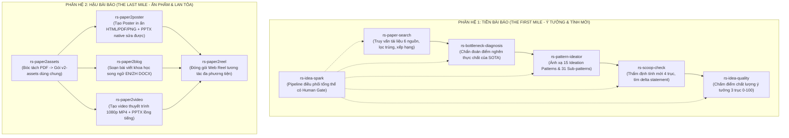

# KẾ HOẠCH TRÍCH XUẤT VÀ ĐÓNG GÓI BỘ KỸ NĂNG MICROSOFT RESEARCH (`microsoft-research`) CHO HỆ SINH THÁI NCKH CỘNG TÁC (HUMAN-IN-THE-LOOP)

> **Dự án:** Microsoft Research Studio Skills Extraction  
> **Thư mục đích:** `E:/gemini/agent_setup/microsoft-research/`  
> **Vị trí tài liệu:** `docs/ai/ke-hoach-trich-xuat-microsoft-research.md`  
> **Triết lý thực thi:** Cộng tác con người là trung tâm (Human-in-the-Loop), Cô lập môi trường 100% trong `.venv`, Hoạt động mượt mà trên laptop CPU/GPU onboard/Apple Silicon không cần GPU rời.

---

## 1. MỤC TIÊU VÀ NGUYÊN TẮC THIẾT KẾ

### 1.1. Mục tiêu
Xây dựng thư mục độc lập `microsoft-research/` đóng vai trò là **"Kho Kỹ năng Nghiên cứu Khoa học Tinh hoa"** (Elite Scientific Skill Depot). Khi bắt đầu một dự án NCKH mới hoặc cần áp dụng vào repo hiện tại, bạn chỉ cần sao chép các kỹ năng cần thiết vào thư mục `.agents/skills/` của repo đó.

### 1.2. Ba nguyên tắc thiết kế bất biến
1. **Human-in-the-Loop (HITL) bắt buộc:**
   - Xóa bỏ tư duy "chạy một mạch tự động" của bản gốc.
   - Mỗi kỹ năng đều thiết lập các **Cổng kiểm duyệt của Con người (Human Review Gates)**.
   - AI chịu trách nhiệm thu thập, phân tích, đề xuất các phương án và giải thích bản chất toán học/kỹ thuật. Con người chịu trách nhiệm lựa chọn hướng đi, tinh chỉnh giả định và quyết định mục tiêu thực nghiệm.
2. **Cô lập Môi trường Tuyệt đối (100% scoped to `.venv`):**
   - Tuân thủ quy tắc trong `AGENTS.md`: Tuyệt đối không cài đặt bất kỳ package hoặc công cụ nào vào global system environment.
   - **Xử lý FFmpeg (Phương án 1):** Sử dụng thư viện `imageio-ffmpeg` trong `.venv`. Thư viện này tự kèm sẵn binary FFmpeg độc lập, script sẽ tự động trích xuất đường dẫn qua `imageio_ffmpeg.get_ffmpeg_exe()`.
   - **Xử lý pdftotext (Phương án 1):** Tích hợp engine bóc tách PDF bằng thư viện Python thuần `pymupdf` (FitZ) trong `.venv`. Loại bỏ hoàn toàn sự phụ thuộc vào gói `poppler-utils` của hệ điều hành.
   - **Xử lý Trình duyệt:** Sử dụng Playwright Chromium cài đặt cục bộ trong cache của môi trường ảo (`uv run python -m playwright install chromium`).
3. **Chuẩn hóa cấu trúc theo chuẩn `cs-research-skills`:**
   - Mỗi skill là một folder độc lập gồm: `SKILL.md` (metadata frontmatter chuẩn), `scripts/` (mã nguồn python thực thi), `references/` (tài liệu hướng dẫn, mẫu hình, rubrics) và `assets/` (nếu có template/mẫu).
   - Tương thích 100% với Antigravity CLI, Claude Code và OpenAI Codex.

---

## 2. DANH MỤC CÁC KỸ NĂNG ĐƯỢC TRÍCH XUẤT (10 SKILLS)

Bộ kỹ năng được chia thành 2 phân hệ đối xứng tương ứng với 2 nửa của vòng đời nghiên cứu:



### Bảng chi tiết 10 Kỹ năng thành phần:

| Mã Kỹ năng | Nguồn gốc trong ResearchStudio | Đầu vào | Đầu ra & Điểm dừng Human Gate |
| :--- | :--- | :--- | :--- |
| **`rs-paper-search`** | `ResearchStudio-Idea/skills/paper_search` | Query, năm, nguồn (arXiv, OpenReview, Semantic Scholar, OpenAlex, DBLP, Crossref) | Bảng kết quả lọc trùng, phân loại độ tương quan.<br>*(Gate: Người dùng chọn các bài then chốt).* |
| **`rs-bottleneck-diagnosis`** | `ResearchStudio-Idea/skills/idea_spark` (Phase 1) | Văn bản các bài báo then chốt | Báo cáo chẩn đoán điểm nghẽn thực chất vs giả tạo.<br>*(Gate: Người dùng chốt điểm nghẽn muốn đánh vào).* |
| **`rs-pattern-ideator`** | `ResearchStudio-Idea/skills/idea_spark` (Phase 2 & 15 Patterns) | Điểm nghẽn đã chọn | Đề xuất 2-3 phương án cơ chế kỹ thuật dựa trên 15 Patterns.<br>*(Gate: Người dùng chọn & chỉnh sửa phương án).* |
| **`rs-scoop-check`** | `ResearchStudio-Idea/skills/scoop_check` | Ý tưởng + Khẳng định tính mới | Đối soát 4 trục với các bài gần nhất, Overlap Level 1-5.<br>*(Gate: Thống nhất Delta Statement để tránh trùng).* |
| **`rs-idea-quality`** | `ResearchStudio-Idea/evaluation/idea_quality` | File Idea Markdown (Title/Motivation/Method) | Đánh giá 3 trục (Problem, Method, Fit), chấm điểm 0-100.<br>*(Gate: Đánh giá độc lập trước khi làm thí nghiệm).* |
| **`rs-idea-spark`** | `ResearchStudio-Idea/skills/idea_spark` | Hướng nghiên cứu sơ khởi | Điều phối tổng thể chu trình sinh đề cương nghiên cứu.<br>*(Gate: Từng phase đều dừng lại xin ý kiến).* |
| **`rs-paper2assets`** | `ResearchStudio-Reel/skills/paper2assets` | File PDF bài báo | Gói tài nguyên chuẩn `assets/` (ảnh 432 dpi, spec 9 phần). |
| **`rs-paper2poster`** | `ResearchStudio-Reel/skills/paper2poster` | Gói `assets/` | `poster.html`, `poster.pdf`, `poster.png`, và `poster.pptx` native. |
| **`rs-paper2blog`** | `ResearchStudio-Reel/skills/paper2blog` | Gói `assets/` | 2 file Word: `blog_en.docx` và `blog_zh.docx`. |
| **`rs-paper2video`** | `ResearchStudio-Reel/skills/paper2video` | Gói `assets/` | `video.mp4` 1080p có phụ đề và hiệu ứng laser + `video.pptx`. |
| **`rs-paper2reel`** | `ResearchStudio-Reel/skills/paper2reel` | Gói thành phẩm | `reel.html` giao diện web tương tác đồng bộ đa phương tiện. |

---

## 3. CẤU TRÚC THƯ MỤC `microsoft-research`

Dưới đây là cây thư mục hoàn chỉnh sẽ được tạo lập:

```text
E:/gemini/agent_setup/microsoft-research/
├── pyproject.toml              # Khai báo dependency cô lập cho .venv
├── README.md                   # Hướng dẫn tổng quan & quy trình copy sử dụng
├── .env.template               # Template API keys cho các cổng học thuật
│
├── rs-paper-search/            # [Skill 1] Tìm kiếm tài liệu đa nguồn
│   ├── SKILL.md
│   ├── scripts/
│   │   ├── search_papers.py
│   │   ├── postprocess.py
│   │   ├── source_worker.py
│   │   └── connectors/         # arxiv, openreview, semanticscholar, openalex, dblp, crossref
│   └── references/
│
├── rs-bottleneck-diagnosis/    # [Skill 2] Chẩn đoán điểm nghẽn bài toán SOTA
│   ├── SKILL.md
│   └── references/             # rubrics chẩn đoán, intent recognition
│
├── rs-pattern-ideator/         # [Skill 3] Động cơ sinh ý tưởng từ 15 Patterns
│   ├── SKILL.md
│   └── references/
│       ├── patterns/           # 15 Ideation Patterns (assumption_pivot, operator_sub, v.v.)
│       └── sub-patterns/       # 31 Sub-patterns chi tiết
│
├── rs-scoop-check/             # [Skill 4] Thẩm định tính mới & rà soát trùng lặp
│   ├── SKILL.md
│   └── scripts/
│       └── check_scoop.py      # Script Python thuần dùng pymupdf (Phương án 1)
│
├── rs-idea-quality/            # [Skill 5] Thước đo chất lượng ý tưởng 3 trục
│   └── SKILL.md
│
├── rs-idea-spark/              # [Skill 6] Nhạc trưởng điều phối Ideation (HITL Mode)
│   ├── SKILL.md
│   ├── scripts/                # run.py (chế độ step-by-step interactive), validators
│   └── references/             # host-runbook, quality-flow
│
├── rs-paper2assets/            # [Skill 7] Bóc tách PDF sang chuẩn v2-assets
│   ├── SKILL.md
│   └── scripts/
│       ├── extract_pdf.py      # Bản nâng cấp dùng Pure Python PyMuPDF (Phương án 1)
│       ├── crop_figure.py
│       ├── fetch_logos.py
│       ├── make_qr.py
│       └── build_package.py
│
├── rs-paper2poster/            # [Skill 8] Tạo Poster in ấn + PPTX sửa được
│   ├── SKILL.md
│   ├── scripts/                # render_poster.py, check_poster.py, generate_audio.py
│   ├── references/
│   ├── assets/                 # layouts (landscape/portrait), headers, themes
│   └── html2pptx/              # Bộ chuyển đổi DOM HTML -> Native PowerPoint Shapes
│
├── rs-paper2blog/              # [Skill 9] Soạn bài viết blog khoa học song ngữ
│   ├── SKILL.md
│   ├── scripts/
│   └── references/             # editorial-style, output-contract, review-checklist
│
├── rs-paper2video/             # [Skill 10] Tạo video thuyết trình đồng bộ âm thanh
│   ├── SKILL.md
│   ├── scripts/                # Tích hợp imageio-ffmpeg (Phương án 1)
│   └── references/             # pptx2video, script_json_schema
│
└── rs-paper2reel/              # [Skill 11] Đóng gói Web Reel tương tác đa phương tiện
    ├── SKILL.md
    ├── scripts/                # build_reel_from_paper.py, serve_reel.py
    └── assets/                 # section_modal_contract.json
```

---

## 4. GIẢI PHÁP KỸ THUẬT CÔ LẬP MÔI TRƯỜNG (`.venv`)

### 4.1. Khai báo `pyproject.toml`
Toàn bộ thư viện được gói gọn, tương thích Python $\ge 3.10$:

```toml
[project]
name = "microsoft-research-skills"
version = "1.0.0"
description = "Bộ công cụ kỹ năng nghiên cứu khoa học Microsoft Research Studio (HITL Edition)"
readme = "README.md"
requires-python = ">=3.10"
dependencies = [
    # Nhóm 1: Kết nối học thuật & Phân tích văn bản
    "feedparser>=6.0.12",
    "openreview-py>=2.2.3",
    "beautifulsoup4>=4.13.0",
    "pymupdf>=1.26.0",
    "scholarly>=1.7.11",
    "requests>=2.31.0",
    "numpy>=1.24.0",

    # Nhóm 2: Xử lý tài liệu, hình ảnh & âm thanh
    "python-docx>=1.1.2",
    "python-pptx>=0.6.23",
    "pillow>=10.0.0",
    "qrcode>=7.4.2",
    "edge-tts>=7.2.8",

    # Nhóm 3: Phương án 1 cho FFmpeg & Render
    "imageio-ffmpeg>=0.5.1",      # Chứa sẵn binary ffmpeg trong .venv
    "playwright>=1.40.0",          # Trình duyệt Chromium headless độc lập
    "lxml>=5.0.0",
    "pyphen>=0.14.0",
    "cairosvg>=2.7.1",
]
```

### 4.2. Triển khai Phương án 1 cho `pdftotext` (Pure Python PyMuPDF)
Trong `rs-paper2assets/scripts/extract_pdf.py` và `rs-scoop-check`, hàm bóc tách văn bản được cấu hình ưu tiên:
```python
def extract_text_pure_python(pdf_path: Path, out_path: Path) -> str:
    """Bóc tách layout văn bản PDF dùng 100% PyMuPDF trong .venv, không cần Poppler."""
    import fitz  # PyMuPDF
    doc = fitz.open(pdf_path)
    pages_text = []
    for page in doc:
        # page.get_text("layout") hoặc "text" bảo toàn khoảng cách cột và ngắt trang
        t = page.get_text("text")
        pages_text.append(t)
    full_text = "\f".join(pages_text)
    out_path.write_text(full_text, encoding="utf-8", errors="replace")
    return full_text
```

### 4.3. Triển khai Phương án 1 cho `ffmpeg` (`imageio-ffmpeg`)
Trong `rs-paper2video` và `rs-paper2reel`, script tự động phát hiện FFmpeg thông qua module Python:
```python
def get_safe_ffmpeg_exe() -> str:
    """Lấy đường dẫn binary ffmpeg nằm gọn trong .venv, không cần cài đặt vào hệ thống."""
    try:
        import imageio_ffmpeg
        return imageio_ffmpeg.get_ffmpeg_exe()
    except ImportError:
        import shutil
        return shutil.which("ffmpeg") or "ffmpeg"
```

---

## 5. LỘ TRÌNH THỰC THI (ACTIONABLE ROADMAP)

1. **Giai đoạn 1: Khởi tạo Cấu trúc & Tệp Cấu hình**
   - Tạo thư mục gốc `microsoft-research/`.
   - Tạo `pyproject.toml`, `.env.template` và `README.md` hướng dẫn.
2. **Giai đoạn 2: Trích xuất Phân hệ Pre-Paper (Ideation & Novelty)**
   - Trích xuất `rs-paper-search`, `rs-bottleneck-diagnosis`, `rs-pattern-ideator`, `rs-scoop-check`, `rs-idea-quality`, `rs-idea-spark`.
   - Cập nhật script `check_scoop` sang Phương án 1 (PyMuPDF).
3. **Giai đoạn 3: Trích xuất Phân hệ Post-Paper (Dissemination & Outreach)**
   - Trích xuất `rs-paper2assets`, `rs-paper2poster`, `rs-paper2blog`, `rs-paper2video`, `rs-paper2reel`.
   - Nâng cấp `extract_pdf.py` sang Phương án 1 (Pure Python PyMuPDF).
   - Tích hợp `imageio-ffmpeg` vào logic điều phối video.
4. **Giai đoạn 4: Kiểm tra & Nghiệm thu**
   - Kiểm tra tính đầy đủ của các file `SKILL.md`.
   - Kiểm tra sự độc lập của thư mục, sẵn sàng để copy sang `.agents/skills/`.

---

*(Kế hoạch này đã được lưu vào `docs/ai/ke-hoach-trich-xuat-microsoft-research.md` để theo dõi tiến độ).*
