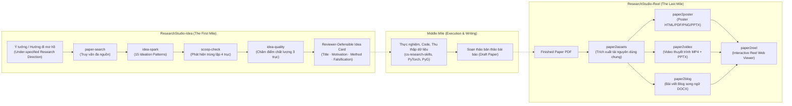
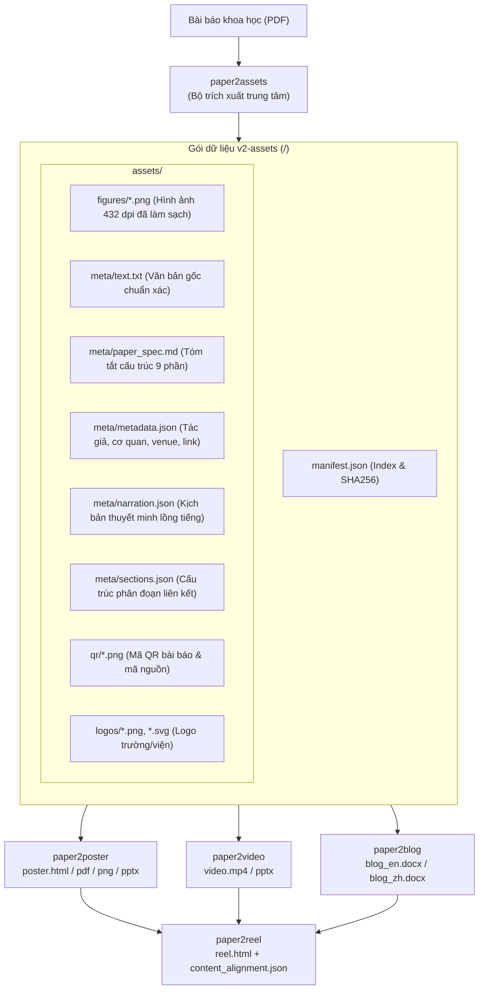
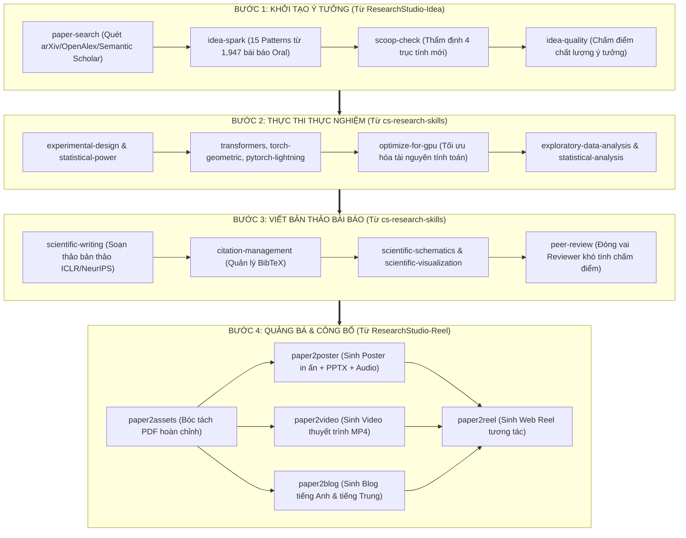

# BÁO CÁO PHÂN TÍCH TOÀN DIỆN RESEARCHSTUDIO VÀ CHIẾN LƯỢC TRÍCH XUẤT SKILLS CHO NGHIÊN CỨU KHOA HỌC (NCKH)

> **Dự án phân tích:** Microsoft Research / AI-Nuts `ResearchStudio`  
> **Thư mục nguồn:** `E:/gemini/agent_setup/ResearchStudio/`  
> **Hai thành phần cốt lõi:** `ResearchStudio-Idea` (Pre-paper ideation) và `ResearchStudio-Reel` (Post-paper dissemination)  
> **Tài liệu tham khảo nền tảng:** arXiv:2607.04439 (*ResearchStudio-Idea*) & arXiv:2607.04438 (*ResearchStudio-Reel*)  
> **Mục tiêu thực hiện:** Phân tích cơ chế hoạt động, đánh giá mức độ bao phủ quy trình nghiên cứu khoa học, và thiết kế chiến lược trích xuất - tích hợp hệ thống kỹ năng vào AI Coding Agent (Antigravity CLI / Claude Code / Codex) để áp dụng trong các repository nghiên cứu khoa học thực tế.

---

## MỤC LỤC TỔNG QUAN

1. [Tổng quan & Kiến trúc Hệ thống ResearchStudio](#1-tổng-quan--kiến-trúc-hệ-thống-researchstudio)
2. [Phân tích Cơ chế Hoạt động của ResearchStudio-Idea (First Mile Ideation)](#2-phân-tích-cơ-chế-hoạt-động-của-researchstudio-idea-first-mile-ideation)
   - 2.1. Triết lý thiết kế & Dữ liệu nền tảng (Corpus 1,947 bài báo ML)
   - 2.2. Hệ thống 15 Ideation Patterns & 31 Sub-patterns
   - 2.3. Bốn Kỹ năng thành phần trong ResearchStudio-Idea
   - 2.4. Động cơ điều phối State-Machine & Quy trình kiểm chứng tất định
3. [Phân tích Cơ chế Hoạt động của ResearchStudio-Reel (Last Mile Dissemination)](#3-phân-tích-cơ-chế-hoạt-động-của-researchstudio-reel-last-mile-dissemination)
   - 3.1. Triết lý "Single Extraction, Multi-Renderer" & Hợp đồng dữ liệu `v2-assets`
   - 3.2. Năm Kỹ năng thành phần trong ResearchStudio-Reel
   - 3.3. Các cổng kiểm định chất lượng nghiêm ngặt (QA & Layout Gates)
4. [Đánh giá Mức độ Hỗ trợ Flow Nghiên cứu Khoa học](#4-đánh-giá-mức-độ-hỗ-trợ-flow-nghiên-cứu-khoa-học)
   - 4.1. Bản đồ quy trình Nghiên cứu Khoa học chuẩn mực
   - 4.2. Khảo sát mức độ bao phủ và các khoảng trống (Research Gaps)
   - 4.3. Sự kết hợp lý tưởng giữa ResearchStudio và CS-Research-Skills
5. [Chiến lược Trích xuất và Tích hợp Kỹ năng vào các Repo NCKH](#5-chiến-lược-trích-xuất-và-tích-hợp-kỹ-năng-vào-các-repo-nckh)
   - 5.1. Phân tầng trích xuất (Extraction Hierarchy: 3 cấp độ)
   - 5.2. Chuyển đổi định dạng từ Claude Code sang Antigravity / Universal Agent
   - 5.3. Yêu cầu môi trường & Tương thích hệ điều hành (Windows / WSL2 / Linux)
   - 5.4. Quản lý cấu hình & API Keys
6. [Kế hoạch Thực thi & Hướng dẫn Từng Bước Triển khai](#6-kế-hoạch-thực-thi--hướng-dẫn-từng-bước-triển-khai)
   - 6.1. Hướng dẫn trích xuất các standalone skills (Plug-and-Play)
   - 6.2. Cấu trúc thư mục `.agents/skills/` chuẩn cho repo NCKH
   - 6.3. Kịch bản sử dụng thực tế (Use-case Scenarios)

---

## 1. TỔNG QUAN & KIẾN TRÚC HỆ THỐNG RESEARCHSTUDIO

`ResearchStudio` là một bộ công cụ nghiên cứu khoa học dựa trên nền tảng tác nhân trí tuệ nhân tạo (Agentic AI) do Microsoft Research và nhóm tác giả AI-Nuts phát triển. Mục tiêu của repository này là đóng vai trò như một **"AI Co-Author"** xuyên suốt toàn bộ vòng đời của một dự án nghiên cứu học thuật — từ khi bài toán nghiên cứu mới chỉ là một ý tưởng sơ khai cho đến khi bài báo được chấp nhận xuất bản và cần quảng bá ra cộng đồng khoa học.

Repository được tổ chức thành 2 module đối xứng đại diện cho hai đầu mút quan trọng nhất trong nghiên cứu:



- **ResearchStudio-Idea (The First Mile):** Giải quyết bài toán tư duy trước khi viết bài báo. Module này nhận đầu vào là một đề tài/hướng đi nghiên cứu chưa rõ ràng, kích hoạt quy trình tìm kiếm tài liệu, chẩn đoán điểm nghẽn (bottleneck), ánh xạ vào kho mẫu hình sáng tạo (ideation patterns), đối chiếu bản quyền ý tưởng (prior art collision) và kết xuất một **"Idea Card"** đạt chuẩn có thể bảo vệ được trước các chuyên gia bình duyệt (reviewer-defensible).
- **ResearchStudio-Reel (The Last Mile):** Giải quyết bài toán phổ biến và lan tỏa tri thức sau khi bài báo đã hoàn thành. Module này nhận đầu vào là file PDF bài báo (hoặc link arXiv), tự động giải nén thành gói tài nguyên trung gian chuẩn (`paper2assets`), sau đó đồng thời tạo ra poster thuyết trình khổ lớn có thể in ấn và có lồng tiếng (`paper2poster`), video trình chiếu có phụ đề (`paper2video`), bài viết truyền thông khoa học song ngữ (`paper2blog`), và giao diện web tương tác đa phương tiện liên kết toàn diện (`paper2reel`).

---

## 2. PHÂN TÍCH CƠ CHẾ HOẠT ĐỘNG CỦA RESEARCHSTUDIO-IDEA (FIRST MILE IDEATION)

### 2.1. Triết lý thiết kế & Dữ liệu nền tảng

`ResearchStudio-Idea` được xây dựng dựa trên nguyên lý: **"Faithful by Construction" (Trung thực theo cấu trúc)**. Một trong những nhược điểm lớn nhất của các mô hình LLM khi brainstorm ý tưởng khoa học là hiện tượng "ảo giác" (hallucination), bịa đặt số liệu, trích dẫn giả, hoặc đưa ra các ý tưởng nghe rất kêu nhưng vi phạm các định luật toán học/vật lý hoặc không thể triển khai thực nghiệm.

Để khắc phục điều này, IdeaSpark được neo giữ (grounded) trên một tập ngữ liệu gồm **1,947 bài báo chất lượng cao** được chấp nhận tại các hội nghị AI hàng đầu thế giới (ICLR, ICML, NeurIPS) giai đoạn 2021–2025. Từ tập ngữ liệu này, nhóm nghiên cứu đã trích xuất ra một hệ phân loại thực nghiệm gồm **15 Ideation Patterns (Mẫu hình sáng tạo)** và **31 Sub-patterns (Mẫu hình con)**.

### 2.2. Hệ thống 15 Ideation Patterns

Khi nhà nghiên cứu đưa ra một bài toán, IdeaSpark không sáng tạo ngẫu nhiên mà phân tích điểm nghẽn của bài toán và đối chiếu với 15 chiến lược tư duy khoa học đã được chứng minh thành công trong lịch sử:

| Mã Pattern | Tên Chiến lược Sáng tạo | Bản chất Thao tác Khoa học (Operational Signature) | Số bài trong Corpus |
| :--- | :--- | :--- | :---: |
| `assumption_audit_and_pivot` | Kiểm toán giả định & Xoay trục | Xác định giả định ngầm mà các công trình trước dựa vào → Nới lỏng giả định (chứng minh mở rộng) hoặc chỉ ra phản ví dụ/lỗ hổng phá vỡ hệ thống → Xây dựng lý thuyết/giải pháp mới. | 181 |
| `architectural_operator_substitution` | Thay thế toán tử hoặc biểu diễn | Nhận diện toán tử/biểu diễn tốn kém về tính toán → Thay thế bằng một toán tử xấp xỉ rẻ hơn nhưng bảo toàn tính chất cốt lõi (độ nhạy, độ cong, tính biểu đạt). | 109 |
| `generative_process_redesign` | Tái thiết kế thành phần sinh cố định | Nhận diện một thành phần vốn bị mặc định là cố định trong quy trình sinh (prior phân phối, số bước khuếch tán, không gian tiềm ẩn) → Biến nó thành biến số tự do để tối ưu chất lượng/tốc độ. | 94 |
| `controlled_diagnostic_design` | Thiết kế công cụ chẩn đoán cô lập nhiễu | Xây dựng công cụ đánh giá có kiểm soát nhằm cô lập các yếu tố gây nhiễu (confounds) để đo lường năng lực thực chất thay vì đo lường lối tắt (shortcuts). | 86 |
| `unify_into_shared_representation` | Đồng nhất hóa vào không gian chung | Chiếu các phương thức dữ liệu (multimodal) hoặc tác vụ không đồng nhất vào một không gian biểu diễn/từ vựng/hàm mục tiêu duy nhất thay vì dùng nhiều pipeline rời rạc. | 82 |
| `reframe_as_solvable_object` | Cấu trúc hóa lại thành bài toán đã có lời giải | Biến đổi một bài toán nan giải thành một đối tượng toán học đã được nghiên cứu kỹ (bài toán quy hoạch ràng buộc, lý thuyết trò chơi/cân bằng, bài toán chọn tổ hợp). | 79 |
| `self_supervised_signal_engineering` | Kiến tạo tín hiệu tự giám sát | Tự tạo ra tín hiệu giám sát thông minh từ cấu trúc nội tại của dữ liệu (chuỗi thời gian, đồ thị, hình học) mà không cần nhãn thủ công. | 66 |
| `structural_prior_encoding` | Mã hóa tiên nghiệm cấu trúc vào kiến trúc | Đưa các định luật đối xứng, tính bất biến (invariance) hoặc tính tương đương (equivariance) trực tiếp vào mạng nơ-ron thay vì bắt mô hình học từ dữ liệu. | 61 |
| `algebraic_equivalence_unification` | Chứng minh tương đương đại số để thống nhất | Chứng minh hai hoặc nhiều phương pháp tưởng chừng đối lập thực chất là các biến thể của cùng một biểu thức toán học tổng quát. | 59 |
| `heterogeneous_decomposition` | Phân rã không đồng nhất để xử lý riêng biệt | Tách dữ liệu hoặc bài toán thành các thành phần có bản chất khác nhau để áp dụng chiến lược xử lý chuyên biệt cho từng phần. | 47 |
| `decompose_and_delegate` | Phân rã và ủy quyền cho bộ giải chuyên biệt | Chia nhỏ bài toán phức tạp thành các bài toán con và giao việc cho các bộ giải độc lập (chuyên gia/mô hình con). | 42 |
| `relax_discrete_search_to_continuous` | Nới lỏng tìm kiếm rời rạc sang liên tục | Chuyển đổi không gian tìm kiếm rời rạc khó tối ưu thành không gian liên tục khả vi để tận dụng thuật toán tối ưu Gradient Descent. | 35 |
| `adapt_via_conditioning` | Thích ứng qua điều kiện hóa thay vì train lại | Tinh chỉnh hành vi của mô hình bằng cơ chế điều kiện hóa (prompt, prefix, adapter) mà không cần huấn luyện lại toàn bộ trọng số. | 18 |
| `characterize_limit_then_surpass` | Xác định giới hạn lý thuyết rồi vượt qua | Thiết lập một chặn trên/dưới về mặt toán học cho các kiến trúc hiện tại, sau đó đề xuất cơ chế mới vượt qua rào cản đó. | 15 |
| `targeted_self_supervised_objective` | Thiết kế hàm mục tiêu hướng tính chất cụ thể | Xây dựng hàm mất mát ép mô hình phải bảo toàn một tính chất hình học hoặc cấu trúc xác định trong không gian đặc trưng. | 15 |

### 2.3. Bốn Kỹ năng thành phần trong ResearchStudio-Idea

Hệ thống được module hóa thành 4 kỹ năng cụ thể:

1. **`idea-spark` (Flagship Skill):**
   - **Vị trí:** `ResearchStudio/ResearchStudio-Idea/skills/idea_spark/`
   - **Nhiệm vụ:** Điều phối toàn bộ quy trình từ đầu vào là câu hỏi nghiên cứu đến đầu ra là Idea Card hoàn chỉnh.
   - **Pipeline 5 giai đoạn (Phase 0 -> Phase 4):**
     - *Phase 0 (Literature Grounding):* Quét tài liệu từ 6 nguồn API, tạo bảng tổng hợp `lit_table.md`, tải PDF toàn văn của các bài báo then chốt.
     - *Phase 1 (Bottleneck Identification):* Đọc toàn văn tài liệu, bóc tách điểm nghẽn thực sự của các giải pháp hiện nay (chặn rẽ: `proceed` hoặc `do_not_generate`).
     - *Phase 2 (Composition Selection & Generation):* Lựa chọn kết hợp từ 1–3 Ideation Patterns, sinh ra cơ chế kỹ thuật cụ thể (`final_candidate.json`), chạy cổng kiểm tra tính mạch lạc toán học/cấu trúc (coherence gate).
     - *Phase 3 (Collision Retrieval & Audit):* Chạy truy vấn va chạm bản quyền ý tưởng, tiến hành phản biện và vá lỗi có giới hạn (bounded patch revision).
     - *Phase 4 (Technical Elaboration & Card Rendering):* Xây dựng khung kỹ thuật, lập kế hoạch phản nghiệm (falsification plan), chuyển ngữ sang bản tóm tắt đại chúng (Anh/Trung) và biên dịch ra định dạng Markdown + PDF LaTeX.

2. **`paper-search` (Multi-Source Search Engine):**
   - **Vị trí:** `ResearchStudio/ResearchStudio-Idea/skills/paper_search/`
   - **Nhiệm vụ:** Tìm kiếm tài liệu đồng thời trên **arXiv, DBLP, OpenAlex, OpenReview, Semantic Scholar, Crossref** và tri thức nội tại của mô hình.
   - **Đặc điểm nổi bật:** Tìm kiếm đa luồng bất đồng bộ, tự động lọc trùng lặp theo tiêu đề chuẩn hóa, xếp hạng độ tương quan theo thang điểm, hỗ trợ tìm kiếm đa truy vấn hợp nhất (`--queries "q1|q2|q3"`).

3. **`scoop-check` (Novelty Collision Verification):**
   - **Vị trí:** `ResearchStudio/ResearchStudio-Idea/skills/scoop_check/`
   - **Nhiệm vụ:** Trả lời câu hỏi sống còn: *"Ý tưởng này đã bị ai làm trước (scooped) hay chưa?"*
   - **Cơ chế 4 trục phân tích:**
     - *Trục 1: Problem framing* (Cách định nghĩa bài toán, dữ liệu đầu vào/ra, cơ chế đánh giá).
     - *Trục 2: Core mechanism* (Đóng góp kỹ thuật cốt lõi: cấu trúc, thuật toán, kỹ thuật chứng minh).
     - *Trục 3: Key insight* (Bản chất tại sao phương pháp hoạt động, điểm khác biệt với SOTA).
     - *Trục 4: Application domain* (Phạm vi ứng dụng cụ thể).
   - **Đánh giá mức độ va chạm (Overlap Score 0–4):** Cho ra kết luận mức độ trùng lặp từ Level 1 (Hoàn toàn bị trùng/scooped) đến Level 5 (Hoàn toàn mới mẻ).

4. **`idea-quality` (Standalone Evaluation Metric):**
   - **Vị trí:** `ResearchStudio/ResearchStudio-Idea/evaluation/idea_quality/`
   - **Nhiệm vụ:** Chấm điểm chất lượng ý tưởng khoa học trên thang điểm 0–100 chỉ dựa trên văn bản ý tưởng (Title/Motivation/Method), độc lập với kết quả thực nghiệm.
   - **3 trục đánh giá độc lập:**
     - *Trục A — Problem position quality:* Điểm nghẽn có thật sự quan trọng, phi hiển nhiên và còn mở hay không?
     - *Trục B — Method quality:* Đánh giá độ sâu (depth), tính hợp lý nội tại (soundness) và tính khả thi về mặt nguyên lý (feasibility).
     - *Trục C — Problem-fit:* Phương pháp đề xuất có thực sự giải quyết trực diện điểm nghẽn đặt ra ở phần Motivation hay không?

### 2.4. Động cơ điều phối State-Machine & Quy trình kiểm chứng tất định

Khác với các hệ thống AI thông thường dựa vào một prompt dài (monolithic prompt), `idea-spark` được điều khiển bởi một máy trạng thái tất định (deterministic state navigator) viết bằng Python: `scripts/run.py`.

```
run.py next --dir <run_dir> --query "<direction>"
```

- **Run Contract (`run_contract.json`):** Mỗi phiên chạy được cấp một hợp đồng bất biến, ghi nhận mã băm (SHA256) của từng đầu vào, prompt và kết quả.
- **Context Isolation Discipline:** Để tránh làm tràn ngữ cảnh của LLM (thường tích lũy 180k–250k tokens gây timeout), hệ thống bắt buộc chạy từng giai đoạn trong các context độc lập (sub-agents), ghi kết quả trung gian trực tiếp xuống đĩa cứng (`.quality/<stage>/result.json`) thay vì giữ trong bộ nhớ chat.
- **Fail-safe & Gate Tracing:** Nếu một ý tưởng không đạt cổng kiểm tra tính mạch lạc hoặc bị trùng lặp với công trình đã có, hệ thống kích hoạt cơ chế `REGENERATE` hoặc `REREVISE` có giới hạn số lần thử, ghi lại lý do thất bại thay vì cố gắng ngụy tạo kết quả.

---

## 3. PHÂN TÍCH CƠ CHẾ HOẠT ĐỘNG CỦA RESEARCHSTUDIO-REEL (LAST MILE DISSEMINATION)

### 3.1. Triết lý "Single Extraction, Multi-Renderer" & Hợp đồng dữ liệu `v2-assets`

Trong quy trình nghiên cứu truyền thống, sau khi bài báo hoàn thành, tác giả thường mất hàng tuần để chuẩn bị slide, vẽ lại poster, viết bài blog giới thiệu và quay video thuyết trình. Các công việc này thường bị phân mảnh và dễ dẫn đến sai lệch số liệu so với bản PDF gốc.

`ResearchStudio-Reel` giải quyết triệt để vấn đề này bằng mô hình kiến trúc **"Trích xuất một lần, Kết xuất đa kênh"**:



Quy tắc bất biến của gói dữ liệu:
1. Thư mục gốc chứa duy nhất các file thành phẩm (deliverables) và file chỉ mục `manifest.json`.
2. Mọi dữ liệu trung gian, hình ảnh, văn bản, âm thanh đều nằm trong thư mục con `assets/`.
3. Mọi đường dẫn trong mã nguồn đều là đường dẫn tương đối (root-relative), đảm bảo gói dữ liệu có thể di chuyển (movable) sang bất kỳ máy tính hoặc máy chủ nào mà không bị gãy liên kết.

### 3.2. Năm Kỹ năng thành phần trong ResearchStudio-Reel

1. **`paper2assets` (Upstream Extractor):**
   - **Vị trí:** `ResearchStudio/ResearchStudio-Reel/skills/paper2assets/`
   - **Đầu vào:** File PDF bài báo hoặc arXiv ID.
   - **Đầu ra:** Gói tài nguyên chuẩn bao gồm: `text.txt` (toàn văn bóc tách từ `pdftotext`), `captions.json` (chú thích hình ảnh), `figures/*.png` (ảnh phóng to zoom=6 đạt độ phân giải in ấn ~432 dpi, cắt viền tự động), `metadata.json`, `paper_spec.md` (tóm tắt cấu trúc 9 phần chuẩn mực học thuật: Problem, Motivation, Contribution, Method, Benchmark, Key Result, Ablation, Headline Numbers, Takeaway).

2. **`paper2poster` (Conference Poster Renderer):**
   - **Vị trí:** `ResearchStudio/ResearchStudio-Reel/skills/paper2poster/`
   - **Đầu vào:** Gói tài nguyên từ `paper2assets`.
   - **Đầu ra:** `poster.html`, `poster.pdf`, `poster.png`, và đặc biệt là file PowerPoint có thể chỉnh sửa `poster.pptx`.
   - **Tính năng cao cấp:**
     - Hỗ trợ 2 khổ chuẩn: Khổ ngang (Landscape 60×36 inch, tỷ lệ 5:3 cho NeurIPS, ICML, CVPR) và Khổ dọc (Portrait A0 33.1×46.8 inch cho ACL, AAAI).
     - Tích hợp công cụ `html2pptx` (chuyển đổi DOM HTML thành các shape native của PowerPoint, không phải dán ảnh chụp màn hình).
     - Tích hợp giọng đọc thuyết minh tự động qua Microsoft Edge-TTS miễn phí; giao diện HTML có phím tắt `a` để nghe thuyết minh từng phần hoặc toàn bài, `s` để mở toàn màn hình.

3. **`paper2video` (Walkthrough Video Generator):**
   - **Vị trí:** `ResearchStudio/ResearchStudio-Reel/skills/paper2video/`
   - **Cơ chế điều phối:** Hoạt động như một nhạc trưởng kết hợp giữa kỹ năng tạo slide `ppt-master` và kỹ năng kết xuất video `pptx2video`.
   - **Đầu ra:** `video.mp4` (có phụ đề dán cứng Bottom-Bar), `video_no_subtitles.mp4`, và `video.pptx`.
   - **Tính năng:** Tự động đồng bộ hiệu ứng chuyển động (entrance animations) theo mốc phát âm thanh, tạo hiệu ứng con trỏ laser spotlight (`spotlight_laser`) hướng sự chú ý của người xem vào các phương trình hoặc biểu đồ tương ứng.

4. **`paper2blog` (Bilingual Editorial Package):**
   - **Vị trí:** `ResearchStudio/ResearchStudio-Reel/skills/paper2blog/`
   - **Đầu ra:** 2 bài viết học thuật độc lập định dạng Microsoft Word: `blog_en.docx` (tiếng Anh chuẩn mực học thuật phương Tây) và `blog_zh.docx` (tiếng Trung theo phong cách bài viết truyền thông WeChat).
   - **Đặc điểm:** Không dịch máy từng câu (word-by-word) mà viết lại tự nhiên theo đúng văn phong đích nhưng cam kết giữ nguyên 100% số liệu thực nghiệm, hình ảnh minh họa và trích dẫn khoa học.

5. **`paper2reel` (Interactive Multi-Modal Reel Viewer):**
   - **Vị trí:** `ResearchStudio/ResearchStudio-Reel/skills/paper2reel/`
   - **Đầu ra:** `reel.html` và file bản đồ đồng bộ `content_alignment.json`.
   - **Trải nghiệm người dùng:** Khi mở trang web, giao diện mặc định hiển thị poster học thuật. Khi người đọc di chuột hoặc nhấn đúp chuột vào bất kỳ phần nào trên poster (ví dụ: phần Method hoặc Key Result), một modal tương tác sẽ mở ra: bên trái phát video clip tương ứng với phụ đề, bên dưới là thumbnail slide bài thuyết trình, bên phải là bài viết phân tích chi tiết.

### 3.3. Các cổng kiểm định chất lượng nghiêm ngặt (QA & Layout Gates)

Điểm tạo nên sự vượt trội của ResearchStudio-Reel là các thuật toán kiểm tra tự động dạng vòng lặp (measured feedback loops):
- **Cổng lấp đầy Poster (Slack & Polish Gate):** Poster không được chấp nhận nếu các ô nội dung bị rỗng (`SPARSE`) hoặc tràn chữ (`OVERFLOW`). Mọi thẻ nội dung phải đạt tỷ lệ lấp đầy chiều cao trong khoảng `[0.90, 1.00]` (`FULL`).
- **Cổng kích thước hình ảnh:** Hình ảnh đồ thị khoa học bắt buộc phải chiếm ít nhất 90% chiều rộng hoặc chiều cao của thẻ chứa nó (`fillRatio >= 0.90`), ngăn chặn triệt để tình trạng hình ảnh bé như con tem nằm lọt thỏm giữa khung trang.
- **Cổng Video QA Strict Mode:** Kiểm tra độ lệch âm thanh - hình ảnh, độ dài phụ đề và thời gian hiển thị trước khi xuất file MP4 cuối cùng.

---

## 4. ĐÁNH GIÁ MỨC ĐỘ HỖ TRỢ FLOW NGHIÊN CỨU KHOA HỌC

### 4.1. Bản đồ quy trình Nghiên cứu Khoa học chuẩn mực

Để trả lời câu hỏi: *"ResearchStudio có các skill hướng dẫn flow nghiên cứu khoa học hay không?"*, chúng ta cần đối chiếu các công cụ của repo này với toàn bộ 5 chặng của một chu trình NCKH chuẩn quốc tế:

| Chặng Nghiên cứu | Các bước nghiệp vụ cụ thể | Mức độ hỗ trợ của ResearchStudio | Công cụ tương ứng trong ResearchStudio |
| :--- | :--- | :---: | :--- |
| **Chặng 1: Khởi tạo ý tưởng & Đặt đề bài (Ideation)** | • Khảo sát bối cảnh bài toán<br>• Xác định điểm nghẽn của SOTA<br>• Lựa chọn cơ chế giải pháp mới<br>• Lập kế hoạch phản nghiệm (falsification) | **100% (Hoàn hảo)** | `idea-spark` (Phase 0, 1, 2, 4), kho 15 Ideation Patterns. |
| **Chặng 2: Tổng quan tài liệu & Kiểm tra tính mới (Literature & Novelty)** | • Tìm kiếm bài báo đa nguồn liên quan<br>• Lọc trùng lặp & phân nhóm công trình<br>• Kiểm tra nguy cơ bị trùng lặp (Scoop Check)<br>• Đánh giá chất lượng ý tưởng trước khi code | **100% (Hoàn hảo)** | `paper-search`, `scoop-check`, `idea-quality`. |
| **Chặng 3: Thiết kế thực nghiệm & Lập trình (Experiment & Code)** | • Thiết kế ma trận thực nghiệm<br>• Lập trình thuật toán/mô hình<br>• Huấn luyện, tối ưu GPU/CUDA<br>• Thu thập số liệu, kiểm định thống kê | **Khoảng trống (Gap)**<br>*(Chỉ có kế hoạch sơ bộ)* | Trong Phase 4 có phần phác thảo `falsification_prediction` và `compute_budget`, nhưng **không có code thực thi thí nghiệm**. |
| **Chặng 4: Soạn thảo bản thảo bài báo (Manuscript Writing)** | • Viết bản thảo toàn văn (LaTeX/Word)<br>• Quản lý danh mục trích dẫn (BibTeX)<br>• Vẽ sơ đồ kiến trúc bài báo<br>• Bình duyệt nội bộ (Peer review giả lập) | **Khoảng trống một phần**<br>*(Chỉ tạo bản tóm tắt)* | Tạo ra `idea.std.md`, `idea.detail.md` và biên dịch PDF LaTeX của Idea Card, nhưng **chưa viết toàn văn bài báo 8-10 trang**. |
| **Chặng 5: Công bố, Thuyết trình & Lan tỏa (Dissemination & Outreach)** | • Thiết kế Poster khổ lớn in ấn hội nghị<br>• Tạo video thuyết trình/lightning talk<br>• Soạn bài viết blog khoa học/cộng đồng<br>• Tạo trang web tương tác đa phương tiện | **100% (Đỉnh cao)** | Toàn bộ suite `ResearchStudio-Reel`: `paper2assets`, `paper2poster`, `paper2video`, `paper2blog`, `paper2reel`. |

### 4.2. Khảo sát mức độ bao phủ và các khoảng trống (Research Gaps)

Từ bảng phân tích trên, chúng ta rút ra kết luận quan trọng:
1. **ResearchStudio KHÔNG hướng dẫn trọn vẹn từ A-Z mọi công đoạn kỹ thuật**, mà tập trung cực mạnh và xuất sắc vào **2 chặng đầu mút**: Chặng đầu (First Mile: Ý tưởng & Tính mới) và Chặng cuối (Last Mile: Ấn phẩm công bố & Lan tỏa).
2. **Khoảng trống ở chặng giữa (Middle Mile):** Repository này không chứa các kỹ năng lập trình mô hình Deep Learning (như PyTorch, Transformers), không chứa các kỹ năng phân tích thống kê thực nghiệm (như SciPy, Statsmodels), và không hỗ trợ viết toàn văn bài báo định dạng LaTeX hội nghị.

### 4.3. Sự kết hợp lý tưởng giữa ResearchStudio và CS-Research-Skills

Thật may mắn, trong không gian làm việc hiện tại (`agent_setup`), chúng ta đã có sẵn kho tài nguyên **`cs-research-skills`** (đã được tổng hợp trong [cs-scientific-skills-report.md](file:///E:/gemini/agent_setup/docs/ai/cs-scientific-skills-report.md)). Khi ghép nối ResearchStudio với kho kỹ năng này, chúng ta sẽ có một **hệ sinh thái nghiên cứu khép kín 100% không tì vết**:



---

## 5. CHIẾN LƯỢC TRÍCH XUẤT VÀ TÍCH HỢP KỸ NĂNG VÀO CÁC REPO NCKH

Để AI Agent (như Antigravity) có thể tự động nhận biết, đọc hướng dẫn và thực thi các kỹ năng từ ResearchStudio khi làm việc trong bất kỳ repo nghiên cứu nào của bạn, chúng ta cần xây dựng một chiến lược trích xuất chuẩn mực.

### 5.1. Phân tầng trích xuất (Extraction Hierarchy)

Chúng ta chia 8 kỹ năng cốt lõi thành 3 gói phân tầng tùy theo nhu cầu và độ phức tạp về môi trường:

```
┌────────────────────────────────────────────────────────────────────────┐
│ GÓI 1: STANDALONE RESEARCH INTELLIGENCE (Cực nhẹ, Plug-and-Play ngay) │
│ • paper-search  : Tìm kiếm bài báo đa nguồn, lọc trùng lặp tự động    │
│ • scoop-check   : Kiểm tra va chạm bản quyền ý tưởng qua 4 trục       │
│ • idea-quality  : Thước đo đánh giá chất lượng ý tưởng không cần code   │
└────────────────────────────────────────────────────────────────────────┘
                                    │
                                    ▼
┌────────────────────────────────────────────────────────────────────────┐
│ GÓI 2: EVIDENCE-BASED IDEATION ENGINE (Động cơ sinh ý tưởng có kiểm chứng) │
│ • idea-spark    : Trọn bộ 15 patterns, state machine run.py,          │
│                   hệ thống rubric & validator tất định                │
└────────────────────────────────────────────────────────────────────────┘
                                    │
                                    ▼
┌────────────────────────────────────────────────────────────────────────┐
│ GÓI 3: RESEARCH DISSEMINATION SUITE (Bộ ấn phẩm công bố & Lan tỏa)     │
│ • paper2assets  : Trích xuất PDF thành chuẩn v2-assets                │
│ • paper2poster  : Tạo Poster HTML/PDF/PNG/PPTX có thuyết minh audio   │
│ • paper2video   : Tạo Video thuyết trình MP4 + PPTX                   │
│ • paper2blog    : Soạn bài viết blog khoa học song ngữ DOCX           │
│ • paper2reel    : Đóng gói trang web Reel tương tác đa phương tiện    │
└────────────────────────────────────────────────────────────────────────┘
```

### 5.2. Chuyển đổi định dạng từ Claude Code sang Antigravity / Universal Agent

Trong mã nguồn gốc của ResearchStudio, các tác giả thiết kế cho Claude Code (`CLAUDE_PROJECT_DIR`, `TaskCreate`, `.claude/skills/`). Khi trích xuất để dùng cho Antigravity hoặc bất kỳ agent nào, chúng ta cần thực hiện các chuẩn hóa sau:

1. **Chuẩn hóa Metadata `SKILL.md`:**
   - Đảm bảo phần YAML frontmatter (`--- name: ... description: ... ---`) rõ ràng, mô tả đầy đủ trigger keywords để Agent tự động kích hoạt khi người dùng yêu cầu.
2. **Loại bỏ biến môi trường đặc thù của Claude:**
   - Thay thế các tham chiếu `${CLAUDE_PROJECT_DIR}/skills/...` bằng đường dẫn tương đối hoặc biến động xác định từ `$SKILL_DIR` / `__file__`.
   - Các script Python trong `idea_spark` và `paper2poster` đã có sẵn cơ chế self-locating (`Path(__file__).resolve().parent...`), điều này giúp việc chạy độc lập rất thuận lợi.
3. **Tháo gỡ các lệnh đặc thù `TaskCreate`:**
   - Trong `scoop_check/SKILL.md` có đoạn yêu cầu dùng `TaskCreate` để theo dõi tiến độ. Khi chuyển sang Antigravity, thay bằng việc cập nhật file `tasks/todo.md` theo quy tắc chuẩn của `AGENTS.md`.

### 5.3. Yêu cầu môi trường & Tương thích hệ điều hành (Windows / WSL2)

Đây là lưu ý **sống còn** vì môi trường hiện tại của bạn là Windows 11:

#### A. Nhóm kỹ năng Python thuần túy (Chạy trực tiếp trên Windows PowerShell)
- `paper-search`, `scoop-check`, `idea-quality`, `idea-spark`:
  - Chạy 100% bằng Python trên Windows.
  - Thư viện yêu cầu: `feedparser`, `openreview-py`, `beautifulsoup4`, `pymupdf`, `requests`, `scholarly`.
  - Có thể cài đặt an toàn vào môi trường ảo nội bộ dự án: `uv pip install feedparser openreview-py beautifulsoup4 pymupdf requests scholarly`.

#### B. Nhóm kỹ năng đa phương tiện (Phụ thuộc công cụ hệ thống ngoài Python)
- `paper2assets`, `paper2poster`, `paper2video`, `paper2reel`:
  - Yêu cầu các công cụ nhị phân:
    1. **Poppler (`pdftotext`):** Dùng để bóc tách text từ PDF giữ nguyên định dạng layout. Trên Windows, có thể cài qua `winget install poppler` hoặc chép bộ binary vào PATH.
    2. **Chromium (Playwright):** Cần thiết để render `poster.html` thành `poster.pdf` và `poster.png`. Cài đặt: `uv run python -m playwright install chromium`.
    3. **FFmpeg & LibreOffice:** Cần thiết cho `paper2video` để ghép nối video, chuyển đổi slide sang hình ảnh.
  - **Khuyến nghị:** Đối với `ResearchStudio-Reel`, giải pháp tối ưu và ổn định nhất trên máy Windows là chạy thông qua **WSL2 (Ubuntu)** nếu cần render video/poster phức tạp, hoặc sử dụng môi trường ảo Windows đã cấu hình sẵn PATH trỏ tới `poppler` và `ffmpeg`.

### 5.4. Quản lý cấu hình & API Keys

Để các kết nối học thuật hoạt động ở tốc độ cao nhất và không bị giới hạn tần suất (rate limits), cần cấu hình file `.env` tại thư mục gốc của repo NCKH:

```bash
# ----- Bắt buộc cho việc truy vấn bài báo đang bình duyệt (OpenReview) -----
OPENREVIEW_USER=your_openreview_email@example.com
OPENREVIEW_PASS=your_openreview_password

# ----- Khuyến nghị để tăng tốc truy vấn OpenAlex (10 req/s thay vì 1 req/s) -----
OPENALEX_MAILTO=your_email@example.com
OPENALEX_API_KEY=your_openalex_key_if_any

# ----- Khuyến nghị cho Semantic Scholar (tránh bị HTTP 429) -----
SEMANTICSCHOLAR_API_KEY=your_semanticscholar_key_if_any

# ----- Tùy chọn cho Google Scholar proxy (ScraperAPI) & Exa -----
SCRAPER_API_KEY=your_scraperapi_key_if_any
EXA_API_KEY=your_exa_key_if_any
```

*(Lưu ý: Ngay cả khi không có API key trả phí, các connector của `paper-search` và `scoop-check` vẫn hoạt động được ở chế độ nặc danh - anonymous mode).*

---

## 6. KẾ HOẠCH THỰC THI & HƯỚNG DẪN TỪNG BƯỚC TRIỂN KHAI

### 6.1. Hướng dẫn trích xuất các Standalone Skills (Plug-and-Play)

Để đưa các skill này vào sử dụng ngay lập tức cho các repo NCKH, có 2 phương án tổ chức:

#### Phương án A: Trích xuất tập trung vào kho kỹ năng hệ thống của Agent (`.agents/skills/`)
Đây là phương án tối ưu nhất. Chúng ta sao chép hoặc tạo symlink từ `ResearchStudio` vào thư mục `.agents/skills/` của workspace này hoặc thư mục cấu hình toàn cục của Antigravity (`~/.gemini/antigravity-cli/skills/`).

Cấu trúc trích xuất khuyến nghị:
```
.agents/skills/
├── rs-paper-search/          <-- Trích xuất từ ResearchStudio-Idea/skills/paper_search
│   ├── SKILL.md
│   ├── scripts/
│   └── references/
├── rs-scoop-check/           <-- Trích xuất từ ResearchStudio-Idea/skills/scoop_check
│   ├── SKILL.md
│   └── scripts/
├── rs-idea-quality/          <-- Trích xuất từ ResearchStudio-Idea/evaluation/idea_quality
│   └── SKILL.md
├── rs-idea-spark/            <-- Trích xuất từ ResearchStudio-Idea/skills/idea_spark
│   ├── SKILL.md
│   ├── scripts/
│   └── references/
├── rs-paper2assets/          <-- Trích xuất từ ResearchStudio-Reel/skills/paper2assets
├── rs-paper2poster/          <-- Trích xuất từ ResearchStudio-Reel/skills/paper2poster
├── rs-paper2blog/            <-- Trích xuất từ ResearchStudio-Reel/skills/paper2blog
└── rs-paper2reel/            <-- Trích xuất từ ResearchStudio-Reel/skills/paper2reel
```

*(Tiền tố `rs-` giúp phân biệt rõ ràng các kỹ năng này với các kỹ năng khác như `paper-lookup` hay `literature-review` đã có trong hệ thống).*

#### Phương án B: Đóng gói thành một CLI Toolkit có thể tái sử dụng
Tạo một package Python nội bộ hoặc script quản lý để khi bạn mở một repo NCKH mới (ví dụ: `E:/research/graph-llm-reasoning`), bạn chỉ cần chạy một lệnh duy nhất để liên kết các kỹ năng cần thiết vào repo đó:
```powershell
# PowerShell command mẫu để link kỹ năng vào repo NCKH mới:
New-Item -ItemType SymbolicLink -Path "E:\research\my-paper\.agents\skills\rs-paper-search" -Target "E:\gemini\agent_setup\ResearchStudio\ResearchStudio-Idea\skills\paper_search"
```

### 6.2. Cấu trúc thư mục `.agents/skills/` chuẩn cho repo NCKH

Dưới đây là cây thư mục mẫu của một repo NCKH hoàn chỉnh được trang bị đầy đủ bộ kỹ năng từ ResearchStudio kết hợp với các kỹ năng CS sẵn có:

```
my-scientific-repo/
├── .agents/
│   ├── skills/
│   │   ├── rs-paper-search/         # [ResearchStudio] Tìm kiếm paper đa nguồn
│   │   ├── rs-scoop-check/          # [ResearchStudio] Kiểm tra trùng lặp ý tưởng
│   │   ├── rs-idea-quality/         # [ResearchStudio] Thẩm định chất lượng ý tưởng
│   │   ├── rs-idea-spark/           # [ResearchStudio] Động cơ sinh ý tưởng 15 patterns
│   │   ├── scientific-writing/      # [CS-Skills] Hỗ trợ viết bản thảo học thuật
│   │   ├── peer-review/             # [CS-Skills] Phản biện bài báo độc lập
│   │   ├── rs-paper2assets/         # [ResearchStudio] Bóc tách PDF
│   │   ├── rs-paper2poster/         # [ResearchStudio] Sinh poster hội nghị + PPTX
│   │   └── rs-paper2blog/           # [ResearchStudio] Sinh bài blog khoa học
│   └── mcp_config.json
├── docs/                            # Tài liệu 3 tầng (Business / Architecture / Implementation)
│   └── ai/                          # Nơi lưu trữ các báo cáo nghiên cứu và ý tưởng
├── src/                             # Mã nguồn mô hình / thuật toán thí nghiệm
├── experiments/                     # Cấu hình chạy thí nghiệm và kết quả
├── papers/                          # Bản thảo PDF / LaTeX của bài báo
├── .env                             # Cấu hình API keys (OpenReview, OpenAlex, Semantic Scholar)
├── AGENTS.md                        # Quy tắc chỉ dẫn cho Agent
└── pyproject.toml                   # Quản lý thư viện môi trường ảo
```

### 6.3. Kịch bản Sử dụng Thực tế (Use-case Scenarios)

Dưới đây là cách bạn có thể tương tác trực tiếp với tôi (Agent) sau khi các kỹ năng được kích hoạt trong repo NCKH:

#### Kịch bản 1: Tìm kiếm tài liệu và Kiểm tra trùng lặp ý tưởng (Scoop Check)
- **Câu lệnh người dùng:**
  > *"Tôi đang có ý tưởng: 'Cải tiến suy luận mô hình ngôn ngữ lớn bằng cách sử dụng bộ dừng sớm (early-exit) dựa trên quỹ đạo dự đoán giữa các tầng nơ-ron'. Hãy kiểm tra xem trên arXiv và NeurIPS/ICLR đã có ai làm điều này chưa, và phân tích nguy cơ bị scoop."*
- **Hành vi của Agent:**
  1. Tự động kích hoạt skill `rs-scoop-check`.
  2. Phân rã ý tưởng thành 4 trục: *Problem framing*, *Core mechanism*, *Key insight*, *Application domain*.
  3. Kích hoạt `rs-paper-search` sinh ra 3 truy vấn tìm kiếm độc lập trên arXiv, OpenReview, Semantic Scholar.
  4. Lọc trùng lặp, đọc tóm tắt các bài có nguy cơ cao nhất, tải text toàn văn để phân tích chi tiết.
  5. Xuất báo cáo Overlap Score (Level 1–5) chỉ rõ các công trình gần nhất và tuyên bố khẳng định sự khác biệt (delta statement).

#### Kịch bản 2: Phát triển một hướng nghiên cứu mới từ đầu (Idea Spark)
- **Câu lệnh người dùng:**
  > *"Tôi muốn làm một đề tài nghiên cứu về việc nén KV cache cho LLM xử lý ngữ cảnh siêu dài (long-context). Hãy dùng IdeaSpark để đề xuất cho tôi một ý tưởng có thể bảo vệ được trước reviewer hội nghị Oral."*
- **Hành vi của Agent:**
  1. Kích hoạt skill `rs-idea-spark`.
  2. Chạy Phase 0: Quét tài liệu hiện tại về KV cache compression, lập bảng `lit_table.md`.
  3. Chạy Phase 1: Xác định điểm nghẽn cốt lõi (ví dụ: mất mát thông tin tại các token chú ý cục bộ).
  4. Chạy Phase 2: Đối chiếu kho 15 patterns, chọn pattern phù hợp (ví dụ: `relax_discrete_search_to_continuous` hoặc `architectural_operator_substitution`).
  5. Chạy Phase 3 & 4: Kiểm tra va chạm bản quyền ý tưởng, vá lỗi logic và xuất ra file `idea.std.en.md` và `idea.detail.en.md` đầy đủ Title, Motivation, Method và Kế hoạch phản nghiệm (Falsification plan).

#### Kịch bản 3: Tự động hóa sản phẩm hội nghị từ bài báo đã accept (Paper to Poster/Blog/Video)
- **Câu lệnh người dùng:**
  > *"Bài báo `papers/my_accepted_paper.pdf` của tôi vừa được nhận vào ICLR. Hãy chuẩn bị cho tôi một poster khổ ngang chuẩn, một bài blog tóm tắt tiếng Anh và một bài tiếng Trung để đăng mạng xã hội."*
- **Hành vi của Agent:**
  1. Kích hoạt `rs-paper2assets` để bóc tách hình ảnh độ phân giải cao và lập bảng `paper_spec.md`.
  2. Kích hoạt `rs-paper2poster` chạy vòng lặp canh lề tự động, tạo `poster.html`, `poster.pdf`, và chuyển đổi sang file `poster.pptx` có thể chỉnh sửa tự do.
  3. Kích hoạt `rs-paper2blog` viết 2 bài `blog_en.docx` và `blog_zh.docx` chuẩn văn phong truyền thông khoa học.

---

## 7. KẾT LUẬN & ĐỀ XUẤT HÀNH ĐỘNG TIẾP THEO

Repository `ResearchStudio` là một tài sản tri thức công nghệ cực kỳ giá trị, được thiết kế theo đúng tư duy kỹ thuật phần mềm chuẩn mực (Software Engineering for AI Agents) với các hợp đồng dữ liệu rõ ràng, máy trạng thái tất định và hệ thống kiểm định chất lượng nghiêm ngặt.

**Đề xuất hành động tiếp theo dành cho bạn:**
1. **Bước 1 (Ưu tiên cao):** Trích xuất ngay **Gói 1 (Standalone Skills)** gồm `paper-search`, `scoop-check` và `idea-quality` vào thư mục `.agents/skills/` của workspace hiện tại. Nhóm này không đòi hỏi cài thêm binary nặng và có thể phục vụ công việc nghiên cứu tức thì.
2. **Bước 2:** Cấu hình file `.env` với email OpenAlex và tài khoản OpenReview để giải phóng toàn bộ băng thông tìm kiếm học thuật.
3. **Bước 3:** Khi có nhu cầu chuẩn bị ấn phẩm hội nghị từ một file PDF cụ thể, kích hoạt trích xuất **Gói 3 (Reel Suite)** và thiết lập các dependency liên quan (Playwright Chromium, Poppler) để vận hành quy trình tự động hóa poster và blog.

*(Toàn bộ các file mã nguồn, tài liệu tham khảo chi tiết và các rubric mẫu đều đã sẵn sàng trong thư mục `ResearchStudio/` để tiến hành trích xuất theo yêu cầu của bạn).*
