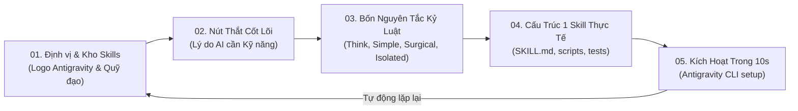

# 02. Đặc Tả Khung Giới Thiệu Chuyển Động (Hero Showcase Motion Card)

> **Mục tiêu**: Xây dựng thành phần giới thiệu sản phẩm động (Animated Showcase Component) nhúng trực tiếp tại khu vực Hero của trang web. Lấy cảm hứng từ bố cục thẻ card và phân đoạn trực quan trong `docs/plan/reference/`, diễn giải đúng câu chuyện của `agent_setup` mà **hoàn toàn không sử dụng các nút điều khiển video lỗi thời** (không nút play/pause, không thanh tua, không màn hình đếm ngược cooldown).

---

## 1. Triết Lý & Trải Nghiệm Giao Diện (UI/UX Philosophy)

1. **Thành phần giao diện tự nhiên (Native Landing Page Component)**:
   - Được thiết kế dưới dạng một **thẻ tương tác cao cấp (Interactive Showcase Card)** với viền kính mờ công nghệ cao (`backdrop-filter: blur(16px)` + viền phát quang xanh ngọc `rgba(110, 231, 183, 0.2)`).
   - Tự động chuyển cảnh nhịp nhàng (6 giây mỗi cảnh) bằng CSS/JS thuần, có thanh tiến trình phân đoạn mỏng nhẹ ở trên đỉnh (Segmented Story Indicators).
   - Người dùng có thể click trực tiếp vào từng tab phân đoạn để chuyển nhanh tới cảnh muốn xem, hoặc để thành phần tự động diễn hoạt lặp lại liên tục.
2. **Không biến thành video player giả cầy**:
   - Không có nút Play/Pause thô kệch.
   - Không có thanh timeline scrub kéo giật.
   - Không có màn hình đếm ngược "phát lại sau 15s" gây khó chịu.
   - Mọi thông tin hiển thị là thông tin thực tế của repository `agent_setup`.

---

## 2. Kịch Bản 5 Phân Đoạn Trực Quan (Story Breakdown)



### Phân đoạn 1: Định Vị & Giới Thiệu `agent_setup`
- **Bố cục card**:
  - Biểu tượng Antigravity phát sáng ở trung tâm, bao quanh bởi các vòng quỹ đạo neon chứa icon của các nhóm skills (BA, Design, Diagram, Docs, System, Code, Research).
  - Tiêu đề: **`agent_setup`**
  - Phụ đề: *Dạy nghề cho AI · Bộ kỹ năng chuyên sâu cho Antigravity*
  - Tác giả: *by Hi Jin*
  - Badges (SVG icon): `50+ Skills` · `Antigravity CLI` · `MIT License`

### Phân đoạn 2: Nút Thắt Cốt Lõi (The Real Bottleneck)
- **Bố cục card**:
  - Tiêu đề: *"Nút thắt không nằm ở Model — Nút thắt là thiếu kỹ năng và kỷ luật"*
  - Biểu tượng Brain phát quang.
  - 3 thẻ cảnh báo các vấn đề thường gặp của AI khi thiếu bộ setup chuẩn:
    - `1. Tự đoán mò & Over-engineering`: Sinh hàng trăm dòng code thừa, class vô bổ.
    - `2. Sửa lung tung (Messy Diffs)`: Tiện tay refactor phá hỏng code vùng lân cận.
    - `3. Làm bẩn môi trường`: Cài đặt package bừa bãi vào global system.

### Phân đoạn 3: Bốn Nguyên Tắc Kỹ Thuật Bất Biến
- **Bố cục card**:
  - 4 thẻ quy tắc vàng (từ Karpathy & AGENTS.md):
    - `Think Before Coding`: Nêu rõ giả định & đánh đổi trước khi viết mã.
    - `Simplicity First`: Lượng code tối thiểu giải quyết bài toán hôm nay.
    - `Surgical Changes`: Sửa đúng chỗ, diff sạch, giữ nguyên style dự án.
    - `Strict Isolation`: Môi trường `.venv` biệt lập 100% trong workspace.

### Phân đoạn 4: Cấu Trúc 1 Skill Chuẩn Của Repo
- **Bố cục card**:
  - Khung code editor mô phỏng cấu trúc thư mục skill thực tế:
    ```
    .agents/skills/<tên_skill>/
    ├── SKILL.md     # Hướng dẫn chi tiết & trigger prompt
    ├── scripts/     # Mã nguồn thực thi cục bộ
    └── references/  # Tài liệu kiến trúc chuyên sâu
    ```
  - Thẻ tóm tắt: Context nhẹ, nạp đúng kỹ năng theo ngữ cảnh thay vì nhồi nhét tài liệu cồng kềnh.

### Phân đoạn 5: Tích Hợp Và Bắt Đầu Trong 10 Giây
- **Bố cục card**:
  - Thẻ Terminal:
    ```bash
    cp -r .agents/ AGENTS.md ./your-project/
    agy  # Khởi chạy Antigravity CLI
    ```
  - Badge tương thích: `Antigravity CLI` · `Gemini CLI` · `Claude Code` · `Cursor`.

---

## 3. Kiến Trúc Kỹ Thuật (Lightweight CSS & Vanilla JS)

- Chuyển cảnh hoàn toàn bằng **CSS Transitions + Flexbox/Grid** mượt mà (chỉ sử dụng `opacity` và `transform` để tối ưu 60 FPS trên GPU).
- Điều khiển phân đoạn bằng JavaScript nhẹ (<3KB):
  - Tự động nhảy cảnh sau mỗi 6 giây (`setInterval`).
  - Khi hover chuột vào card: Tạm dừng chuyển cảnh để người dùng đọc kỹ.
  - Khi click vào thanh phân đoạn: Nhảy ngay tới cảnh được chọn.
