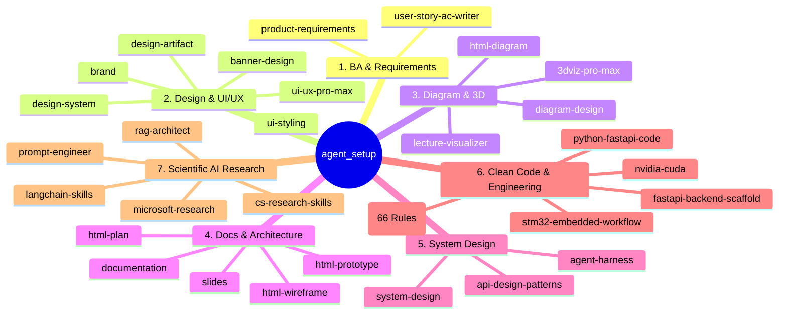

# 03. Cấu Trúc Toàn Bộ Kỹ Năng (Skills) Trong `agent_setup`

> **Mục tiêu**: Chuẩn hóa danh mục hơn 50+ kỹ năng thực tế có trong repository `agent_setup` dành cho **Antigravity CLI** và các AI Coding Agents.

---

## 1. Bảy Trụ Cột Kỹ Năng Cốt Lõi (The 7 Pillars)

---

## 2. Chi Tiết Từng Nhóm Kỹ Năng

### 💼 Trụ cột 1: BA & Requirements (Phân Tích Nghiệp Vụ)
- `user-story-ac-writer`: Bóc tách User Story và Acceptance Criteria chuẩn INVEST + Given-When-Then (Gherkin), kiểm tra độ bao phủ lỗi (Fact-list coverage), thiết lập Architecture Guardrails.
- `product-requirements`: Phân tích yêu cầu cấp độ Senior IT-BA & Product Owner, lập bảng Open Questions (OQ), thiết kế Scope Diagram và sinh PRD tích hợp chuẩn 3 tầng tài liệu.

### 🎨 Trụ cột 2: Design Systems, UI/UX & Brand (Thiết Kế Giao Diện)
- `ui-ux-pro-max`: Trí tuệ thiết kế UI/UX toàn diện: 50 phong cách thị giác, 192 bảng màu chuyên dụng, 74 bộ ghép font, 119 quy tắc UX, hỗ trợ 22 framework frontend.
- `design-system`: Token architecture 3 tầng (Primitive -> Semantic -> Component), CSS variables, component specs.
- `ui-styling`: shadcn/ui, Radix UI, Tailwind CSS, accessibility, canvas visual designs.
- `design-artifact`: HTML artifacts styling (landing page, reports, demo).
- `banner-design`: Thiết kế banner social media, ads, hero asset, print.
- `brand`: Brand voice, visual identity, messaging framework.

### 📐 Trụ cột 3: Sơ Đồ Kiến Trúc & 3D (Diagrams, Viz & 3D)
- `diagram-design`: Vẽ sơ đồ kiến trúc chuẩn doanh nghiệp: Flowchart, Sequence, State Machine, C4 Model, ERD, Network Topology (hỗ trợ HTML/SVG, .drawio, .excalidraw).
- `html-diagram`: Self-contained interactive HTML diagrams (topology, state, sequence, quantitative).
- `3dviz-pro-max`: 3D WebGL/Three.js interactive scenes, spatial models, mechanical rigs, 223 recipes.
- `lecture-visualizer`: Trực quan hóa bài giảng đại học/cao học, mô phỏng thuật toán 2D/3D dạng single-file HTML.

### 📑 Trụ cột 4: Kiến Trúc Tài Liệu & Kế Hoạch (Docs & Plans)
- `documentation`: Hệ thống tài liệu 3 tầng (Business / Architecture / Implementation), Single Source of Truth, Architecture Guardrails.
- `html-plan`: Single-file HTML plans, timeline, dependencies, task reviewability.
- `html-wireframe`: Wireframe HTML kiểm tra cấu trúc thông tin, task flow trước khi lên UI.
- `html-prototype`: Mockup/prototype HTML tương tác cao cấp, responsive, grounded in design system.
- `slides`: Tạo presentation HTML với Chart.js, responsive layouts.

### 🏛️ Trụ cột 5: Thiết Kế Hệ Thống & Agent Harness (System Design)
- `system-design`: Distributed system architecture, API design, capacity planning, sharding, caching, CAP theorem.
- `agent-harness`: Thiết kế & vận hành AI Agent dài hạn (multi-turn, context management, session persist, guardrails).
- `api-design-patterns`: Design patterns cho API enterprise, REST/GraphQL/gRPC.

### 💻 Trụ cột 6: Kỹ Thuật Lập Trình & Mã Sạch (Clean Code & Engineering)
- `clean-code`: 66 canonical Clean Code rules (Robert C. Martin), Boy Scout Rule, phát hiện code smells trên 21 ngôn ngữ.
- `python-fastapi-code`: Senior Python/FastAPI engineering, SOLID, Pydantic V2, async SQLAlchemy, pytest-asyncio.
- `fastapi-backend-scaffold`: Scaffolding FastAPI chuẩn controller/service/repo, virtualenv isolation, uvicorn.
- `nvidia-cuda`: Lập trình GPU CUDA C/C++, cuBLAS, cuDNN, NCCL, tối ưu hóa kernel.
- `stm32-embedded-workflow`: Senior embedded STM32, CubeMX pin mapping, clock math, HAL drivers, register-level rationale.

### 🔬 Trụ cột 7: Nghiên Cứu Khoa Học & AI Tiên Tiến (Research)
- `cs-research-skills/*`: Nghiên cứu khoa học máy tính (literature-review, exploratory data analysis, statistical analysis, PyTorch, Transformers, Qiskit...).
- `microsoft-research/*`: Công cụ nghiên cứu (rs-idea-spark, rs-paper-search, rs-paper2blog, rs-paper2poster...).
- `rag-architect`, `prompt-engineer`, `langchain-skills`: Thiết kế RAG đa tầng, tối ưu Prompt và StateGraph orchestration.
