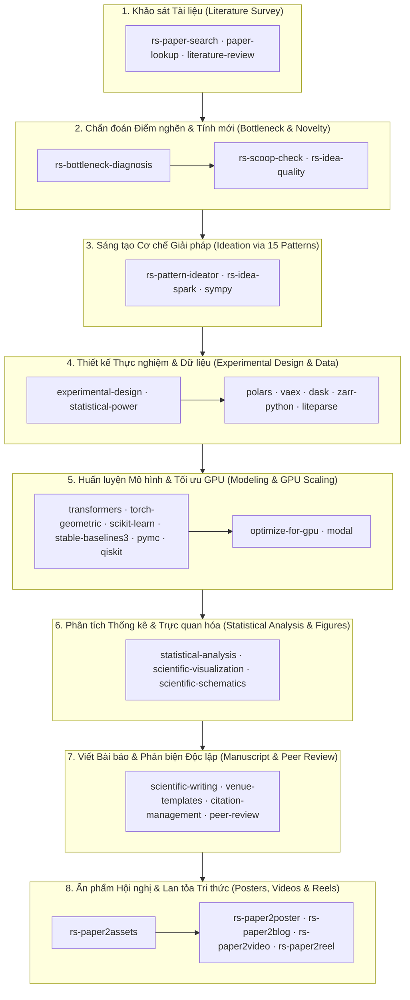

# RESEARCH HUB (Master Index & Scientific Workflow Orchestrator)

> **Single Source of Truth & Meta-Skill for 57 Scientific Research Skills**  
> *Libraries Indexed:* `cs-research-skills` (46 skills) & `microsoft-research` (11 skills)  
> *Framework:* Collaborative Human-in-the-Loop (HITL)  
> *Target Runtimes:* Antigravity CLI (`agy`), Claude Code, OpenAI Codex  

---

## 1. TỔNG QUAN / OVERVIEW

Khi thực hiện nghiên cứu khoa học (NCKH) với AI Agent, việc nạp cùng lúc hàng chục file `SKILL.md` sẽ làm tràn cửa sổ ngữ cảnh (Context Window) của LLM và gây lãng phí token.

`research-hub` giải quyết triệt để vấn đề này:
- **Chỉ mục tập trung (Master Index):** Đóng vai trò là mục lục tra cứu nhanh toàn bộ **57 kỹ năng nghiên cứu khoa học**. AI Agent chỉ cần đọc file [SKILL.md](SKILL.md) của `research-hub` là có thể nắm trọn tên, vị trí và mô tả chi tiết của từng skill để kích hoạt đúng lúc.
- **Quy trình chuẩn mực 8 chặng (8-Stage Research Flow):** Hướng dẫn Agent và Nhà nghiên cứu đi qua toàn bộ vòng đời NCKH từ bước khảo sát tài liệu ban đầu đến khi xuất bản bài báo và tạo ấn phẩm truyền thông.
- **Cộng tác Con người là Trung tâm (Human-in-the-Loop):** Mỗi giai đoạn đều có điểm dừng (Stop Gate) để người dùng phản biện, duyệt hướng đi, trước khi Agent chuyển sang bước tiếp theo.

---

## 2. CHU TRÌNH NGHIÊN CỨU 8 CHẶNG (8-STAGE WORKFLOW)



---

## 3. HƯỚNG DẪN SỬ DỤNG CHO BẠN BÈ & CỘNG ĐỒNG (QUICK START)

Nếu bạn vừa tải hoặc clone repository này về máy và muốn sử dụng cho đề tài nghiên cứu của mình:

### Cách 1: Sử dụng trực tiếp trong repo này
Bạn chỉ cần mở terminal / giao diện chat của Agent (Antigravity CLI / Claude Code / Codex) và ra lệnh:
> *"Tra cứu `research-hub` để biết nên dùng skill nào. Hãy bắt đầu từ việc tìm kiếm các bài báo SOTA về chủ đề [Tên đề tài của bạn]."*

Agent sẽ đọc [SKILL.md](SKILL.md), tự động tìm thấy kỹ năng `rs-paper-search`, thực thi và dừng lại xin ý kiến của bạn.

---

### Cách 2: Copy kỹ năng sang một repo nghiên cứu khác của bạn
Khi bạn có một repo NCKH riêng biệt (ví dụ: `D:/my-lab/quantum-gnn`), bạn chỉ cần copy các kỹ năng bạn cần từ kho này:

```bash
# 1. Tạo thư mục .agents/skills trong dự án của bạn
mkdir -p .agents/skills

# 2. Copy research-hub để Agent có mục lục tra cứu:
cp -r path/to/research-hub .agents/skills/

# 3. Copy các kỹ năng bạn cần dùng (ví dụ: tìm bài báo, tính mới, viết paper):
cp -r path/to/microsoft-research/rs-paper-search .agents/skills/
cp -r path/to/microsoft-research/rs-scoop-check .agents/skills/
cp -r path/to/cs-research-skills/torch-geometric .agents/skills/
cp -r path/to/cs-research-skills/scientific-writing .agents/skills/
```

### Thiết lập môi trường Python ảo (.venv) an toàn:
```bash
# Khởi tạo môi trường ảo Python 3.10+
uv venv --python 3.10
# Kích hoạt trên Windows:
.venv\Scripts\activate
# Hoặc trên Linux/macOS:
source .venv/bin/activate

# Cài đặt các thư viện cần thiết từ microsoft-research (đã cô lập 100%):
uv pip install -e path/to/microsoft-research
uv run python -m playwright install chromium
```

---

## 4. DANH MỤC PHÂN LOẠI 57 KỸ NĂNG (INDEX SUMMARY)

Chi tiết đầy đủ về tham số, đầu vào, đầu ra và mô tả của từng kỹ năng được liệt kê tại:  
👉 **[Xem toàn bộ chỉ mục kỹ năng tại SKILL.md](SKILL.md)**

- **Nhóm 1: Khảo sát tài liệu & Ý tưởng (8 skills):** `rs-paper-search`, `paper-lookup`, `literature-review`, `rs-bottleneck-diagnosis`, `rs-pattern-ideator`, `rs-scoop-check`, `rs-idea-quality`, `rs-idea-spark`.
- **Nhóm 2: Thiết kế thực nghiệm & Xử lý dữ liệu (9 skills):** `experimental-design`, `statistical-power`, `exploratory-data-analysis`, `polars`, `vaex`, `dask`, `zarr-python`, `liteparse`, `markitdown`.
- **Nhóm 3: Học sâu & Mô hình nền tảng (3 skills):** `transformers`, `pytorch-lightning`, `hugging-science`.
- **Nhóm 4: Mạng đồ thị & Khoa học mạng lưới (2 skills):** `torch-geometric`, `networkx`.
- **Nhóm 5: Học máy truyền thống & XAI (3 skills):** `scikit-learn`, `shap`, `umap-learn`.
- **Nhóm 6: Chuỗi thời gian (2 skills):** `timesfm-forecasting`, `aeon`.
- **Nhóm 7: Học tăng cường & Giả lập HPC (2 skills):** `stable-baselines3`, `pufferlib`.
- **Nhóm 8: Mô hình xác suất & Tối ưu hóa (4 skills):** `pymc`, `pymoo`, `sympy`, `simpy`.
- **Nhóm 9: Điện toán lượng tử & Khoa học thần kinh (4 skills):** `qiskit`, `cirq`, `pennylane`, `arbor`.
- **Nhóm 10: Tối ưu phần cứng & Hạ tầng tác nhân (6 skills):** `optimize-for-gpu`, `get-available-resources`, `modal`, `pi-agent`, `consciousness-council`, `autoskill`.
- **Nhóm 11: Kiểm định thống kê & Đồ thị khoa học (3 skills):** `statistical-analysis`, `scientific-visualization`, `scientific-schematics`.
- **Nhóm 12: Viết bài báo & Phản biện học thuật (4 skills):** `scientific-writing`, `venue-templates`, `citation-management`, `peer-review`.
- **Nhóm 13: Ấn phẩm hội nghị, Video & Outreach (7 skills):** `rs-paper2assets`, `rs-paper2poster`, `latex-posters`, `scientific-slides`, `rs-paper2blog`, `rs-paper2video`, `rs-paper2reel`.
