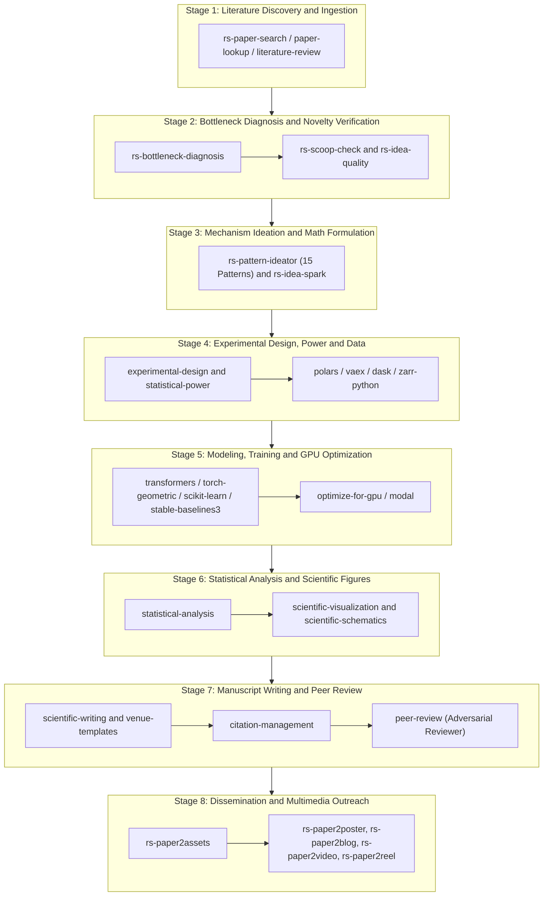

# Research Hub: Master Index & Scientific Workflow Orchestrator

> **The Primary Control and Routing Layer for AI-Assisted Scientific Research**  
> *Total Skills Indexed: 57 Specialized Research Skills*  
> *Sources: 46 skills in `cs-research-skills/` + 11 skills in `microsoft-research/`*  
> *Execution Model: Collaborative Human-in-the-Loop (HITL) — Step-by-Step Rigor*

---

## 1. PURPOSE AND USAGE FOR AI AGENTS

This skill serves as the **Master Router and Single Source of Truth** for AI Agents (Antigravity CLI, Claude Code, OpenAI Codex).

### Why this skill exists:
1. **Zero Context Overload:** Instead of loading 57 separate `SKILL.md` files (which would consume >150,000 tokens of context), the agent reads **only this single master file** to understand the exact name, location, and capability of every research skill.
2. **Instant Decision Routing:** When the human researcher states a goal (e.g., "find literature", "prove novelty", "run bayesian regression", "format paper for NeurIPS", "render conference poster"), the agent immediately maps the request to the matching skill and its directory path.
### Path Resolution Protocol for Agents:
When this repository's skills are copied into an active research project:
1. **Installed Location:** Skills are placed in `<workspace_root>/.agents/skills/<skill-name>/` (or `.claude/skills/<skill-name>/`).
2. **Script Execution Path:** When invoking bundled CLI scripts from the workspace root, format the path as:
   - Installed in project: `python .agents/skills/<skill-name>/scripts/<script-name>.py [args]`
   - Running in this central depot: `python microsoft-research/<skill-name>/scripts/<script-name>.py [args]` or `python cs-research-skills/<skill-name>/scripts/<script-name>.py [args]`
3. **Internal Path Resilience:** All internal assets, templates, and sub-skills are dynamically discovered relative to `Path(__file__)`. Cross-skill dependencies (`rs-paper2assets`, `rs-paper2poster`, etc.) automatically discover each other inside `.agents/skills/` or sibling directories.

---

## 2. THE 8-STAGE END-TO-END SCIENTIFIC RESEARCH FLOW

When embarking on a scientific research project from scratch or continuing an existing investigation, follow this canonical 8-stage lifecycle:



### Stage-by-Stage Human-in-the-Loop Protocol:

- **Stage 1 (Literature Discovery):** Use `rs-paper-search` (multi-source concurrent query across arXiv, OpenReview, Semantic Scholar, OpenAlex, DBLP) or `literature-review`. **STOP:** Present a deduplicated matrix to the researcher; researcher selects 2-4 anchor papers.
- **Stage 2 (Bottleneck Diagnosis & Novelty Check):** Use `rs-bottleneck-diagnosis` to identify load-bearing obstacles of SOTA. Run `rs-scoop-check` across 4 axes (Framing, Mechanism, Insight, Domain) to establish the *Delta Statement*. **STOP:** Researcher confirms the core obstacle and approves the delta.
- **Stage 3 (Mechanism Design):** Map the bottleneck using `rs-pattern-ideator` (15 empirical ML patterns). Propose 2-3 algorithmic mechanisms. Evaluate intrinsic quality with `rs-idea-quality`. **STOP:** Researcher selects and refines the mathematical formulation.
- **Stage 4 (Experimental Design & Data Prep):** Use `experimental-design` and `statistical-power` to compute sample sizes and effect sizes. Process raw data using `polars`, `dask`, or `vaex`. Parse PDFs/tables via `liteparse` or `markitdown`.
- **Stage 5 (Algorithmic Modeling & GPU Execution):** Implement models using specialized domain skills (`transformers`, `pytorch-lightning`, `torch-geometric`, `stable-baselines3`, `pymc`, `qiskit`). Calibrate compute using `get-available-resources` and `optimize-for-gpu`. Offload heavy cluster runs to `modal` if local compute is insufficient.
- **Stage 6 (Hypothesis Testing & Visualization):** Run rigorous statistical testing via `statistical-analysis`. Render publication-ready plots and network diagrams with `scientific-visualization` and `scientific-schematics`.
- **Stage 7 (Paper Writing & Peer Review):** Author full-length paper with `scientific-writing`, formatting with `venue-templates` (ICLR/NeurIPS/CVPR/IEEE). Audit BibTeX with `citation-management`. Run blind adversarial critique via `peer-review`.
- **Stage 8 (Dissemination & Outreach):** Ingest accepted PDF via `rs-paper2assets`. Render conference posters and editable PPTX with `rs-paper2poster` (or `latex-posters`, `scientific-slides`). Author bilingual articles via `rs-paper2blog`. Generate narrated 1080p walkthrough videos via `rs-paper2video` and interactive web viewers via `rs-paper2reel`.

---

## 3. MASTER SKILL INDEX: ALL 57 SKILLS BY DOMAIN

### 1. Literature Survey, Ideation & Novelty Verification
> *Core intelligence skills for finding prior art, diagnosing SOTA bottlenecks, formulating novel mechanisms with 15 ML patterns, and verifying originality.*

| Skill Name | Location / Path | Purpose & Capabilities |
| :--- | :--- | :--- |
| **`rs-paper-search`** | [`microsoft-research/rs-paper-search`](file:///microsoft-research/rs-paper-search) | Search papers across arXiv, DBLP, OpenAlex, OpenReview, Semantic Scholar, and Crossref for a given query and year range. Performs concurrent multi-source querying, deduplication, and relevance ranking. STOPS and presents the surveyed literature to the human researcher for selection before moving downstream. |
| **`paper-lookup`** | [`cs-research-skills/paper-lookup`](file:///cs-research-skills/paper-lookup) | Searches 18 scholarly APIs for papers, preprints, citations, open-access full text, repository records, and journal OA status, and returns results with reproducible provenance. Covers PubMed, PMC, Europe PMC, bioRxiv, medRxiv, arXiv, OpenAlex, Crossref, Semantic Scholar, CORE, Unpaywall, OpenCitations, PubTator3, Zenodo, Figshare, ROR, BioStudies, and DOAJ. Use when searching for papers, citations, DOI/PMID/arXiv lookups, abstracts, full text, open-access PDFs, preprints, citation graphs, author publications, biomedical entity annotations, deposited records (Zenodo, Figshare, BioStudies), institution ROR IDs, or any scholarly literature query. Triggers on mentions of any supported database or requests like "find papers on X", "look up this DOI", "who cites this paper", or "get me the PDF". |
| **`literature-review`** | [`cs-research-skills/literature-review`](file:///cs-research-skills/literature-review) | Conducts systematic, scoping, and narrative literature reviews using PubMed, arXiv, bioRxiv, Semantic Scholar, and other appropriate sources. Use for research synthesis, reproducible literature searches, screening, citation checking, or preparing Markdown and PDF reviews. Tracks search coverage, records versus studies, and evidence limitations; supports meta-analysis planning but does not supply a meta-analysis engine. |
| **`rs-bottleneck-diagnosis`** | [`microsoft-research/rs-bottleneck-diagnosis`](file:///microsoft-research/rs-bottleneck-diagnosis) | Diagnose genuine theoretical, algorithmic, or empirical bottlenecks in State-of-the-Art (SOTA) research literature. Distinguish load-bearing bottlenecks from superficial soft targets. STOP and present findings to the human researcher for alignment before proceeding to ideation. |
| **`rs-pattern-ideator`** | [`microsoft-research/rs-pattern-ideator`](file:///microsoft-research/rs-pattern-ideator) | Maps a confirmed research bottleneck to the empirical taxonomy of 15 Ideation Patterns and 31 Sub-patterns induced from 1,947 ICLR/ICML/NeurIPS Oral papers. Formulates 2-3 concrete, reviewer-defensible mechanism proposals with explicit mathematical operators or architectures. STOPS to discuss and co-decide with the human researcher. |
| **`rs-scoop-check`** | [`microsoft-research/rs-scoop-check`](file:///microsoft-research/rs-scoop-check) | Check whether a proposed research novelty overlaps with existing published literature across four atomic axes (Problem framing, Core mechanism, Key insight, Application domain). Provides an Overlap Level (1-5), closest competitor papers, and a crisp Delta Statement. STOPS to discuss novelty findings with the human researcher. |
| **`rs-idea-quality`** | [`microsoft-research/rs-idea-quality`](file:///microsoft-research/rs-idea-quality) | Score the QUALITY of a research idea at the idea stage — given a Markdown file with Title / Motivation / Method sections (no experiments needed), produce a per-axis quality assessment with cited evidence and an overall 0–100 score plus a verdict; or, given two such idea files, a blind head-to-head comparison. TRIGGER when the user asks "how good is this idea", "rate / score / grade this research idea or proposal", "review my idea .md before I write it up", "is this contribution strong enough to pursue", "which of these two idea files is stronger", or hands over an idea Markdown file (Title/Motivation/Method) and wants a quality judgment. |
| **`rs-idea-spark`** | [`microsoft-research/rs-idea-spark`](file:///microsoft-research/rs-idea-spark) | Orchestrates the end-to-end research ideation pipeline (Literature Grounding -> Bottleneck Diagnosis -> 15-Pattern Matching -> Collision Verification -> Card Rendering) with mandatory Human-in-the-Loop review gates between phases. Produces reviewer-defensible idea cards. |

### 2. Experimental Design, Power Analysis & Data Engineering
> *Formulating statistically sound trial designs, computing required sample sizes, and handling massive scientific datasets out-of-core.*

| Skill Name | Location / Path | Purpose & Capabilities |
| :--- | :--- | :--- |
| **`experimental-design`** | [`cs-research-skills/experimental-design`](file:///cs-research-skills/experimental-design) | Designs experiments and studies BEFORE data is collected — choosing a design, randomizing, blocking, and laying out treatment combinations so results are interpretable. Use whenever someone is planning a study, asks how to assign subjects/samples to groups, mentions randomization, blocking, stratification, controls, factorial or fractional-factorial designs, design of experiments (DOE), screening many factors, response-surface optimization, crossover or repeated-measures or split-plot designs, cluster/group randomization, Latin squares, plate layouts, batch/run-order effects, replication vs. pseudoreplication, or sequential/adaptive/group-sequential designs. Trigger even for informal phrasings like "how should I set up this experiment", "how do I avoid confounding", "what's the best way to test these 6 factors", or "assign these mice to conditions". For computing the sample size or power once the design is chosen, use statistical-power; for analyzing data already collected, use statistical-analysis. |
| **`statistical-power`** | [`cs-research-skills/statistical-power`](file:///cs-research-skills/statistical-power) | Calculates sample sizes and statistical power for study planning. Applies when someone asks "how many subjects/samples/replicates do I need", wants an a priori power analysis, a minimum detectable effect (MDE), a power curve, or needs to justify a sample size for a grant, IRB protocol, or pre-registration. Covers closed-form power for t-tests, ANOVA, proportions, correlations, chi-square, and regression, plus simulation-based (Monte Carlo) power for complex designs — logistic/Poisson regression, mixed models, cluster-randomized trials, survival, and interactions. Also handles requests that only mention an effect size, alpha, or "80% power" without saying "power analysis" explicitly. For laying out the study (randomization, blocking, factorial/DOE, crossover, sequential designs) use experimental-design; for analyzing data already collected and reporting it use statistical-analysis. |
| **`exploratory-data-analysis`** | [`cs-research-skills/exploratory-data-analysis`](file:///cs-research-skills/exploratory-data-analysis) | "Performs bounded, local exploratory analysis of explicitly supported scientific files. Supports redacted CSV/TSV/JSON profiles; optional NumPy, HDF5, FASTA/FASTQ, and basic image metadata inspection; missingness/leakage audits; outlier and transformation sensitivity; and rigorous EDA report scaffolds. Other domain formats are reference-only and unknown formats fail closed." |
| **`polars`** | [`cs-research-skills/polars`](file:///cs-research-skills/polars) | High-performance DataFrame library for Python ETL, analytics, and pandas migration. It supports expression-based data manipulation with lazy query optimization, parallel execution, streaming out-of-core processing, Arrow interoperability, and optional GPU execution. |
| **`vaex`** | [`cs-research-skills/vaex`](file:///cs-research-skills/vaex) | Processes large tabular scientific datasets with Vaex expressions, filtered views, streamed statistics, binned visualizations, and file conversion. Use for larger-than-RAM HDF5, Arrow, CSV, or Parquet analysis, virtual feature engineering, or Vaex ML preprocessing; distinguishes these operations from estimators and conversions that materialize data. |
| **`dask`** | [`cs-research-skills/dask`](file:///cs-research-skills/dask) | Scales pandas, NumPy, and custom Python research workflows beyond memory or across clusters with Dask. Covers DataFrames, Arrays, Bags, Futures, chunking, schedulers, and distributed diagnostics. Use for partitioned file processing, scientific array computation, or parallel tasks whose memory and dependency structure require Dask. |
| **`zarr-python`** | [`cs-research-skills/zarr-python`](file:///cs-research-skills/zarr-python) | Stores and queries chunked N-D scientific arrays with Zarr-Python 3, including codecs, sharding, S3/GCS storage, and NumPy/Dask/Xarray integration. Use for array layout, bounded I/O, format migration, or scientific metadata preservation. |
| **`liteparse`** | [`cs-research-skills/liteparse`](file:///cs-research-skills/liteparse) | Local document and PDF parsing that returns spatial text with bounding boxes. Use for extracting text from PDFs, DOCX, Office files, and images; running OCR on scans; producing layout-preserved JSON for RAG; batch-ingesting folders of papers; or rendering pages to PNG for multimodal agents. Distinguishing capabilities are spatial text boxes, Markdown, page raster output, and local parsing with optional custom HTTP OCR. |
| **`markitdown`** | [`cs-research-skills/markitdown`](file:///cs-research-skills/markitdown) | Converts heterogeneous documents and selected URIs to Markdown with Microsoft MarkItDown for text analysis, search, and LLM/RAG ingestion. Covers safe local conversion, streams, Office/PDF/data formats, batch workflows, plugins, vision OCR, Azure extraction, and the official MCP server. |

### 3. Deep Learning, Transformers & Foundation Models
> *Architecting, fine-tuning, and evaluating state-of-the-art neural networks, LLMs, and multi-GPU distributed training.*

| Skill Name | Location / Path | Purpose & Capabilities |
| :--- | :--- | :--- |
| **`transformers`** | [`cs-research-skills/transformers`](file:///cs-research-skills/transformers) | Hugging Face Transformers for loading Hub models, running pipeline inference, text generation, and Trainer fine-tuning on NLP, vision, audio, and multimodal tasks. Applies when working with AutoModel, pipelines, tokenizers, generation configs, or TrainingArguments within Transformers. |
| **`pytorch-lightning`** | [`cs-research-skills/pytorch-lightning`](file:///cs-research-skills/pytorch-lightning) | Deep learning framework (PyTorch Lightning / lightning package). Organize PyTorch code into LightningModules, configure Trainers for multi-GPU/TPU, implement data pipelines, callbacks, logging (W&B, TensorBoard, MLflow), distributed training (DDP, FSDP, DeepSpeed), for scalable neural network training. |
| **`hugging-science`** | [`cs-research-skills/hugging-science`](file:///cs-research-skills/hugging-science) | Discovers and evaluates scientific datasets, models, methodology posts, and Spaces through the Hugging Science catalog. Used when selecting scientific ML resources in biology, chemistry, genomics, materials, climate, physics, astronomy, medicine, mathematics, protein design, single-cell analysis, or PDE modeling, and when checking their actual datasets, Transformers, native-runtime, Inference Providers, or Gradio interfaces. |

### 4. Graph Neural Networks & Network Science
> *Geometric deep learning, message-passing algorithms, heterogeneous graph representation, and complex network topology.*

| Skill Name | Location / Path | Purpose & Capabilities |
| :--- | :--- | :--- |
| **`torch-geometric`** | [`cs-research-skills/torch-geometric`](file:///cs-research-skills/torch-geometric) | Supports PyTorch Geometric (PyG) graph neural networks — node/link/graph classification, message passing (GCN, GAT, GraphSAGE, GIN), heterogeneous graphs, neighbor sampling, and custom datasets. Use when working with torch_geometric, not for general NetworkX analytics or non-graph PyTorch models. |
| **`networkx`** | [`cs-research-skills/networkx`](file:///cs-research-skills/networkx) | Creates, analyzes, and visualizes complex networks and graphs in Python with NetworkX. Use when working with network/graph data structures, computing graph algorithms (shortest paths, centrality, clustering), detecting communities, generating synthetic networks (random, scale-free, small-world), reading/writing graph file formats, or drawing network topologies. Common applications include social, biological, transportation, and citation networks. |

### 5. Classical ML, Explainability (XAI) & Embeddings
> *Tabular baselines, Shapley value attribution for black-box transparency, and nonlinear manifold dimensionality reduction.*

| Skill Name | Location / Path | Purpose & Capabilities |
| :--- | :--- | :--- |
| **`scikit-learn`** | [`cs-research-skills/scikit-learn`](file:///cs-research-skills/scikit-learn) | Supports machine learning in Python with scikit-learn. Applies when working with supervised learning (classification, regression), unsupervised learning (clustering, dimensionality reduction), model evaluation, hyperparameter tuning, preprocessing, or building ML pipelines. Provides comprehensive reference documentation for algorithms, preprocessing techniques, pipelines, and best practices. |
| **`shap`** | [`cs-research-skills/shap`](file:///cs-research-skills/shap) | Explain and audit machine-learning predictions with SHAP. Use for selecting SHAP explainers and maskers, computing and validating feature attributions, handling multi-output explanations, and producing local or global SHAP visualizations. |
| **`umap-learn`** | [`cs-research-skills/umap-learn`](file:///cs-research-skills/umap-learn) | Applies UMAP-learn to nonlinear dimensionality reduction, 2D/3D embeddings, clustering preprocessing, supervised or semi-supervised UMAP, DensMAP, AlignedUMAP, and Parametric UMAP workflows. |

### 6. Time-Series Modeling & Forecasting
> *Zero-shot foundation model time-series forecasting, temporal classification, segmentation, and anomaly detection.*

| Skill Name | Location / Path | Purpose & Capabilities |
| :--- | :--- | :--- |
| **`timesfm-forecasting`** | [`cs-research-skills/timesfm-forecasting`](file:///cs-research-skills/timesfm-forecasting) | Performs zero-shot time-series forecasting with Google's TimesFM, including regular-grid CSV preparation, quantile forecasts, XReg covariates, and held-out evaluation. Uses the Apache-licensed TimesFM 2.5 checkpoint by default and documents the distinct TimesFM 3.0 multivariate API and weight-license requirements. |
| **`aeon`** | [`cs-research-skills/aeon`](file:///cs-research-skills/aeon) | This skill should be used for time series machine learning tasks including classification, regression, clustering, forecasting, anomaly detection, segmentation, and similarity search. Use when working with temporal data, sequential patterns, or time-indexed observations requiring specialized algorithms beyond standard ML approaches. Particularly suited for univariate and multivariate time series analysis with scikit-learn compatible APIs. |

### 7. Reinforcement Learning & High-Throughput Simulators
> *Single-agent RL algorithms (PPO, SAC, DQN) and ultra-high-throughput C/CUDA environment vectorization.*

| Skill Name | Location / Path | Purpose & Capabilities |
| :--- | :--- | :--- |
| **`stable-baselines3`** | [`cs-research-skills/stable-baselines3`](file:///cs-research-skills/stable-baselines3) | Trains and evaluates single-agent reinforcement learning with Stable Baselines3 (PPO, SAC, DQN, TD3, DDPG, A2C), Gymnasium custom environments, vectorized rollouts, callbacks, and checkpoint normalization. Applies to reproducible RL experiments, continuous control, discrete actions, and SB3-Contrib recurrent or masked policies. |
| **`pufferlib`** | [`cs-research-skills/pufferlib`](file:///cs-research-skills/pufferlib) | Version-aware guidance for PufferLib reinforcement-learning environments, vectorization, policies, PuffeRL training, evaluation, and safe checkpoint review. Covers the native 5.0 build and environment API, published 3.0.0 Gymnasium/PettingZoo adaptation, and a pinned historical 4.0 profile. |

### 8. Probabilistic Modeling, Optimization, Symbolic Math & Simulation
> *Bayesian MCMC inference, multi-objective Pareto optimization, exact symbolic algebra, and discrete-event queuing simulation.*

| Skill Name | Location / Path | Purpose & Capabilities |
| :--- | :--- | :--- |
| **`pymc`** | [`cs-research-skills/pymc`](file:///cs-research-skills/pymc) | Builds and checks Bayesian models with PyMC, including hierarchical models, NUTS MCMC, variational inference, mutable-data predictions, posterior predictive checks, diagnostics, and PSIS-LOO model comparison. Use for probabilistic modeling and uncertainty inference in PyMC. |
| **`pymoo`** | [`cs-research-skills/pymoo`](file:///cs-research-skills/pymoo) | Solves and validates single-, multi-, and many-objective optimization with pymoo, including NSGA-II, NSGA-III, MOEA/D, constraints, Pareto approximations, reference directions, and ZDT/DTLZ benchmarks for engineering and research problems. |
| **`sympy`** | [`cs-research-skills/sympy`](file:///cs-research-skills/sympy) | Performs exact symbolic mathematics with SymPy for algebra, calculus, equation solving, symbolic linear algebra, physics, and lambdify or LaTeX code generation. Use when a task needs symbolic results, explicit assumptions, or exact arithmetic; use NumPy or SciPy for purely numerical workloads. |
| **`simpy`** | [`cs-research-skills/simpy`](file:///cs-research-skills/simpy) | Builds, inspects, tests, and analyzes bounded process-based discrete-event simulations with SimPy. Use for event scheduling, resource queues, interrupts, monitoring, independent replications, warm-up, and reproducible output analysis. |

### 9. Quantum Computing & Computational Neuroscience
> *Circuit synthesis, variational quantum algorithms (QML), quantum error mitigation, and biophysical spiking neural simulations.*

| Skill Name | Location / Path | Purpose & Capabilities |
| :--- | :--- | :--- |
| **`qiskit`** | [`cs-research-skills/qiskit`](file:///cs-research-skills/qiskit) | Builds, simulates, transpiles, and executes quantum circuits with Qiskit and IBM Quantum Runtime. Use for Qiskit 2.x circuits and operators, V2 Sampler or Estimator primitives, target-aware transpilation, local or noisy simulation, IBM QPU execution, Runtime sessions or batches, error mitigation, and Qiskit ecosystem packages. |
| **`cirq`** | [`cs-research-skills/cirq`](file:///cs-research-skills/cirq) | Google quantum computing framework. Use when targeting Google Quantum AI hardware, designing noise-aware circuits, or running quantum characterization experiments. Best for Google hardware, noise modeling, and low-level circuit design. For IBM hardware use qiskit; for quantum ML with autodiff use pennylane; for physics simulations use qutip. |
| **`pennylane`** | [`cs-research-skills/pennylane`](file:///cs-research-skills/pennylane) | Builds and differentiates PennyLane quantum circuits, hybrid PyTorch or JAX models, molecular VQE and QAOA workflows. Use for variational quantum algorithms, quantum machine learning, simulator validation, and moving validated circuits to provider plugins. For hardware-specific compilation use qiskit or cirq; for open-system dynamics use qutip. |
| **`arbor`** | [`cs-research-skills/arbor`](file:///cs-research-skills/arbor) | Applies Arbor Hypothesis Tree Refinement to research artifacts with repeatable evaluators, including model training, agent harnesses, data synthesis and benchmark optimization. Uses persistent hypotheses, isolated experiments, evidence propagation and held-out candidate comparison for multi-experiment research runs. Includes a standard-library state manager and guidance for the RUC-NLPIR Arbor CLI. |

### 10. Hardware Acceleration, Scaling & Agent Infrastructure
> *CUDA memory optimization, hardware resource detection, serverless cloud GPU offloading, and multi-agent debate councils.*

| Skill Name | Location / Path | Purpose & Capabilities |
| :--- | :--- | :--- |
| **`optimize-for-gpu`** | [`cs-research-skills/optimize-for-gpu`](file:///cs-research-skills/optimize-for-gpu) | GPU-accelerates scientific Python on NVIDIA hardware and verifies that the result is correct and faster. Use for CUDA/GPU optimization; CPU-bound NumPy, SciPy, pandas, scikit-learn, NetworkX, scikit-image, vector-search, image-processing, graph, simulation, or file-I/O workloads; CuPy, cuDF, cuML, cuGraph, cuVS, cuCIM, KvikIO, Warp, Newton, Numba-CUDA, or RAFT questions; and profiling, memory-transfer, kernel, or multi-GPU bottlenecks. Also use when large data-parallel Python code is slow and GPU acceleration is a plausible option, even if the user does not name CUDA. |
| **`get-available-resources`** | [`cs-research-skills/get-available-resources`](file:///cs-research-skills/get-available-resources) | Detects host inventory and effective CPU, memory, disk, scheduler, container, and accelerator limits when a user asks for resource-aware planning or before a clearly resource-sensitive local workload. Produces a redacted JSON snapshot and conservative planning helpers without stress tests or assuming visible host hardware is usable. |
| **`modal`** | [`cs-research-skills/modal`](file:///cs-research-skills/modal) | Modal is a serverless cloud platform for running Python on demand, including on-demand GPUs. Use when deploying or serving AI/ML models, running GPU-accelerated workloads (training, fine-tuning, inference), serving web endpoints, scheduling batch jobs, or scaling Python code to cloud containers with the Modal SDK. |
| **`pi-agent`** | [`cs-research-skills/pi-agent`](file:///cs-research-skills/pi-agent) | Builds with and operates Pi, the minimal terminal coding harness. Use for installing Pi, configuring providers/models/settings/environment variables, creating Pi skills/extensions/packages/themes/prompt templates, embedding Pi through the SDK, integrating over RPC or JSON event streams, parsing sessions, running local models through the llama.cpp router, developing custom Pi providers and TUI components, or using ecosystem packages such as pi-subagents (delegation/orchestration), pi-mcp-adapter (MCP servers), pi-interview (interactive forms), and pi-web-access (web search, fetching, video understanding). |
| **`consciousness-council`** | [`cs-research-skills/consciousness-council`](file:///cs-research-skills/consciousness-council) | Structures a multi-perspective council exercise for decisions, research trade-offs, and creative challenges. Simulates thinking archetypes, separates evidence from assumptions and values, and synthesizes a conditional recommendation. Use when the user requests a council, panel, devil's advocate analysis, "mind council", or deliberate comparison of perspectives on a difficult choice. |
| **`autoskill`** | [`cs-research-skills/autoskill`](file:///cs-research-skills/autoskill) | Analyzes user-requested Screenpipe history windows to detect repeated research workflows, match existing scientific skills, and stage new skill drafts or composition recipes for review. Requires a reachable Screenpipe HTTP API, normally on localhost:3030. Detection and embedding inference run locally; the selected LLM receives redacted app/title cluster summaries and matched skill descriptions. Use only when the user explicitly asks to analyze their recent work and propose skills. |

### 11. Statistical Hypothesis Testing & Scientific Visualization
> *Rigorous p-value corrections, parametric/nonparametric tests, and publication-ready matplotlib/seaborn figures and schematics.*

| Skill Name | Location / Path | Purpose & Capabilities |
| :--- | :--- | :--- |
| **`statistical-analysis`** | [`cs-research-skills/statistical-analysis`](file:///cs-research-skills/statistical-analysis) | Guided statistical analysis for research data - test selection, assumption checking, effect sizes, power analysis, Bayesian alternatives, and APA-formatted reporting. Use whenever a user wants to compare groups, test a hypothesis, analyze experimental or survey data, check statistical assumptions, compute required sample sizes, or write up results - even if they never name a specific test. Covers t-tests, ANOVA, chi-square, correlation, regression, non-parametric and Bayesian methods. For low-level model APIs, see the statsmodels and pymc skills. |
| **`scientific-visualization`** | [`cs-research-skills/scientific-visualization`](file:///cs-research-skills/scientific-visualization) | Creates and audits truthful, accessible, publication-ready scientific figures with Matplotlib, Seaborn, or Plotly. Use it for figure design, multi-panel layouts, uncertainty and missing-data displays, color/contrast review, image metadata validation, and journal export planning. |
| **`scientific-schematics`** | [`cs-research-skills/scientific-schematics`](file:///cs-research-skills/scientific-schematics) | Generates scientific diagram drafts using Nano Banana 2 AI with smart iterative refinement. Uses Gemini 3.7 Flash for quality review. Refines when the review requests improvement, with at most two generations. Specialized in neural network architectures, system diagrams, flowcharts, biological pathways, and complex scientific visualizations. |

### 12. Manuscript Authoring, Citation Management & Peer Review
> *Drafting ICLR/NeurIPS/IEEE papers, BibTeX verification, conference template compliance, and adversarial pre-submission review.*

| Skill Name | Location / Path | Purpose & Capabilities |
| :--- | :--- | :--- |
| **`scientific-writing`** | [`cs-research-skills/scientific-writing`](file:///cs-research-skills/scientific-writing) | Drafts, revises, and audits scientific manuscripts or reports with explicit evidence provenance, reporting-guideline coverage, authorship accountability, confidentiality controls, and local consistency checks. Use for manuscript sections, references, declarations, tables, figures, or submission preparation when scientific accuracy and traceability matter. |
| **`venue-templates`** | [`cs-research-skills/venue-templates`](file:///cs-research-skills/venue-templates) | Prepares journal manuscripts, conference papers, research posters, and grant documents using venue-specific formatting guidance and bundled LaTeX scaffolds. Supports selecting an official template, checking current page or anonymity rules, adapting academic writing to a venue, or inspecting a submission PDF. |
| **`citation-management`** | [`cs-research-skills/citation-management`](file:///cs-research-skills/citation-management) | Comprehensive citation management for academic research. Search OpenAlex, PubMed, and Google Scholar for papers, extract accurate metadata, validate citations, and generate properly formatted BibTeX entries. This skill should be used when you need to find papers, verify citation information, convert DOIs to BibTeX, or ensure reference accuracy in scientific writing. |
| **`peer-review`** | [`cs-research-skills/peer-review`](file:///cs-research-skills/peer-review) | Prepares evidence-bounded, constructive peer-review drafts and structured manuscript assessments. Supports authorized review of scientific manuscripts, protocols, preprints, or research proposals; reporting-guideline selection; claim–evidence checks; methods, statistics, reproducibility, ethics, figure/table, and citation critique; or revision-response planning. |

### 13. Conference Outreach, Presentations & Dissemination
> *Automating print-ready posters, natively editable PPTX decks, narrated walkthrough videos, bilingual blogs, and web reels.*

| Skill Name | Location / Path | Purpose & Capabilities |
| :--- | :--- | :--- |
| **`rs-paper2assets`** | [`microsoft-research/rs-paper2assets`](file:///microsoft-research/rs-paper2assets) | Extract a research paper PDF into a structured set of poster-agnostic assets reusable by any downstream renderer (paper2poster, paper2blog, paper2video, paper2reel). Produces assets/figures/ (432 dpi), assets/meta/text.txt (via Pure Python PyMuPDF), metadata.json, and a 9-section structured summary (paper_spec.md). STOPS to allow the researcher to review extracted assets before downstream rendering. |
| **`rs-paper2poster`** | [`microsoft-research/rs-paper2poster`](file:///microsoft-research/rs-paper2poster) | Render an extracted paper's 9-section spec into a print-ready academic poster (HTML, PDF, PNG) and an editable PowerPoint (.pptx with native shapes) via bundled html2pptx. Supports 60x36in landscape and A0 portrait with measured fill loops and Edge-TTS audio. STOPS to present deliverables for researcher editing. |
| **`latex-posters`** | [`cs-research-skills/latex-posters`](file:///cs-research-skills/latex-posters) | "Creates research posters in LaTeX using beamerposter, tikzposter, or baposter. Use for conference posters, academic presentations, multi-column scientific layouts, figure integration, typography, compilation, and PDF preflight." |
| **`scientific-slides`** | [`cs-research-skills/scientific-slides`](file:///cs-research-skills/scientific-slides) | Builds slide decks and presentations for research talks. Used for making PowerPoint slides, conference presentations, seminar talks, research presentations, thesis defense slides, or any scientific talk. Provides slide structure, design templates, timing guidance, and visual validation. Works with PowerPoint and LaTeX Beamer. |
| **`rs-paper2blog`** | [`microsoft-research/rs-paper2blog`](file:///microsoft-research/rs-paper2blog) | Transform academic paper materials into a bilingual editorial package (blog_en.docx and blog_zh.docx). Preserves exact experimental numbers and figures while adapting tone for international research blogs and WeChat public accounts. STOPS to present article drafts for review. |
| **`rs-paper2video`** | [`microsoft-research/rs-paper2video`](file:///microsoft-research/rs-paper2video) | Turn a research paper, paper2assets package, or PPT deck into a narrated 1080p walkthrough MP4 video with synced bottom-bar subtitles, laser spotlight cues, and editable PPTX. Uses ppt-master and pptx2video with imageio-ffmpeg. STOPS to present video deliverable for review. |
| **`rs-paper2reel`** | [`microsoft-research/rs-paper2reel`](file:///microsoft-research/rs-paper2reel) | Build an interactive HTML viewer (reel.html) that aligns paper2poster output with slide frames, video clips, and bilingual blog text via content_alignment.json without mutating original deliverables. STOPS to present interactive web preview. |

---

## 4. INSTRUCTIONS FOR HUMAN RESEARCHERS & FRIENDS

If you are adopting these scientific research skills in any of your projects:

### 1. Copying Research Skills into Your Target Repository:
In your target research repository, skills are organized under `.agents/skills/`. You can copy `research-hub` along with all skills from `cs-research-skills/` and `microsoft-research/`:

```powershell
# In PowerShell from your target repository root:
New-Item -ItemType Directory -Force -Path ".agents\skills"
Copy-Item -Recurse "E:\gemini\agent_setup\research-hub" ".agents\skills\"
Copy-Item -Recurse "E:\gemini\agent_setup\microsoft-research\*" ".agents\skills\"
Copy-Item -Recurse "E:\gemini\agent_setup\cs-research-skills\*" ".agents\skills\"
```

*(Note: Since all standalone configuration files `pyproject.toml` and `.env.template` are cleanly housed inside `research-hub/`, copying `*` from the source directories copies 100% valid skill folders without leaving loose files at the `.agents/skills/` root level).*

### 2. Isolated Python Environment Setup (.venv):
Install the shared dependencies managed inside `research-hub/pyproject.toml` using `uv`:

```powershell
# 1. Initialize isolated virtual environment
uv venv --python 3.10
.venv\Scripts\activate   # On Windows (or 'source .venv/bin/activate' on macOS/Linux)

# 2. Install dependencies via research-hub
uv pip install -e .agents\skills\research-hub

# 3. Install headless Chromium for poster rendering (Playwright)
uv run python -m playwright install chromium

# 4. Configure API keys (OpenAlex, OpenReview, Semantic Scholar)
Copy-Item ".agents\skills\research-hub\.env.template" ".env"
# Edit .env with your credentials
```

### 3. Collaborative Prompting Example:
Tell your AI Agent:  
*"Consult `research-hub` to see which skill to use. First, run `rs-paper-search` on KV cache compression, stop and show me the literature table before doing anything else."*

